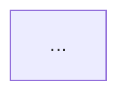

# update-study-notes: Keep Study Notes in Sync with the Wiki

The wiki grows with every ingest. Study notes should grow with it. This skill bridges the two — reading the tracking table, diffing what the wiki knows against what the notes contain, and patching the gap.

---

## When This Skill Runs

1. **Automatically** — via the Stop hook at the end of every session (reads the log, patches only modules where new content was ingested).
2. **Manually** — user says `/update-study-notes` or "update study notes" (full refresh of all tracked modules).

---

## Step 1 — Read the Tracking Table

Read `study-notes/index.md`. Locate the **"Create Study Notes For"** table. Extract every row where **Auto-Update** = `yes`.

For each row, collect:
- `module` — the module code (e.g. `ICT3113`)
- `title` — the module title
- `source_pattern` — the lowercase pattern to match against `wiki/sources/` filenames
- `notes_file` — path to the exam notes file (e.g. `study-notes/ICT3113 - Performance Optimisation Exam Notes.md`)
- `formula_file` — path to the formula sheet (e.g. `study-notes/ICT3113 - Formula Sheet.md`)

---

## Step 2 — Identify What's New (Automatic Mode Only)

When running from the Stop hook, skip a full refresh and patch only what changed this session.

```bash
# Read the top of the log to find today's ingests
head -80 "C:/Arcane-Index/wiki/log.md"
```

For each tracked module, check whether today's log entries contain an ingest whose source path matches the module's `source_pattern`. If no match → skip that module. If match → proceed to Step 3 for that module only.

When running **manually**, skip this step and proceed to Step 3 for **all** tracked modules.

---

## Step 3 — Discover All Wiki Pages for the Module

For each module being updated, collect its full wiki footprint:

```bash
# Find all source index pages for this module
ls "C:/Arcane-Index/wiki/sources/" | grep -i "<source_pattern>"
```

Read each matching source page. From each source page, collect:
- All concept pages listed under **Connections** or **Concept pages** (`[[concepts/...]]` wikilinks)
- The source page's own **Section Coverage** table (tells you what topics it covers)

Build a flat list: `{ source_pages: [...], concept_pages: [...] }`.

---

## Step 4 — Diff Against Existing Study Notes

Read the existing notes file for this module.

For each item in the wiki footprint:
- **Source page / lecture not mentioned anywhere in the notes** → this is a **new lecture** that needs a new section.
- **Concept page whose core content is absent from the notes** → this is a **topic gap** that needs new subsections or callouts.

A topic is considered "present" if the notes file contains either:
- The concept page's title (case-insensitive), **or**
- A section heading that clearly covers the same content.

**Do not duplicate** content already well-covered in the notes. The goal is to *add* the delta, not rewrite the whole file.

---

## Step 5 — Patch the Notes

### 5a. Adding a new lecture's content

When a source page (e.g. `ict3113-pod-l5`) is not yet covered in the notes:

1. Read the full source page from `wiki/sources/`.
2. Read any concept pages it links to that contain genuinely new content.
3. Synthesise a new section for the notes file. Follow the existing notes' format (same heading depth, callout style, table style).
4. Insert the new section in the correct position — lectures should appear in order (L1 before L2 etc.); new topics go after the last related section.
5. Update the **Module Map** Mermaid diagram if a new top-level topic is added.

### 5b. Filling a topic gap within an existing section

When an existing section is present but is missing detail that the wiki now covers:

1. Read the relevant concept page.
2. Identify the specific subsection or table that is missing.
3. Append it to the relevant existing section. Do not restructure the whole section.

### 5c. Updating the formula sheet

If any of the new content introduces formulas, algorithms, or lookup tables:

1. Read the formula sheet.
2. Add a new compact section for the new content.
3. Keep each entry terse — the formula sheet is a reference card, not prose.

### 5d. Updating the Coverage Summary

After patching, update the **Coverage Summary** row for this module in `study-notes/index.md`:

- Append new topic keywords to the existing cell (comma-separated, after ` · `).
- Do not rewrite topics already listed.

---

## Step 6 — Create Notes from Scratch (New Module)

If the notes file path from the tracking table **does not exist** yet:

1. Collect all source pages for the module using Step 3.
2. Read every source page and all linked concept pages.
3. Generate full study notes following this structure:

```markdown
---
type: study-notes
title: "<Module Code> <Module Title> — Exam Notes"
module: <MODULE_CODE>
tags: [study-notes, <module-code-lowercase>, exam-prep]
created: <YYYY-MM-DD>
updated: <YYYY-MM-DD>
---

# <Module Code> <Module Title>
## Complete Exam Study Notes

> [!tip] How to Use These Notes
> ...

---

## Module Map



---

## §1 — <First Topic>
...
```

4. Generate a companion formula sheet in the same style as existing formula sheets.
5. Add both files to the tracking table in `study-notes/index.md` (fill in the **Notes File** and **Formula Sheet** columns if they were blank).
6. Add both files to the **Modules** and **Coverage Summary** tables in `study-notes/index.md`.

---

## Step 7 — Report

After all modules are processed, output a summary:

```
Study notes updated:
  ✅ ICT3113 — added §8 JMeter Test Plan Sizing (Lec05)
  ✅ INF2005 — no new content since last update
  ⏭️ ICT3112 — no new ingests this session (skipped)
```

If running manually and no gaps were found for any module: "Study notes are already up to date."

---

## Rules

- **Never overwrite existing correct content.** Only add to it.
- **Preserve the exact section structure** of the existing notes. Insert new sections; do not restructure old ones.
- **Match the writing style** of the existing notes — same callout types, same table formats, same heading depth.
- **British English** spelling and grammar throughout (per vault writing standards).
- **Do not update** source files in `raw/` or wiki pages — this skill only writes to `study-notes/`.
- If a concept page's content is already well-summarised in the notes, do not re-add it. Check carefully before adding.
- After every write, confirm the file was updated correctly by checking its last-modified content.
- **No wiki meta back-links in study note files.** Individual notes files (exam notes, formula sheets, daily notes) must **not** contain links to `wiki/index`, `wiki/hot`, `wiki/log`, or any other top-level wiki meta page. Only `study-notes/index.md` is permitted to carry those links.
- **Always read `study-notes/index.md` first** to discover which modules to process — never hardcode module names.

---

## Frontmatter for New Notes Files

```yaml
---
type: study-notes
title: "<Module> <Title> — Exam Notes"
module: <CODE>
tags: [study-notes, <code-lowercase>, exam-prep]
created: <YYYY-MM-DD>
updated: <YYYY-MM-DD>
---
```

Formula sheet frontmatter:
```yaml
---
type: study-notes
title: "<Module> <Title> — Formula Sheet"
module: <CODE>
tags: [study-notes, <code-lowercase>, formula-sheet, cheat-sheet, exam-prep]
created: <YYYY-MM-DD>
updated: <YYYY-MM-DD>
---
```
