# ICT3113 Performance Optimisation and Design
## Complete Exam Study Notes

> [!tip] How to Use These Notes
> Read the **diagrams and tables** first to get the structure. Then drill the **worked examples** (§11). The **Four Sources Framework** (§10) is your exam weapon — every question traces to Demand, Capacity, Variability, or Population.

---

## Module Map

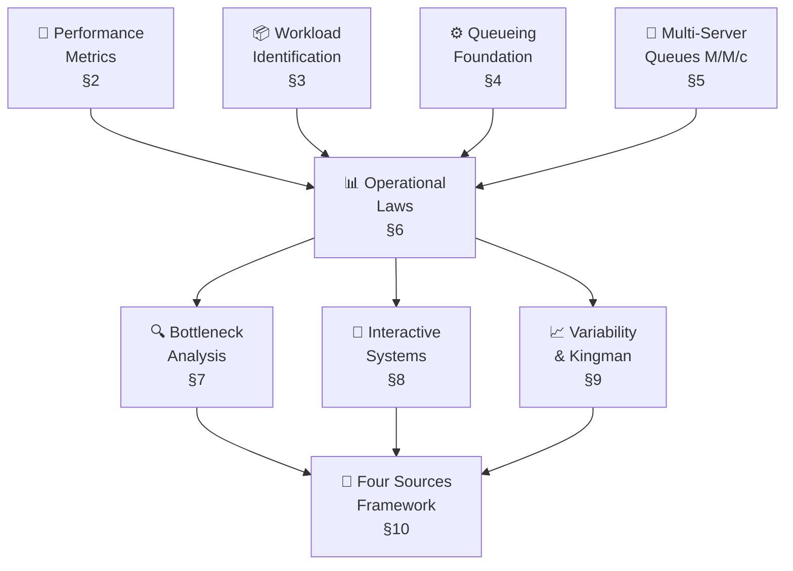

---

## 1. Performance Engineering Philosophy

### The Core Loop

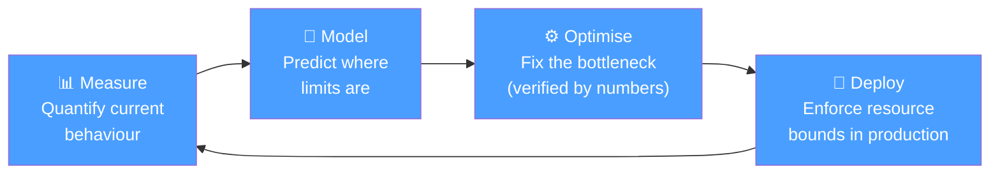

> [!warning] Golden Rule
> **Optimising without measuring is guessing.** You must identify the bottleneck by measurement before touching anything. Fixes that are not verified with numbers may have shifted the bottleneck, not removed it.

### When to Optimise — 3 Conditions

| Condition | Why |
|-----------|-----|
| ① A bottleneck has been **identified by measurement** — not suspected | Ensures you fix the right thing |
| ② The gain is **significant enough** to justify the cost | Amdahl's Law bounds maximum benefit |
| ③ The fix can be **verified with numbers** | A/B comparison or before/after under same workload |

### Classical Optimisation Techniques

| Technique | Mechanism | Effect |
|-----------|-----------|--------|
| **Indexing** | Lookup structure avoids full scans | O(n) → O(log n) |
| **Caching** | Store expensive results for reuse | Reduces S; depends on hit rate |
| **Concurrency** | Parallel execution | Throughput rises until a resource saturates |
| **Algorithmic** | Replace O(n²) with O(n log n) | Scales better at large input |

---

## 2. Performance Metrics

### Six Properties of a Good Metric (LRRECI)

> [!note] Mnemonic: **L**azy **R**abbits **R**un **E**very **C**hilly **I**nning

| Property | Fails when… |
|----------|------------|
| **L**inearity | 2× resource → 0.1× improvement |
| **R**eliability | Metric says A > B; B wins in practice |
| **R**epeatability | Two identical runs give different scores |
| **E**ase of measurement | Requires full distribution (percentiles harder than mean) |
| **C**onsistency | Different labs compute "the same benchmark" differently |
| **I**ndependence | Benchmark designed by vendor whose system it tests |

> [!example] Mars Climate Orbiter (1999)
> Ground software sent navigation data in **pound-force seconds**; NASA expected **newton-seconds**. A consistency violation at a system boundary destroyed a \$327.6M spacecraft.

### Three Classes of Metrics

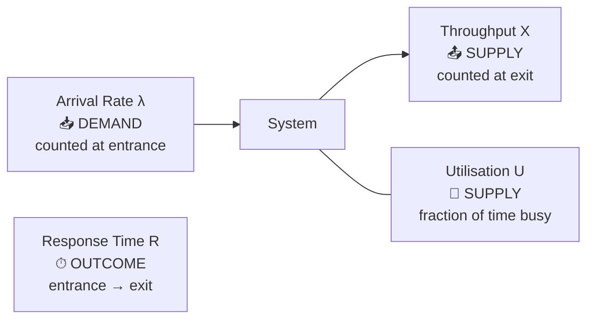

| Class | Metric | Symbol | Counted at |
|-------|--------|--------|-----------|
| **Outcome / User Experience** | Response Time | R | Between entrance and exit |
| **Demand** | Arrival Rate | λ | Entrance |
| **Supply** | Throughput | X | Exit |
| **Supply** | Utilisation | U | Device |

---

### Response Time: R = W + S

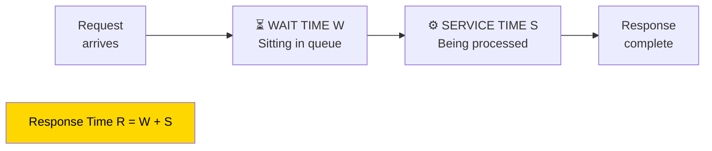

> [!tip] W/S Classification Trick — Exam Favourite
> **Service time = only the time the server is actively working on YOUR request.** All other time (waiting, interruptions, pauses) is wait time.

**Exercise A — Larry the Procrastinator:**

| Activity | Type |
|----------|------|
| Going to washroom, setting up laptop | Wait W |
| Working on Lab Part 1 (2 min) | Service S |
| Getting distracted | Wait W |
| Working on Lab Part 2 (8 min) | Service S |

S = 2 + 8 = **10 min** ← only active work counts

**Exercise B — Polyclinic Visit:**

| Phase | Duration | Type |
|-------|----------|------|
| Queuing before registration | 25 min | W |
| Doctor consultation | 10 min | S |
| Waiting for test results | 15 min | W |
| Follow-up procedure | 5 min | S |
| **Total R** | **55 min** | |

S = 15 min, W = 40 min → **73% of visit is wait time** (queue-dominated)

> [!tip] Non-obvious Insight
> Reducing service time also reduces wait time — the doctor finishing 3 minutes sooner means each patient behind them enters service 3 minutes earlier. The total time saving across all patients exceeds the 3-minute cut.

### User Perception Thresholds

| Time | Perception |
|------|-----------|
| ≈ 0.1 s | Instantaneous — no feedback needed |
| ≈ 1 s | Delay noticed; flow of thought maintained |
| ≈ 10 s | Show a progress indicator |

### Percentiles and Tail Latency

```
Response time distribution (right-skewed):

Frequency
   ↑
   │  █
   │  ██
   │  ████
   │  ██████
   │  ████████░░░░░░░░░░░░░░...
   └─────────────────────────────→ Response time
        │   │              │
       p50  p95           p99
      (111) (120)        (outliers)
   mean = 298 ms  (pulled up by outliers)
```

| Statistic | Use | Problem |
|-----------|-----|---------|
| Mean | Easy to compute | Pulled high by outliers — hides tail |
| p50 (median) | "Typical" request | Makes no commitment about top 50% |
| p90/p95/p99 | Tail commitment | Harder to compute (needs full distribution) |

> [!warning] SLO Selection
> **P90 = 120 ms** beats mean (298 ms) or median (111 ms) as an SLO because it commits that **90% of users receive a response within 120 ms** and makes the tail explicitly visible and contractable.

### SLI / SLO / SLA

| Term | Definition | Example |
|------|-----------|---------|
| **SLI** — Service Level Indicator | The metric being measured | p99 response time |
| **SLO** — Service Level Objective | The target value | p99 < 200 ms |
| **SLA** — Service Level Agreement | Formal agreement with consequences for breach | Contract with penalty clauses |

### Why the Tail Matters — Fan-Out Formula

When one user request triggers N backend calls:

$$P(\text{at least one slow}) = 1 - (1 - 0.01)^N$$

At N = 100: P ≈ **63%** — the majority of page loads hit the tail.

---

### Utilisation Law: U = X × S

**Derivation (pie-eating analogy):**

> 60-minute contest. You eat 5 pies at 10 min each.
> Busy time = 5 × 10 = 50 min → U = 50/60 = **83%**
> X = 5/60 pies/min; U = X × S = (5/60) × 10 = 50/60 ✓

| Given | Find | Formula |
|-------|------|---------|
| λ, S (stable) | U | U = λ × S |
| U, X | S | S = U / X |
| S | λ_max | λ_max = 1/S (at U = 1) |

> [!warning] λ vs X — Critical Distinction
> - Stable system: **X = λ** (every arrival is served) → U = λS is valid
> - Overloaded system: **X < λ** (work is queued or dropped) → must use **U = XS** (general law)

**MRI Scanner Exercises:**

| Q | Given | Find | Working | Answer |
|---|-------|------|---------|--------|
| 1 | λ = 2/hr, S = 25 min | U | 2 × 25/60 | **83%** |
| 2 | U = 60%, λ = 12/hr | S | 0.6 / (12/60) | **3 min** |
| 3 | S = 6 min | X_max | 60/6 | **10 patients/hr** |

### Utilisation vs Response Time — Non-linear Relationship

```
R ↑ (response time)
   │
   │                                         /
   │                                       /
   │                                     /
   │                                   /
   │                                 /
   │                              /
   │                          /
   │                     /
   │               /
   │         /
   │    /
   └──────────────────────────────────→ ρ (utilisation)
   0      0.4     0.6    0.8  0.9  1.0
         │              │
         │ moderate      │ steep — small λ increases
         │ load          │ cause large R increases
         "headroom zone"
         (run below 70-80%)
```

**Key insight:** At low U, R ≈ S. As U → 1, R grows without bound. This is why systems run with deliberate headroom.

---

## 3. Workload Identification

### Three Components of a Workload

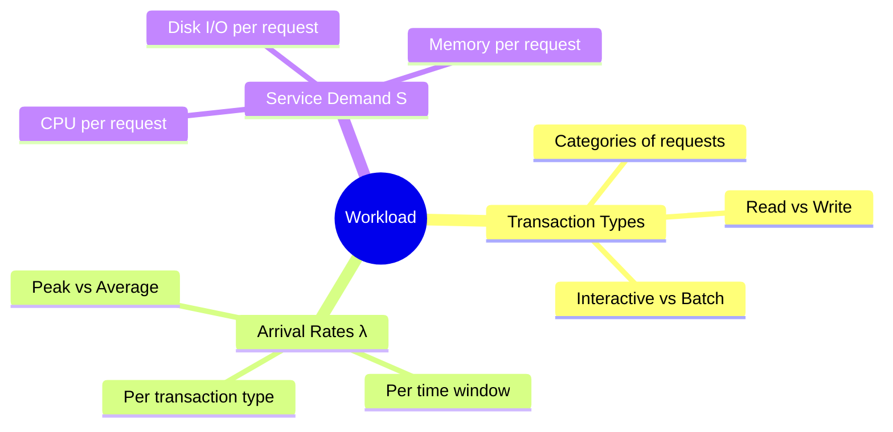

### Estimation Methodology — Decomposition Chain

```
population
    → × active fraction
        → × actions per active user
            → ÷ time window
                → = arrival rate λ
                    → × service demand S
                        → = utilisation U = λS
                            → ÷ U_target
                                → = server count
```

> [!example] e-Filing Deadline
> 2M taxpayers → 20% file on deadline day → 400,000 filings
> → spread over 12 hrs → 9.3 filings/s average
> → ×3 evening peak → **28 filings/s**
> → ×30 web requests/session → **830 req/s** at web tier
> → at 70% U target → **≈ 24 servers**

### Peak vs Average

| Concept | Rule |
|---------|------|
| **Design for peak** | Size for the worst credible sustained load within SLO |
| **Predictable peaks** | Payday, results day, deadline — read the business calendar |
| **Peak-within-peak** | A one-hour event can land in the first minute if triggered simultaneously |

> [!example] Taylor Swift Case
> 330,000 tickets + millions of buyers → the real workload is not "serve ticket purchases" — it is "absorb millions of simultaneous arrivals". **During an extreme peak, the queuing system is the product.**

### Common Workload Mistakes

| Mistake | Consequence |
|---------|-------------|
| Sizing for average, not peak | System fails when most users are watching |
| Ignoring workload mix | Read-heavy model undersizes write-heavy reality |
| Hidden assumptions | Errors cannot be found or corrected |
| No headroom | First growth spike breaches SLO |

---

## 4. Queueing Theory Foundation

### Key Symbols

| Symbol | Name | Definition |
|--------|------|-----------|
| λ | Arrival rate | Jobs offered per unit time — demand at entrance |
| μ | Service rate / capacity | μ = 1/S for a single continuously busy server |
| S | Service time | Time the server spends processing one job |
| X | Throughput | Jobs completed per unit time — supply at exit |
| U | Utilisation | Fraction of time server is busy |
| W | Wait time | Time in queue, before service begins |
| R | Response time | Total time W + S |
| ρ | Traffic intensity | ρ = λ/μ = λ × S |
| N | Number in system | Average jobs in the system (queue + in service) |

### Little's Law

$$N = X \times R$$

"The average number of items in a system equals the throughput times the average time each item spends in the system."

- Applies to any stable system regardless of arrival distribution, service distribution, or number of servers
- Generalises to any subsystem: N_queue = X × W

### Observation Boundary Effect

> [!warning] Exam Trap
> In a **short finite trace**, sample mean of inter-arrival gaps **≠ 1/λ**.
> Always compute λ = (number of arrivals) / (observation window length).

**Worked Example (API Server, 20 s window):**

Arrivals at t = 0, 2, 9, 12. Server processes FIFO.

| Request | Arrives | Starts | Ends | W | S | R |
|---------|---------|--------|------|---|---|---|
| A | 0 | 0 | 3 | 0 | 3 | 3 |
| B | 2 | 3 | 8 | 1 | 5 | 6 |
| C | 9 | 9 | 13 | 0 | 4 | 4 |
| D | 12 | 13 | 15 | 1 | 2 | 3 |

| Metric | Calculation | Value |
|--------|-------------|-------|
| λ | 4 / 20 s | **0.2 jobs/s** |
| Mean observed gap | (2 + 7 + 3) / 3 | **4 s** |
| 1/λ | 1 / 0.2 | **5 s** ← not equal to mean gap |
| Mean S | 14 / 4 | **3.5 s** |
| U | 14 / 20 | **70%** |

Gap mean (4 s) ≠ 1/λ (5 s) because observed gaps only cover t = 0 to t = 12, not the full 20-second window.

### M/M/1 Single-Server Queue

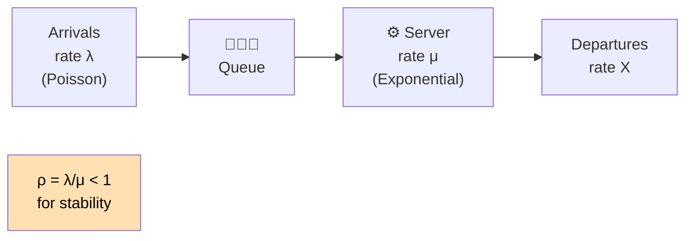

- **M** (first) = Markov arrivals (Poisson process)
- **M** (second) = Markov service (exponential distribution)
- **1** = single server
- **Stability:** ρ = λ/μ < 1 (λ < μ)
- **Wait in queue:** W = ρ/(1−ρ) × S
- **Response time:** R = S / (1−ρ) = W + S

---

## 5. Multi-Server Queues — M/M/c

### Structure

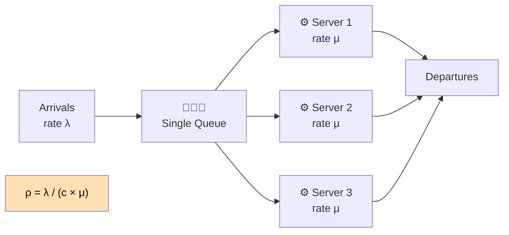

### Key Formula

$$\rho = \frac{\lambda}{c \times \mu} = \frac{\lambda \times S}{c}$$

**Stable if ρ < 1 (i.e. λ < c × μ)**

Real-world examples: 3 API servers behind one load balancer, thread pool with c workers, c GPUs sharing one request queue.

### One Fast Server vs Many Slow Servers

Given the same aggregate capacity (total throughput = c × μ):

| Scenario | Latency | Why |
|----------|---------|-----|
| **1 fast server (rate c×μ)** | **Lower** | Each job gets the full rate c×μ |
| **c slow servers (each rate μ)** | Higher | Each job gets only rate μ |

**But real systems use many servers because:**
- Single device cannot scale up indefinitely
- Fault tolerance: one server failing removes only 1/c of capacity

> [!tip] The case for many servers is **operational** (fault tolerance, cost, scaling limits), NOT a queueing advantage.

### Worked Example — API Tier

λ = 8 tps, S = 148 ms, c = 3 servers:

| State | ρ per server | Mean wait at API |
|-------|-------------|-----------------|
| Normal (c = 3) | 8 × 0.148 / 3 = **0.40** | ≈ 7 ms |
| One server down (c = 2) | 8 × 0.148 / 2 = **0.60** | ≈ 58 ms (8× worse) |

---

## 6. Operational Laws

### System Structure (Running Case)

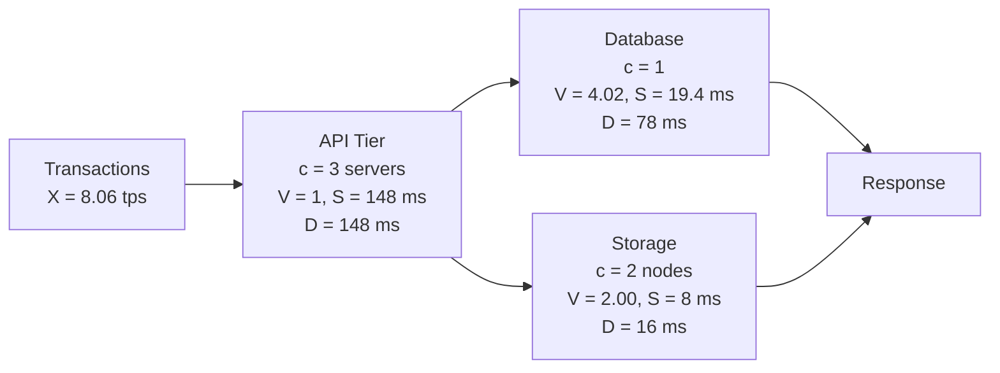

### 6.1 — Forced Flow Law

$$X_k = V_k \times X$$

All device throughputs are forced into fixed proportion to system throughput by visit counts.

> [!example] E.4.1
> Each web transaction issues V = 4 SQL queries. System throughput X = 25 tps.
> X(db) = 4 × 25 = **100 queries/second**

**Running case verification:** V(db) = 4.02, X = 8.06 tps → X(db) = 4.02 × 8.06 ≈ **32.4 qps** (exactly what the log shows).

### 6.2 — Service Demand

$$D_k = V_k \times S_k$$

Total service time one transaction requires at device k across all its visits.

### 6.3 — Service Demand Law

$$U_k = X \times D_k$$

The Utilisation Law (U = XS) restated per device using demands.

Also: **D_k = U_k / X** — compute demand from monitoring data without tracing individual visits.

> [!example] E.4.2
> V = 4 queries, S = 5 ms → D(db) = 4 × 5 = **20 ms**
> At X = 30 tps: U(db) = 30 × 0.020 = **60%**

### Measured Demands — Running Case BEFORE Window

| Device | V | S | D | U at X = 8.06 tps |
|--------|---|---|---|--------------------|
| API tier (c = 3) | 1.00 | 148 ms | **148 ms** | 8.06 × 0.148 / 3 ≈ **0.40** per server |
| Database (c = 1) | 4.02 | 19.4 ms | **78 ms** | 8.06 × 0.078 ≈ **0.63** |
| Storage (c = 2) | 2.00 | 8.0 ms | **16 ms** | 8.06 × 0.016 / 2 ≈ **0.06** |

All moderate. Nothing saturated. Yet p95 = 3.5 s. → The problem is **variability** (see §9).

---

## 7. Bottleneck Analysis

### Capacity Bottleneck vs Congestion Hotspot

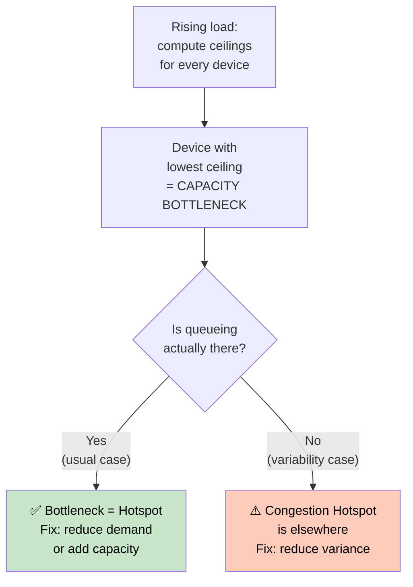

| Term | Definition |
|------|-----------|
| **Capacity Bottleneck** | Device with **lowest throughput ceiling** — first to saturate as load increases |
| **Congestion Hotspot** | Device where **queueing actually accumulates** — may differ from bottleneck due to variability |

### Throughput Ceilings

**Single-server device:**

$$X \leq \frac{1}{D_{max}}$$

**Device with c servers:**

$$X \leq \frac{c}{D}$$

> [!warning] The largest demand ≠ the bottleneck when server counts differ!
> Always divide by server count to get the ceiling. The bottleneck is the **lowest ceiling**.

**Response Time Lower Bound (no queueing anywhere):**

$$R \geq D_1 + D_2 + \ldots + D_n$$

### Worked Example — Running Case

| Device | Servers | Ceiling | |
|--------|---------|---------|---|
| API tier | 3 | 3 / 0.148 = **20.3 tps** | Not the bottleneck |
| Database | 1 | 1 / 0.078 = **12.8 tps** | ← **Lowest = bottleneck** |
| Storage | 2 | 2 / 0.016 = **125 tps** | Far from binding |

Minimum response time: R ≥ 148 + 78 + 16 = **242 ms**

A target of 20 tps is infeasible without changing the database.

### Worked Example — Wafer Fab (E.4.3 / E.4.4)

| Step | D | Ceiling (1 tool) |
|------|---|-----------------|
| Deposition | 6.7 h | 3.6 lots/day |
| **Photolithography** | **8.6 h** | **2.8 lots/day** ← bottleneck |
| Etch | 5.4 h | 4.4 lots/day |
| Ion implant | 3.2 h | 7.5 lots/day |
| CMP | 2.6 h | 9.2 lots/day |
| Metrology | 1.6 h | 15 lots/day |

**E.4.3 answer:** Bottleneck = photolithography; X ≤ 2.8 lots/day.

**E.4.4 (c = 3 litho tools):** Litho ceiling = 3/8.6 = 8.4 lots/day → deposition (3.6 lots/day) becomes new binding ceiling.

**One tool fails (c = 2):** Litho ceiling = 2/8.6 = 5.6 lots/day. With λ = 3.05 lots/day, **still no saturation** — rising queue is a variability effect, not a capacity shortfall.

### Three Levers to Fix a Bottleneck

Since D = V × S:

| Lever | How | Example |
|-------|-----|---------|
| **Reduce V** | Cache results → fewer visits to device | DB visits: 4 → 2 (halves D) |
| **Reduce S** | Index, optimise query | Each visit faster |
| **Add capacity** | Replicas, faster hardware | Ceiling rises |

> [!tip] Optimisation is iterative — fix one bottleneck, recompute ceilings, find the next one.

---

## 8. Interactive Systems

### Open vs Closed Systems

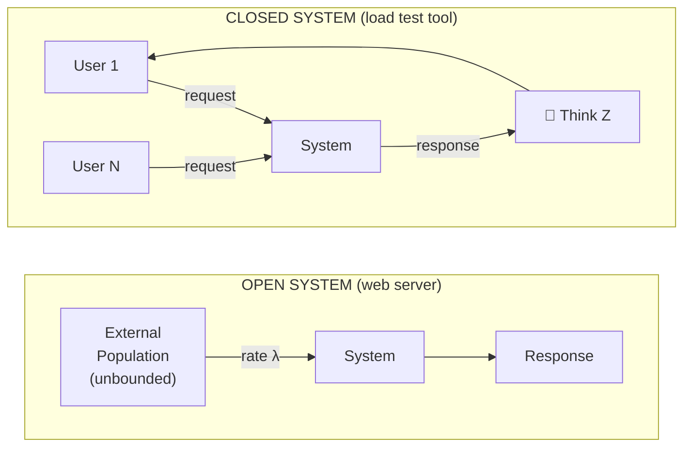

| Model | Users | Think time | Examples |
|-------|-------|-----------|---------|
| **Open** | Unbounded external population | None | Web server, API gateway |
| **Closed** | Fixed N users cycling | Z (average think time) | Load testing tools, DB connection pools |

### Interactive Response Time Law

Apply Little's Law to the whole system including users:

$$N = X \times (R + Z)$$

Rearranging:

$$\boxed{R = \frac{N}{X} - Z}$$

**Interpretation:**
- Tool fixes N (virtual users) and Z (think time)
- Tool measures X (throughput)
- Law gives R (experienced response time)

> [!example] E.4.5
> N = 200 users, Z = 10 s, X = 18 tps
> R = 200/18 − 10 = 11.11 − 10 = **1.11 seconds**

> [!warning] Doubling users when throughput is capped at the bottleneck ceiling → all extra N appears as extra R, not extra X.

---

## 9. Variability and the Kingman Formula

### Coefficient of Variation

$$C = \frac{\text{standard deviation}}{\text{mean}}$$

| Symbol | Measures | Value = 0 | Value = 1 | Value > 1 |
|--------|----------|-----------|-----------|-----------|
| **Cₐ** | Inter-arrival time variability | Perfectly regular arrivals | Poisson (M/M/1 assumption) | Bursty arrivals |
| **Cₛ** | Service time variability | Fixed service time | Exponential (M/M/1 assumption) | Mixed workload |

> [!example] High Cₛ trap
> An API serving mostly 20 ms lookups plus occasional 5-second report queries has very high Cₛ, even though the **mean** service time looks moderate. Averages hide this completely.

### The Kingman Formula (G/G/1 — single server)

$$\boxed{W \approx \underbrace{\frac{\rho}{1-\rho}}_{\text{utilisation}} \times \underbrace{\frac{C_a^2 + C_s^2}{2}}_{\text{variability}} \times \underbrace{S}_{\text{service time}}}$$

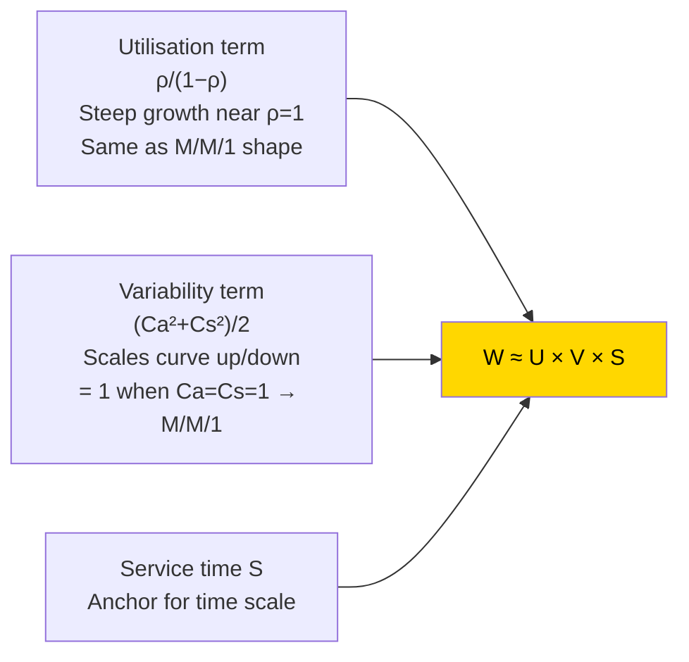

- At Ca = Cs = 1: reduces exactly to the **M/M/1 result**
- Formula is **approximate** for G/G/1, but excellent for first-order reasoning

### Worked Comparison (E.4.6 style)

All three scenarios: **ρ = 0.8, S = 100 ms**. Utilisation term = 0.8/0.2 = **4**.

| Scenario | Ca² | Cs² | Variability term | **W** |
|----------|-----|-----|----------------|-------|
| Regular (deterministic) | 0 | 0 | 0 | **≈ 0 ms** |
| Markov (M/M/1) | 1 | 1 | 1 | 4 × 1 × 100 = **400 ms** |
| Mixed workload | 1 | 4 | 2.5 | 4 × 2.5 × 100 = **1,000 ms** |

Same hardware, same load, same mean service time → **2.5× more waiting** from variance alone.

> [!example] E.4.6
> ρ = 0.9, S = 50 ms. Utilisation term = 9.
> - Ca² = Cs² = 1: W ≈ 9 × 1 × 50 = **450 ms**
> - Ca² = 1, Cs² = 9: W ≈ 9 × 5 × 50 = **2,250 ms**
>
> Five times longer wait purely from service time variance.

### Sakasegawa's G/G/c Approximation (Multi-Server)

$$W \approx \frac{C_a^2 + C_s^2}{2} \times \frac{\rho^{\sqrt{2(c+1)}-1}}{c(1-\rho)} \times S$$

Same three-factor structure as Kingman with a modified utilisation term for c servers.

Use to **understand the mechanism** (what grew, and why) rather than as a precise point predictor.

### Variability in Practice

| Situation | Mechanism | Fix |
|-----------|-----------|-----|
| **Mixed workloads** (long + short requests) | High Cₛ | Split into separate queues (reduces Cₛ) |
| **Bursty arrivals** (retry storms, scheduled jobs) | High Cₐ | Jittered retries, request smoothing |
| **Headroom rule** | Both | Run interactive systems below 70–80% U |
| **LLM inference** | Token count varies → high Cₛ | Continuous batching; separate prefill from decode |

### Running Case Diagnosis

Database service time distribution shows **two populations**:

```
Frequency
   ↑
   │  ████  ←── Standard queries ~5 ms (many)
   │  ████
   │  ████
   │  █░░░░░░░░░░░░░░░░░░░░░░░░░░░░█  ←── Report queries ~375 ms (few)
   └──────────────────────────────────────→ Service time
      5ms                            375ms
```

Cs² ≈ **34** at the database — extreme. One report query ≈ 75 standard queries of work. Mean = 19.4 ms. Almost no query actually takes 19.4 ms.

**Fix:** Move report queries to a read replica (DB-RPT).

| Metric | BEFORE | AFTER |
|--------|--------|-------|
| DB-01 Cs² | ≈ 34 | ≈ 0 |
| DB-01 wait per query | 165 ms | 5 ms |
| Transaction p95 | 3.48 s | **0.44 s** (8× improvement) |

**Kingman Validation on DB-RPT:**

```
Inputs: ρ = 0.23, Ca² = 1.0, Cs² = 0.26, S = 1.43 s
Predicted W ≈ (0.23/0.77) × (1.26/2) × 1.43 ≈ 0.30 s
Measured W = 0.27 s  (within 8%) ✓
```

> [!warning] Kingman caveat
> The same check on shared DB-01 (BEFORE) over-predicts by 2–3×. In a network, arrivals feed back on themselves — they are not independent. **Kingman is precise where its assumptions hold; a mechanism-teacher everywhere else.**

---

## 10. Four Sources Framework

Every performance problem traces to one of four root causes. Diagnose which is binding **before** touching anything.

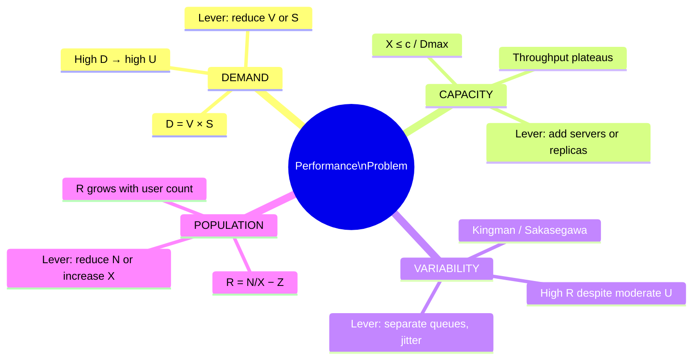

| Source | Formula | Key symptom | Fix |
|--------|---------|-------------|-----|
| **Demand** | D = V × S | High U, bottleneck shifts unexpectedly | Reduce V (cache) or S (index) |
| **Capacity** | X ≤ c/D | Throughput plateaus; adding load has no effect | Add servers, replicas, faster hardware |
| **Variability** | Kingman / Sakasegawa | High tail latency at moderate U; individual requests vary wildly | Separate heavy/light; jitter arrivals |
| **Population** | R = N/X − Z | R grows with user count even when X is unconstrained | Reduce N or increase throughput ceiling |

### Applying the Diagnosis

| Case | Demand | Capacity | Variability | Population | Root cause |
|------|--------|----------|-------------|------------|------------|
| Online service BEFORE | Unchanged | Not binding (X = 8.06 vs ceiling 12.8) | **Cs² ≈ 34** at DB | Open system | **Variability** |
| Wafer fab (LITHO-02 down) | Unchanged | Reduced but not binding (λ = 3.05 vs ceiling 5.6) | **Cₐ ≈ 1.5** amplified | Open system | **Variability** |

---

## 11. All Worked Examples — Assignments

### E.4.1 — Forced Flow Law

> Each web transaction issues 4 SQL queries. Web server completes 25 tps. What must the database sustain?

X(db) = V × X = 4 × 25 = **100 queries/second**

---

### E.4.2 — Service Demand Law

> From E.4.1: each query takes 5 ms. What is DB demand per transaction, and DB utilisation at 30 tps?

D(db) = V × S = 4 × 5 = **20 ms per transaction**
U(db) = X × D = 30 × 0.020 = **0.60 (60%)**

---

### E.4.3 — Bottleneck Analysis (single server per step)

> Fab demands: deposition 6.7 h, litho 8.6 h, etch 5.4 h, ion implant 3.2 h, CMP 2.6 h, metrology 1.6 h. All single tools. Bottleneck?

Largest demand = litho at 8.6 h.
X ≤ 1/8.6 lots/h = 24/8.6 ≈ **2.8 lots/day**

---

### E.4.4 — Bottleneck Analysis (multi-server)

> Three litho tools behind one queue. New ceiling? One tool fails — does the fab saturate at λ = 3.05 lots/day?

With c = 3: litho ceiling = 3/8.6 ≈ 8.4 lots/day.
New binding ceiling = deposition = 24/6.7 ≈ **3.6 lots/day**

One tool fails (c = 2): litho ceiling = 2/8.6 ≈ **5.6 lots/day** > 3.6 > 3.05 → **fab does not saturate**. Rising queue = variability effect.

---

### E.4.5 — Interactive Response Time Law

> N = 200 users, Z = 10 s, X = 18 tps. What is R?

R = N/X − Z = 200/18 − 10 = 11.11 − 10 = **1.11 seconds**

---

### E.4.6 — Kingman Formula

> ρ = 0.9, S = 50 ms. Estimate W when (i) Ca² = Cs² = 1, (ii) Ca² = 1, Cs² = 9.

Utilisation term = ρ/(1−ρ) = 0.9/0.1 = 9.

(i) W ≈ 9 × (1+1)/2 × 50 = 9 × 1 × 50 = **450 ms**
(ii) W ≈ 9 × (1+9)/2 × 50 = 9 × 5 × 50 = **2,250 ms**

5× increase purely from variance.

---

### Workload Exercises

**Manufacturing:**

| Question | Working | Answer |
|----------|---------|--------|
| Average rate | 120,000 / (20 × 8 hr) | 750 units/hr |
| U at average rate | 750 × 4/3600 | **83%** |
| Final-week rate | 48,000 / (5 × 8 hr) | 1,200 units/hr |
| U at final-week rate | 1,200 × 4/3600 = 1.33 | **133% — overloaded** |

**Healthcare (polyclinic):**

| Question | Working | Answer |
|----------|---------|--------|
| Total arrivals | 60 × 70% + 25 | 67 patients/hr |
| U at 67/hr | μ = 80/hr; 67/80 | **83.8%** — coping |
| With flu drive | 82/80 | **102.5% — overloaded** |

**IT Flash Sale:**

| Question | Working | Answer |
|----------|---------|--------|
| Arrivals in first minute | 500,000 × 4% / 60 s | 333 arrivals/s |
| Product service req/s | 333 × 6 | 2,000 req/s |
| Servers at 70% U | ⌈2,000 / 70⌉ | **29 servers** |
| Peak:average ratio | 2,000 / 40 | **50×** |

---

## 12. Case Study Summaries

### Online Service — Three Windows

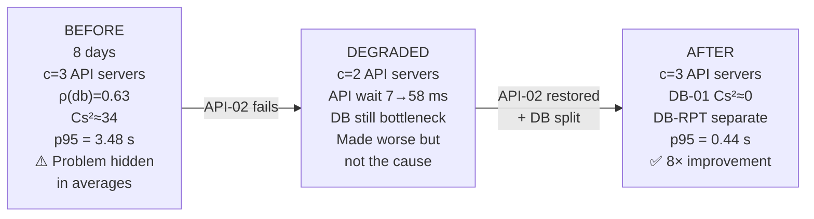

**Root cause:** Cs² ≈ 34 at the database from mixed workload (standard + report queries).
**Fix:** Separate queues by traffic type → attack the variance, not the load.

### Wafer Fab — LITHO-02 Failure

| Metric | January (Healthy) | June (Problem) |
|--------|------------------|---------------|
| Tools in litho | 3 | 2 (LITHO-02 degraded) |
| ρ per tool | 0.36 | 0.54 |
| Litho queue time | Baseline | **3× higher** |
| Cycle time | 1.8 days | **2.2 days** |
| Throughput | Still 3.05 lots/day | Still 3.05 lots/day |

**Why not a capacity problem:** With λ = 3.05 and ceiling = 5.6 (c=2), the fab **never saturates**.
**Why a variability problem:** High Cₐ ≈ 1.5 (bursty arrivals) combined with higher ρ inflated wait via Sakasegawa's formula.

Priority discipline: Hot lots — 3.2 h queue; Normal lots — 8.0 h queue.

---

## 13. Formula Quick Reference

| Formula | Name | Notes |
|---------|------|-------|
| R = W + S | Response time | Always |
| U = X × S | Utilisation Law | General; use U = λS only when stable |
| N = X × R | Little's Law | Any stable system |
| ρ = λ/(c × μ) | M/M/c traffic intensity | c = 1 gives M/M/1 |
| X_k = V_k × X | Forced Flow Law | Device throughput from system throughput |
| D_k = V_k × S_k | Service demand | Total service time per transaction at device k |
| U_k = X × D_k | Service Demand Law | Utilisation Law per device using demands |
| X ≤ 1/D_max | Throughput ceiling (1 server) | |
| X ≤ c/D | Throughput ceiling (c servers) | Lowest ceiling = bottleneck |
| R ≥ Σ D_k | Response time lower bound | Best possible R when no queueing |
| R = N/X − Z | Interactive Response Time Law | Closed systems; derived from N = X(R+Z) |
| C = σ/mean | Coefficient of variation | Cₐ for arrivals, Cₛ for service |
| W ≈ [ρ/(1−ρ)] × [(Ca²+Cs²)/2] × S | Kingman (G/G/1) | Ca=Cs=1 reduces to M/M/1 |
| W ≈ [(Ca²+Cs²)/2] × [ρ^(√(2(c+1))−1) / c(1−ρ)] × S | Sakasegawa (G/G/c) | Multi-server Kingman |

### Utilisation Law — Calculator

| Given | Find | Calculation |
|-------|------|-------------|
| λ = 3/s, S = 100 ms | U | 3 × 0.1 = **30%** |
| U = 0.9, λ = 100/s | S | 0.9/100 = **9 ms** |
| S = 10 ms | λ_max (at U=1) | 1/0.01 = **100 tps** |
| λ = 8 tps, S = 0.148 s, c = 3 | ρ | 8 × 0.148/3 = **0.395** |

### Kingman — Calculator

| ρ | 1−ρ | ρ/(1−ρ) |
|---|-----|---------|
| 0.5 | 0.5 | 1.0 |
| 0.6 | 0.4 | 1.5 |
| 0.7 | 0.3 | 2.33 |
| 0.8 | 0.2 | 4.0 |
| 0.9 | 0.1 | 9.0 |
| 0.95 | 0.05 | 19.0 |

---

## Exam Strategy Checklist

> [!tip] For any performance question:
> 1. **Identify which of the Four Sources is at play** (Demand / Capacity / Variability / Population)
> 2. **Draw the system** — identify devices, visit counts V, server counts c
> 3. **Compute demands** D_k = V_k × S_k
> 4. **Compute ceilings** c/D for each device → find bottleneck (lowest ceiling)
> 5. **Apply the right formula** based on what is asked (Kingman = variability; Interactive Law = closed system; Forced Flow = device throughput)
> 6. **Check if the answer makes sense** — U should be < 1 in a stable system; R should be ≥ S

> [!warning] Common Exam Mistakes
> - Using λ instead of X in Utilisation Law when the system is overloaded
> - Confusing **capacity bottleneck** (lowest ceiling) with **largest demand** (not the same when c differs)
> - Forgetting to divide demand by server count c when computing the ceiling
> - Computing 1/λ from the mean of observed inter-arrival gaps instead of from the full window
> - Assuming the largest-demand device is automatically the congestion hotspot — it may not be if variability is driving the queue elsewhere
