# ICT3112 Software Verification and Validation
## Complete Exam Study Notes

> [!tip] How to Use These Notes
> Start with the **Module Map** and §1 definitions — they anchor everything else. The **whitebox** (§5) and **blackbox** (§6) sections are the most formula-heavy and exam-likely. Drill the **worked examples** in each technique section.

---

## Module Map

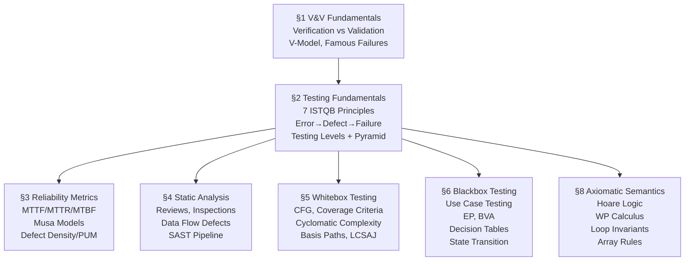

---

## 1. V&V Fundamentals

### Core Definitions

> [!warning] Most Examined Distinction
> These two questions are **always** the starting point of any exam question on V&V.

| Term | Question | Focus |
|------|----------|-------|
| **Verification** | "Are we building the product **right**?" | Conformance to specification |
| **Validation** | "Are we building the **right** product?" | Fulfilment of user needs and intended purpose |
| **V&V combined** | "Does it meet specs **and** fulfil its purpose?" | Both simultaneously |

### Static vs Dynamic V&V

| | **Static V&V** | **Dynamic V&V** |
|---|---|---|
| Code executed? | **No** | **Yes** |
| Focus | **Prevention** of defects | **Detection** of defects |
| Methods | Reviews, inspections, walkthroughs, SAST tools | Testing, simulation, model checking |
| Lifecycle phase | Requirements, design, early code (shift left) | After implementation |
| Cost to find defects | **Lower** (caught before they embed) | Higher |

### The V-Model

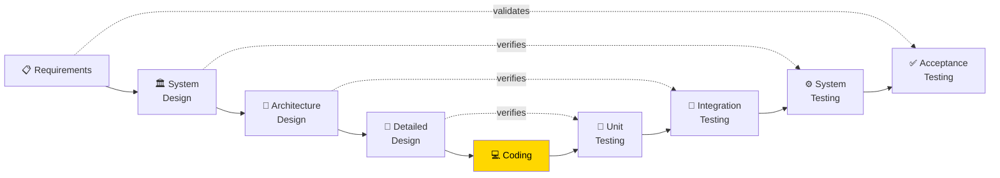

**Key:** Left side = specification artefacts; Right side = corresponding test levels. The arrows show what each test level validates.

### Root Causes of Poor Software Quality — Six DORA Categories

| # | Category | Examples |
|---|----------|---------|
| 1 | **People / Communication / Culture** | Siloed teams, blame culture |
| 2 | **Planning / Workload / Change Pressure** | Unrealistic deadlines, scope creep |
| 3 | **Requirements / Architecture / Design** | Wrong or ambiguous requirements |
| 4 | **Implementation / Maintainability** | Spaghetti code, uninitialised variables |
| 5 | **Configuration / Dependencies / Supply Chain** | Unmanaged dependencies, missing pinned versions |
| 6 | **Verification / Delivery / Operational Feedback** | Inadequate testing, no feedback loops |

### Famous Software Failures

> [!example] These appear in exams — know the root cause, not just the name.

| Incident | Year | Root Cause | Impact |
|---------|------|-----------|--------|
| **Therac-25** | 1980s | Race condition + software override of hardware safety interlocks; missing fail-safes | 3 deaths from radiation overdose; paradigm case for safety-critical V&V |
| **Ariane 5** | 1996 | 64-bit float → 16-bit integer overflow; reuse of Ariane 4 code **without revalidation** | $500M rocket destroyed 37 seconds after launch |
| **CrowdStrike** | 2024 | Faulty kernel-level update pushed to millions of Windows endpoints without sufficient validation | $5.4B economic impact; global outages across airlines, hospitals, banks |

### Cost of Poor Software Quality

| Year | Source | Estimate |
|------|--------|---------|
| 2002 | US NIST | $59.5 billion/year |
| 2021 | CISQ | $2.08 trillion/year |
| 2022 | CISQ | $2.41 trillion/year |

> [!tip] Key Rule
> **Defect fix cost rises exponentially the later in the SDLC it is caught.** Defects found in requirements cost ~10× less to fix than those found in production.

---

## 2. Testing Fundamentals

### The Seven ISTQB Principles

> [!note] Mnemonic: **T**each **E**very **E**ager **D**eveloper **P**roper **T**esting **A**pproaches

| # | Principle | One-Line Meaning |
|---|-----------|-----------------|
| 1 | **Testing shows presence of defects** | Proves defects exist; cannot prove zero defects |
| 2 | **Exhaustive testing is impossible** | Use risk analysis to focus effort |
| 3 | **Early testing saves cost** | Shift left — find defects before they embed |
| 4 | **Defect clustering** | 80% of defects live in ~20% of the code (Pareto) |
| 5 | **Pesticide paradox** | Repeated identical tests stop finding new defects — refresh suites |
| 6 | **Testing is context-dependent** | Safety-critical ≠ marketing website |
| 7 | **Absence-of-errors fallacy** | Zero defects ≠ useful software; must test the right things |

### Error → Defect → Failure Chain

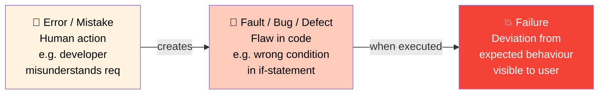

> "Testing can show that defects are present, but cannot prove there are no defects." — Bill Hetzel

### Four Testing Levels

```
┌──────────────────────────────────────────────────────┐
│           Acceptance Testing (UAT)                    │
│  "Are we building the RIGHT product?"                 │
│  Techniques: Use cases, real user scenarios           │
├──────────────────────────────────────────────────────┤
│              System Testing                           │
│  "Does the complete system work?"                     │
│  Techniques: Blackbox — EP, BVA, Decision Tables      │
├──────────────────────────────────────────────────────┤
│           Integration Testing                         │
│  "Do the components work together?"                   │
│  Techniques: Mix of blackbox / whitebox               │
├──────────────────────────────────────────────────────┤
│              Unit Testing                             │
│  "Does each isolated unit work correctly?"            │
│  Techniques: Whitebox — CFG, coverage criteria        │
└──────────────────────────────────────────────────────┘
```

### The Testing Pyramid

```
           ▲
          /E2E\         ← Few; slow; expensive; flaky
         /──────\
        /Integration\   ← Some; moderately fast
       /──────────────\
      /  Unit Tests    \ ← Many; fast; cheap; high ROI
     /──────────────────\

Recommended distribution: 70% Unit — 20% Integration — 10% E2E
```

> [!warning] Anti-Pattern: Ice Cream Cone
> Many teams invert the pyramid — heavy reliance on manual/UI tests, few unit tests. Result: slow CI, brittle tests, high maintenance cost. Fix: push tests **down** the pyramid.

### Static Testing Techniques (Formality Spectrum)

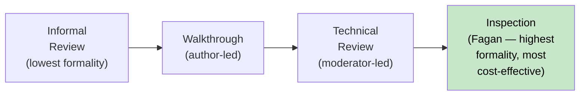

| Technique | Who leads | Output | Formality |
|-----------|-----------|--------|-----------|
| Informal review | Author | None required | Lowest |
| Walkthrough | Author | Issues noted | Low |
| Technical review | Moderator | Defect list | Medium |
| **Inspection (Fagan)** | Trained moderator | Metrics + formal report | **Highest / Most cost-effective** |

### Retesting vs Regression Testing

| Type | Definition |
|------|-----------|
| **Retesting** | Re-running tests that **previously found defects** to confirm the fix works |
| **Regression testing** | Running tests in **parallel areas** to confirm fixes don't break something else |

> [!warning] Up to 50% of bug fixes introduce additional errors. Regression testing is not optional.

### Eight Good Testing Practices

| # | Practice |
|---|---------|
| 1 | A good test has **high probability of detecting undiscovered defects** — not just showing it works |
| 2 | Don't be the **only one testing your own code** — peer review is essential |
| 3 | Specify **expected result before** running the test |
| 4 | Write tests for both **valid and invalid** inputs |
| 5 | **Thoroughly inspect results** of each test |
| 6 | Make **testability** a key design objective |
| 7 | **Never alter the programme** to make testing easier |
| 8 | Testing must start with clear **objectives** |

### Goodhart's Law in Testing

> "When a measure becomes a target, it ceases to be a good measure."

**Applied:** When teams are evaluated on test counts or coverage %, they write tests designed to pass rather than to find defects. The goal is **finding defects**, not achieving metric targets.

---

## 3. Software Reliability Metrics

### Core Metrics

| Metric | Formula | Meaning |
|--------|---------|---------|
| **MTTF** | Empirical | Mean Time To Failure — avg time from start to first failure |
| **MTTR** | Empirical | Mean Time To Repair — avg time to restore after failure |
| **MTBF** | MTTF + MTTR | Mean Time Between Failures |
| **Availability** | MTTF / (MTTF + MTTR) | Proportion of time system is operational |

> [!example] Worked Example
> MTTF = 9 hours, MTTR = 1 hour
> MTBF = 9 + 1 = **10 hours**
> Availability = 9 / 10 = **0.9 = 90%**

> [!warning] Lab simplification
> The lab uses `MTBF / (MTBF + MTTR)` (substituting MTBF for MTTF). Know both forms.

### Execution Time vs Calendar Time

| Type | Also Called | Definition | Differs when… |
|------|------------|-----------|--------------|
| **Execution time** | CPU time | Cumulative processor time consumed | Multi-threaded: many CPU-s fit in fewer wall-clock seconds |
| **Calendar time** | Wall-clock time | Real-world elapsed time | I/O-bound: CPU idles; wall time > CPU time |

> Always specify environment when reporting time-based metrics.

### Basic Musa Reliability Model

Assumes **constant rate of decrease** in failure intensity — each fault fixed reduces failure rate by the same amount.

$$\mu(\tau) = \nu_0 \times \left[1 - e^{-\lambda_0 \tau / \nu_0}\right]$$

$$\lambda(\tau) = \lambda_0 \times e^{-\lambda_0 \tau / \nu_0}$$

| Symbol | Meaning |
|--------|---------|
| μ(τ) | Expected total failures by time τ |
| λ(τ) | Failure intensity at time τ |
| ν₀ | Total expected failures (initial fault count) |
| λ₀ | Initial failure intensity |

**Suited for:** stable/mature releases where faults are evenly distributed.

> [!example] Worked Check (λ₀=2, ν₀=10, τ=5)
> Exponent = −λ₀τ/ν₀ = −(2×5)/10 = −1
> λ(5) = 2 × e⁻¹ ≈ **0.7358 failures/time unit**
> μ(5) = 10 × (1 − e⁻¹) ≈ **6.3212 expected failures**

### Logarithmic Musa Reliability Model

Assumes frequently-triggered faults are found first — **diminishing returns** as testing continues.

$$\mu(\tau) = \frac{1}{\theta} \ln(\lambda_0 \theta \tau + 1)$$

$$\lambda(\tau) = \lambda_0 \times e^{-\theta \mu(\tau)}$$

| Symbol | Meaning |
|--------|---------|
| θ | Per-fault decrease in intensity (higher = more skewed fault distribution) |

**Suited for:** early testing where a few heavily-used paths accumulate most failures first. Tends toward zero but never reaches it — arguably more realistic.

**Key distinction:** High-traffic bugs surface quickly → large initial drop in λ → diminishing returns for rare paths.

### Defect Density

$$\text{Defect Density} = \frac{\text{Defects}}{\text{KLOC}}$$

- **KLOC** = Kilo Lines of Code (1,000 LOC)
- **SSI** = Shipped Source Instructions
- **CSI** = Changed Source Instructions

**Tracking across releases:**
```
KSSI(current) = KSSI(previous) + KCSI − deleted_lines − changed_lines
```

### Customer-Facing Metrics

**PUM — Problems per User Month:**

$$\text{PUM} = \frac{\text{Total Problems}}{\text{Total User Months}}$$

**Total User Months** = number of users × months in period.

**Quality Frameworks:**

| Framework | Dimensions |
|-----------|-----------|
| **IBM CUPRIMDSO** | Capability, Usability, Performance, Reliability, Installability, Maintainability, Documentation, Service, Overall |
| **HP FURPS** | Functionality, Usability, Reliability, Performance, Supportability |

---

## 4. Static Analysis

### Why Static Analysis?

| Testing | Static Analysis |
|---------|----------------|
| Finds bugs on exercised paths only | Reasons about **all paths simultaneously** |
| Cannot cover rare paths | Finds bugs in untested paths |
| Cannot detect race conditions reliably | Can model concurrent execution states |

### Data Flow Defect Classes

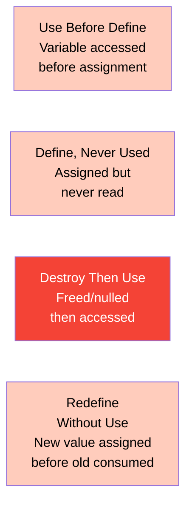

> [!tip] Modern IDEs flag many of these automatically (e.g., "variable used before assignment"). Understanding the underlying classes matters for code inspection and exam questions.

### When Static Analysis Runs

| Timing | Examples |
|--------|---------|
| Before compile-time | IDE warnings, lint checks |
| At compile-time | Type checking, compiler warnings (`-Wall`) |
| After compile-time | SAST tools in CI/CD pipeline |

---

## 5. Whitebox Testing

> **"Tests derived from the internal structure of the code."** Applied primarily at unit and integration testing levels.

### Two Categories

| Category | Purpose |
|----------|---------|
| **Control Flow** | Identify execution paths; design test cases to cover those paths |
| **Data Flow** | Identify improper use of data values due to coding errors |

---

### Control Flow Graphs (CFGs)

A CFG is a directed graph where:
- **Nodes** = statements or statement blocks
- **Edges** = transitions between statements

#### Node Types

| Type | Description | Diagram |
|------|------------|---------|
| **Sequence** | Linear statements | → A → B → |
| **If-then-else** | Binary decision | → D → T or F |
| **Case/Switch** | Multiple exits | → D → C1, C2, C3 |
| **Junction** | Paths converge | T, F → → |
| **While loop** | Condition before body | back-edge when true |
| **Do-until** | Body before condition | executes at least once |

#### Reference Example — Factorial

```
int i=1, facto=1          ← node 1
input num                 ← node 2
if (num < 0)              ← node 3 (DECISION)
  print "nope"            ← node 4
else
  while (i <= num)        ← node 6 (DECISION — back-edge from 9)
    facto = facto * i     ← node 7
    i++                   ← node 8
  end-while               ← node 9 → back to 6
  print(facto)            ← node 10
end-if                    ← node 11
```

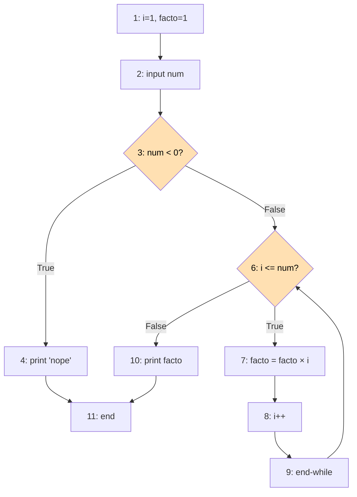

**CFG Stats:** 11 nodes, 12 edges (including back-edge 9→6)
**Three paths:**

| Path | Node Sequence | Trigger |
|------|--------------|---------|
| **P1** | 1→2→3→4→11 | num < 0 |
| **P2** | 1→2→3→6→10→11 | num = 0 (loop skipped) |
| **P3** | 1→2→3→6→7→8→9→6→10→11 | num > 0 (loop runs) |

---

### Coverage Criteria — Hierarchy

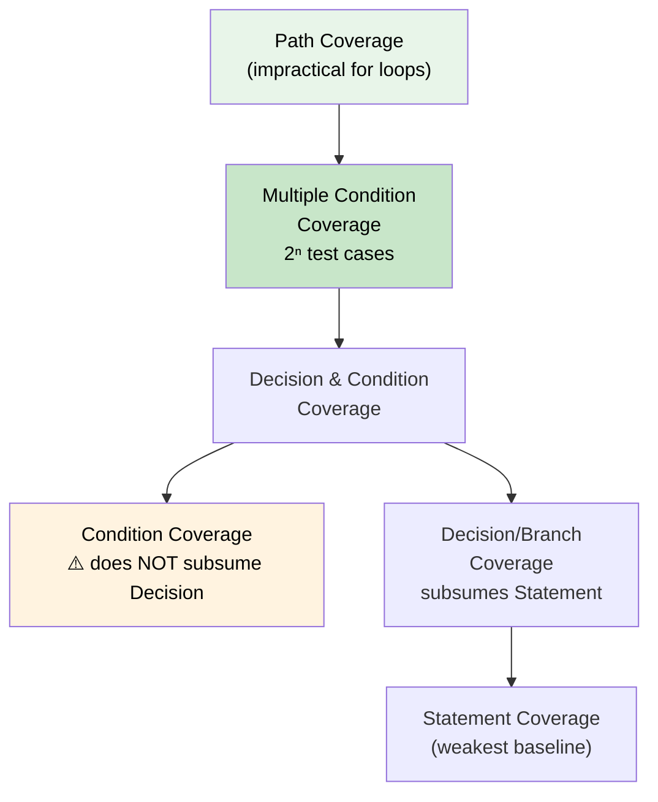

---

### Coverage Criteria — Detail

#### 1. Statement Coverage (Weakest)

> Every executable statement executed at least once.

$$\text{Coverage \%} = \frac{\text{statements executed}}{\text{total executable statements}} \times 100$$

**Factorial:** 2 test cases (num > 0, num < 0) cover all 11 nodes.

---

#### 2. Decision / Branch Coverage

> Every decision's **True** and **False** outcomes each executed at least once. **Subsumes** statement coverage.

$$\text{Coverage \%} = \frac{\text{decision outcomes executed}}{\text{total decision outcomes}} \times 100$$

**Factorial:** 2 decisions (`if`, `while`) × 2 outcomes = 4 outcomes needed.
- Path 1 (num < 0): if→True ✓, while→False ✓
- Path 2 (num > 0): if→False ✓, while→True ✓ (False covered when loop ends)

---

#### 3. Condition Coverage

> Each **individual sub-condition** within a compound decision takes both True and False at least once.

> [!warning] Critical Gap — Condition coverage does NOT subsume Decision coverage!

```
if (X and Y):
    print("tested")
```

| TC | X | Y | Conditions Covered | Branch Taken |
|----|---|---|--------------------|-------------|
| 1 | T | F | X=T ✓, Y=F ✓ | False only |
| 2 | F | T | X=F ✓, Y=T ✓ | False only |

100% condition coverage achieved — but the **True branch is NEVER executed!**

---

#### 4. Decision & Condition Coverage

> Both Condition coverage and Decision coverage satisfied simultaneously — closes the gap above.

---

#### 5. Multiple Condition Coverage

> All possible T/F **combinations** of each condition group are exercised.

For `if (A && B && C)`: 2³ = **8 test cases** required. Subsumes all lower criteria.

---

#### 6. Path Coverage + Loop Coverage

> Every distinct control flow path exercised. Impractical for loops → use Loop Coverage:

| Iteration | Description |
|-----------|------------|
| **Zero** | Loop body never executes (skip condition) |
| **One** | Loop executes exactly once |
| **Typical** | Normal number of iterations |
| **Max** | Maximum feasible iterations |

---

### Coverage Summary Table

| Criterion | Subsumes | Min TCs (Factorial) | Use Case |
|-----------|----------|---------------------|---------|
| Statement | — | 2 | Minimum baseline |
| Decision/Branch | Statement | 2 | Standard CI target |
| Condition | ⚠️ Neither subsumes Decision | 2+ | Compound conditions |
| D & C | Decision + Condition | 2+ | Better practice |
| Multiple Condition | All above | 2ⁿ per group | Safety-critical |
| Path (+ loop) | Multiple Condition | 3+ | Safety-critical only |

---

### Cyclomatic Complexity (McCabe, 1976)

$$\boxed{C = E - N + 2}$$

- **E** = edges in the CFG
- **N** = nodes in the CFG
- **C** = minimum number of **independent basis paths**

**Factorial:** C = 12 − 11 + 2 = **3**

#### Threshold Values

| C Range | Risk |
|---------|------|
| 1–4 | Simple, low risk |
| 5–10 | Marginal, low risk |
| 11–20 | Complex, moderate risk |
| 21–50 | Complex, **high risk** |
| > 50 | **Untestable**, very high risk |

---

### Basis Path Testing

**Basis paths** = independent, non-looping paths that can linearly generate all other paths through a module.

**Independent path:** introduces at least one new statement or edge not seen in previous paths.

**Five-step process:**

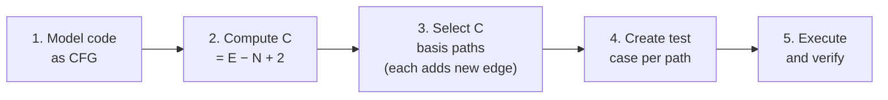

**Guarantee:** Basis path testing guarantees **at least full branch coverage**.

**Factorial (C = 3):**

| Path # | Input | Expected Output |
|--------|-------|----------------|
| 1 | num = −1 | "nope" |
| 2 | num = 0 | 1 |
| 3 | num = 3 | 6 |

---

### LCSAJ — Linear Code Sequence and Jump

LCSAJ breaks code into **tuples (X, Y, Z)**:
- **X** = first statement of the linear sequence
- **Y** = last statement (where the jump occurs)
- **Z** = jump target (another statement or `exit`)

**LCSAJ provides 100% decision coverage.**

> [!example] Simple If-Else Example
> ```
> 1. // begin
> 2. int num
> 3. input(num)
> 4. if (num < 0)
> 5.   print "less"
> 6. else
> 7.   print "more"
> 8. // end
> ```
>
> | Tuple | (X, Y, Z) | Traversed by |
> |-------|-----------|--------------|
> | 1 | (1, 4, 7) | Path 2: num ≥ 0 |
> | 2 | (1, 6, exit) | Path 1: num < 0 |
> | 3 | (7, 8, exit) | Path 2: num ≥ 0 |
>
> **Full coverage with 2 test cases** (X = −5 and X = 5).

---

## 6. Blackbox Testing

> **"Tests derived from the specification without reference to the internal structure."** Applied at all levels, most commonly at system and acceptance testing.

### Five Techniques Overview

| Technique | Best For | Key Strength |
|-----------|---------|--------------|
| **Use Case Testing** | End-to-end flows; integration defects | Detects real-world usage problems |
| **Equivalence Partitioning** | Large input domains | Minimises test cases efficiently |
| **Boundary Value Analysis** | Ranged inputs | High defect yield at boundaries |
| **Decision Table Testing** | Multi-condition logic | Exhaustive condition combinations |
| **State Transition Testing** | FSMs, protocols, UIs | Exposes missing/dead/unspecified states |

---

### 1. Use Case Testing

Tests the system from the **user's perspective** — not the developer's.

#### Use Case Components

| Component | Description |
|-----------|------------|
| **Actors** | Users or external systems interacting |
| **Preconditions** | Must hold before execution |
| **Postconditions** | System state after execution |
| **Primary system flow** | Happy-path sequence |
| **Alternative flows** | Errors, exceptions, alternate paths |

#### What Scenario Tests Detect

1. Defects from **real-world usage** patterns
2. **Integration defects** at component boundaries
3. **Dead-end states** — states the system can enter but cannot exit
4. Defects invisible in isolated unit tests

> [!example] Resource Loan System
> - TC#1: Valid loan (MSP430, ID:001) → grants eligibility, displays to PO
> - TC#2: Invalid item (Chemical X) → fails eligibility, shows error

---

### 2. Equivalence Partitioning (EP)

**Goal:** Minimise test cases while maintaining broad coverage.

**Mechanism:** Divide input domain into groups where every value in a group produces the same result. Test **one representative per partition**.

#### Example — Integer Input 0–100

```
◄─────────────────────────────────────────►
   Invalid 1    |      Valid       | Invalid 2
    x < 0       |   0 ≤ x ≤ 100   |  x > 100
─────────────────────────────────────────────
   e.g. −10           e.g. 50        e.g. 110
```

**Minimum test set:** 3 test cases (one per partition).

#### EP Advantages / Disadvantages

| ✅ Advantages | ❌ Disadvantages |
|---|---|
| Easy to analyse | Excludes some inputs |
| Applicable at all test levels | No rule for selecting value within a partition |
| Minimises test cases | No guarantee all elements behave identically |
| Can partition both inputs **and outputs** | Limited focus on input combinations |

---

### 3. Boundary Value Analysis (BVA)

**Goal:** Design tests specifically at **boundary values** — defects cluster at the edges of ranges.

**Complements EP:** while EP selects one value per partition, BVA selects values **at and just beyond** each boundary.

#### Example — Integer 0–100

```
──────────────────────────────────────────────────────
   Invalid │ Valid Lower │    Valid Interior    │ Valid Upper │ Invalid
           │             │                     │             │
          -1      0       1          99        100     101
                  ↑                             ↑
             Lower valid                    Upper valid
             boundary                      boundary
```

| Value | Type |
|-------|------|
| −1 | Invalid lower boundary (just below) |
| 0 | Valid lower boundary |
| 1 | Low + 1 (extended BVA) |
| 99 | High − 1 (extended BVA) |
| 100 | Valid upper boundary |
| 101 | Invalid upper boundary (just above) |

#### Example — String: First Name (1–10 Capital Letters A–Z)

| Test Value | Type | Boundary |
|-----------|------|---------|
| "G" (1 char) | Valid | Lower length |
| "A" (ASCII 65) | Valid | Lower ASCII |
| "BORDERNAME" (10 chars) | Valid | Upper length |
| "Z" (ASCII 90) | Valid | Upper ASCII |
| null / empty | Invalid | Null boundary |
| "@" (ASCII 64) | Invalid | Just below 'A' |
| "FAKEBIGNAME" (11 chars) | Invalid | Just above upper length |
| "[" (ASCII 91) | Invalid | Just above 'Z' |

> [!warning] Test ASCII boundary and string length boundary in **separate test cases**. Combining them obscures which boundary caused the failure.

#### Four General BVA Rules

| Rule | Guidance |
|------|---------|
| **1** | Range of values → valid tests at each end; invalid tests just beyond each end. Consider output conditions too. |
| **2** | No specified range → use min and max values plus one below and one above. |
| **3** | Sets of values → test each value and set size; for files test first and last records. |
| **4** | Any extreme input or output → test it. |

---

### 4. Decision Table Testing

**Goal:** Model complex logic precisely — every combination of conditions mapped to actions.

**Structure:** Each **column (Rule)** = unique combination of condition values → specific set of actions.

$$n \text{ binary conditions} \Rightarrow \text{maximum } 2^n \text{ rules}$$

#### Example 1 — Movie Ticket Pricing

| Condition | Rule 1 | Rule 2 | Rule 3 | Rule 4 |
|-----------|--------|--------|--------|--------|
| Student? | Yes | Yes | No | No |
| Aged < 21? | Yes | No | Yes | No |
| **Discount** | **15%** | **10%** | **5%** | **None** |

**Test:** one test case per column.

#### Example 2 — Movie Ticket System

| Condition | Rule 1 | Rule 2 | Rule 3 |
|-----------|--------|--------|--------|
| Movie ID valid? | N | Y | Y |
| Payment valid? | — | N | Y |
| Show welcome screen | Y | N | N |
| Reject payment | N | Y | N |
| Supply ticket | N | N | Y |

#### Decision Table Constraints

1. Condition evaluation order does not affect the resulting action
2. Rule evaluation order does not affect the resulting action
3. Once a rule fires, no further rules are examined
4. Multiple actions from one rule: action order is ignored
5. n binary decisions → 2ⁿ maximum cases
6. Find inputs that force **each column (rule)** to execute

---

### 5. State Transition Testing

**Goal:** Design test cases that exercise valid and invalid state transitions in systems with explicit states.

#### Applications

- Communication protocols (human-machine, system-system, module-module)
- User transaction flows with persistent sessions
- OS control functions (security handling, permission states)

#### Components

| Component | Definition |
|-----------|-----------|
| **State** | Unique system situation defined by variables with specific values; has a duration |
| **Transition** | System changes state in response to an input/event |
| **Input/Event** | Causes a transition (considered instantaneous) |
| **Output/Action** | Associated with each input+transition combination |

#### Before Testing — Identify:

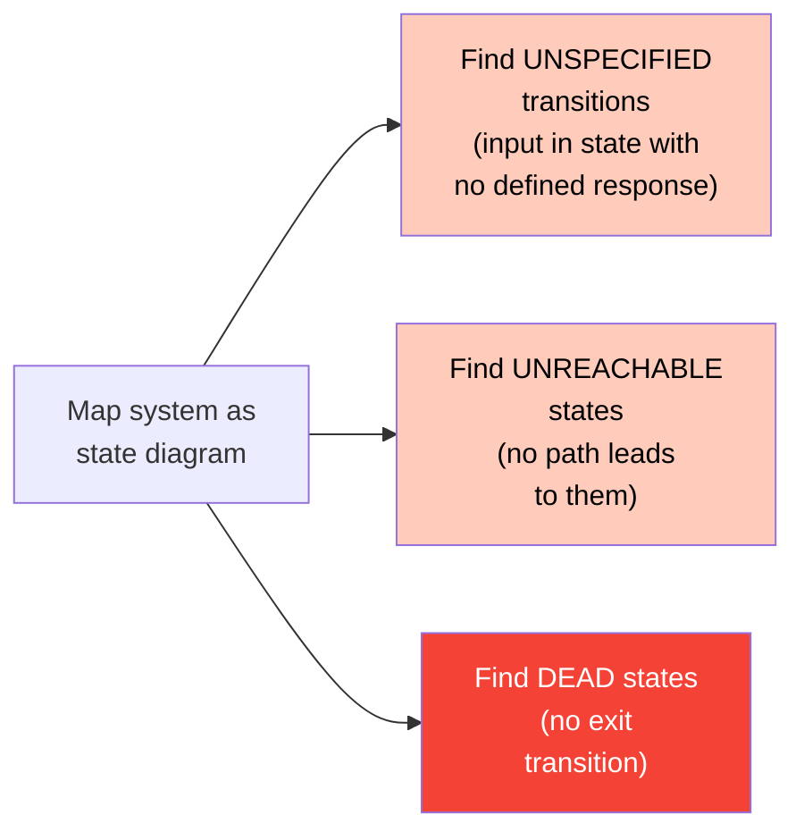

#### Worked Example — Face Recognition Door Lock

**States:** S1 (Wait for Face), S2 (Face Recognised, Door Unlocked), S3 (Wait to Activate System)

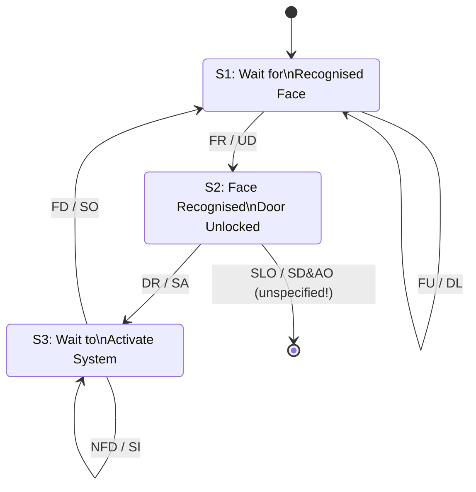

**Event legend:** FU=Face Unrecognised, FR=Face Recognised, DR=Door Reclosed, SLO=Set Lock Off, NFD=No Face Detected, FD=Face Detected

#### 0-Switch Coverage (All Transitions)

One test case per transition:

| TC | Start | Input | Expected Output | End |
|----|-------|-------|-----------------|-----|
| 1 | S1 | FU | DL (Door Locked) | S1 |
| 2 | S1 | FR | UD (Unlocked) | S2 |
| 3 | S2 | DR | SA (Sensors Activated) | S3 |
| 4 | S2 | SLO | SD&AO | **Unspecified** |
| 5 | S3 | NFD | SI (System Idle) | S3 |
| 6 | S3 | FD | SO (System On) | S1 |

**6 test cases** → 0-switch coverage.

#### 1-Switch Coverage (Consecutive Transition Pairs)

Tests every unique **pair** of consecutive transitions. Self-loops excluded.

**10 test cases** → 1-switch coverage.

| Coverage | Also Called | TCs | What It Covers |
|---------|------------|-----|---------------|
| **0-switch** | All-transitions | 6 | Every individual transition once |
| **1-switch** | Switch coverage | 10 | Every consecutive pair of transitions |

---

## 7. Comparing Whitebox vs Blackbox

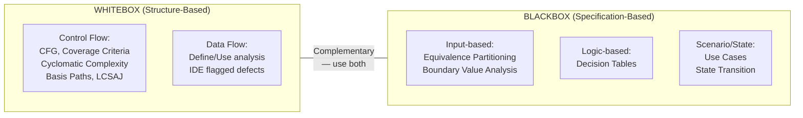

| Dimension | Whitebox | Blackbox |
|-----------|---------|---------|
| Test basis | **Internal code structure** | **Specification / requirements** |
| Code knowledge needed | Full | None required |
| Typical level | Unit, integration | System, acceptance |
| Finds | Logic errors, dead code, unreachable paths | Missing functionality, incorrect behaviour |
| Also called | Structure-based, code-based | Specification-based, functional |

---

## 8. Axiomatic Semantics (Hoare Logic)

> **"Proving programme correctness by logical inference rather than testing."** Introduced by Sir Tony Hoare (1969). ICT3112 Modules 0–8.

### Hoare Triple

$$\{P\} \; C \; \{Q\}$$

- **P** = precondition — must hold *before* C executes
- **C** = command / programme fragment
- **Q** = postcondition — holds *after* C terminates

#### Partial vs Total Correctness

| Type | Meaning |
|------|---------|
| **Partial correctness** | *If* C terminates, then Q holds; does **not** guarantee termination |
| **Total correctness** | C terminates **and** Q holds |

> Hoare's original system is partial. Add a termination variant argument for total correctness.

---

### The Six Inference Rules

#### SKIP

$$\frac{}{\{P\} \; \textbf{skip} \; \{P\}}$$

Skip changes nothing — precondition equals postcondition.

---

#### ASSIGN

$$\frac{}{\{Q[x \leftarrow E]\} \; x := E \; \{Q\}}$$

Work **backwards**: substitute `x ← E` into Q to obtain the precondition.

> [!example] `{?} x := x + 1 {x = 5}` → substitute: `x + 1 = 5` → precondition: `x = 4`.

---

#### CONSEQUENCE (Strengthen Pre / Weaken Post)

$$\frac{P \Rightarrow P', \quad \{P'\} \; C \; \{Q'\}, \quad Q' \Rightarrow Q}{\{P\} \; C \; \{Q\}}$$

Use when the given P is stronger than required, or the given Q is weaker than what the rule produces.

---

#### SEQ (Sequential Composition)

$$\frac{\{P\} \; C_1 \; \{R\}, \quad \{R\} \; C_2 \; \{Q\}}{\{P\} \; C_1 ; C_2 \; \{Q\}}$$

Chain triples through a shared intermediate assertion R. In practice: compute wp backwards from Q.

---

#### IF

$$\frac{\{P \wedge B\} \; C_1 \; \{Q\}, \quad \{P \wedge \neg B\} \; C_2 \; \{Q\}}{\{P\} \; \textbf{if } B \textbf{ then } C_1 \textbf{ else } C_2 \; \{Q\}}$$

Both branches must establish Q; the guard B is added to the precondition of the taken branch and ¬B to the other.

---

#### WHILE

$$\frac{\{I \wedge B\} \; C \; \{I\}}{\{I\} \; \textbf{while } B \textbf{ do } C \; \{I \wedge \neg B\}}$$

I is the **loop invariant**. At exit: invariant holds and guard is false.

---

### Weakest Precondition (WP) Calculus

`wp(C, Q)` = the *largest* set of states from which C terminates in a state satisfying Q.

| Command | wp(C, Q) |
|---------|----------|
| `skip` | Q |
| `x := E` | Q[x ← E] |
| `C₁; C₂` | wp(C₁, wp(C₂, Q)) |
| `if B then C₁ else C₂` | (B ∧ wp(C₁, Q)) ∨ (¬B ∧ wp(C₂, Q)) |
| `while B do C` | Requires loop invariant I |

> **Key rule:** `wp(x := E, Q) = Q[x ← E]` — substitute E for every free occurrence of x in Q.

---

### Loop Invariants

A loop invariant I must satisfy **four obligations**:

| Obligation | Formal Form | Meaning |
|------------|------------|---------|
| **Establishment** | P ⇒ I | Invariant holds before the first iteration |
| **Preservation** | {I ∧ B} C {I} | Loop body maintains the invariant |
| **Exit** | I ∧ ¬B ⇒ Q | Invariant plus loop-exit implies postcondition |
| **Termination** | Variant E ≥ 0 and strictly decreases | Loop terminates |

#### Five-Step Invariant Recipe

| Step | Action |
|------|--------|
| **1. Q** | Write down the postcondition |
| **2. Trace** | Table of variable values at each loop-head pass |
| **3. Generalise** | Replace the final/target value with a *progress variable* |
| **4. Bounds** | Add a counter range (e.g. `0 ≤ i ≤ n`) |
| **5. Check** | Verify all four obligations mechanically |

> **Common variant patterns:** loop counter (`E = n − i`), remaining work (`E = n − k`), value itself (`E = x` when x is decremented).

---

### Array Rules

#### ARRAY-READ

Requires `def(a[i])` — i.e. `0 ≤ i < sizeof(a)` — before reading from an array.

$$\frac{\{P \wedge \text{def}(a[i])\} \; x := a[i] \; \{Q[x \leftarrow a[i]]\}}{}$$

#### ARRAY-ASSIGN

Uses array-update notation `a[i ← E]` for substitution:

$$\frac{}{\{Q[a \leftarrow a[i \leftarrow E]]\} \; a[i] := E \; \{Q\}}$$

`a[i ← E]` = array a with index i overwritten by E. Apply this when computing wp backwards through an array assignment.

---

### Common Invariant Patterns

| Programme structure | Typical invariant form |
|--------------------|----------------------|
| Counter summing to `n` | `total = sum(0..i−1)  ∧  0 ≤ i ≤ n` |
| Running product | `result = init × i  ∧  0 ≤ i ≤ n` |
| Array scan for maximum | `max = maximum(a[0..i−1])  ∧  0 ≤ i ≤ n` |
| Bit-manipulation loop | `x · y + z = x′ · y′` (product invariant) |

---

### Proof Outline Format

```
{P}                          ← precondition
  statement₁
{R}                          ← intermediate assertion
  statement₂
{Q}                          ← postcondition
```

Annotations between statements make each inference step independently verifiable.

---

## 9. Key Formulas Reference Sheet

| Formula | Name |
|---------|------|
| MTBF = MTTF + MTTR | Mean Time Between Failures |
| Availability = MTTF / (MTTF + MTTR) | System availability |
| λ(τ) = λ₀ × e^(−λ₀τ/ν₀) | Basic Musa failure intensity |
| μ(τ) = ν₀ × [1 − e^(−λ₀τ/ν₀)] | Basic Musa expected failures |
| C = E − N + 2 | Cyclomatic complexity |
| 2ⁿ | Max rules in decision table (n binary conditions) |
| Defect Density = Defects / KLOC | Defect rate |
| PUM = Total Problems / Total User Months | Problems per User Month |
| {P} C {Q} | Hoare triple (partial correctness) |
| wp(x := E, Q) = Q[x ← E] | WP for assignment |
| wp(C₁;C₂, Q) = wp(C₁, wp(C₂, Q)) | WP for sequential composition |
| wp(if B then C₁ else C₂, Q) = (B ∧ wp(C₁,Q)) ∨ (¬B ∧ wp(C₂,Q)) | WP for conditional |
| Establishment: P ⇒ I | Loop invariant — initial obligation |
| Preservation: {I ∧ B} C {I} | Loop invariant — body obligation |
| Exit: I ∧ ¬B ⇒ Q | Loop invariant — exit obligation |
| Termination: E ≥ 0, strictly decreasing | Loop invariant — variant obligation |

---

## 10. Exam Checklist

> [!tip] For any Hoare Logic / WP question:
> 1. Identify the **type of statement** (skip, assign, seq, if, while, array)
> 2. For assignments: apply `wp(x := E, Q) = Q[x ← E]` **right to left**
> 3. For sequences: chain wp backwards — innermost statement first
> 4. For loops: identify invariant I using the **5-step recipe** (Q → trace → generalise → bounds → check)
> 5. Check all **four invariant obligations** (Establishment, Preservation, Exit, Termination)
> 6. For arrays: always include `def(a[i])` guard and use `a[i ← E]` notation for array-assign substitution

> [!warning] Hoare Logic Common Mistakes
> - Computing wp **left to right** (it must go **right to left**)
> - Forgetting to substitute into **all free occurrences** of x in Q, not just the first
> - Confusing **partial** correctness (if terminates, Q holds) with **total** (terminates AND Q holds)
> - Omitting the `def(a[i])` guard when applying ARRAY-READ
> - Using `a[i] = E` in place of the correct `a[i ← E]` array-update notation

> [!tip] For any whitebox question:
> 1. Draw the **CFG** first — nodes and edges
> 2. Count E and N → compute **C = E − N + 2**
> 3. Identify the **coverage criterion** asked for
> 4. List the test paths required (remember: Condition ≠ Decision coverage!)
> 5. For basis paths: C independent paths, each introducing at least one new edge

> [!tip] For any blackbox question:
> 1. **EP first** — identify all valid and invalid partitions
> 2. **BVA** — find all boundary values (at, just below, just above each boundary)
> 3. **Decision table** — list all conditions → 2ⁿ columns max → identify irrelevant/impossible combos
> 4. **State transition** — draw the diagram; find unspecified/unreachable/dead states; 0-switch = one TC per transition

> [!warning] Common Mistakes to Avoid
> - Confusing **Verification** (right product?) with **Validation** (right way?)
> - Stating that condition coverage subsumes decision coverage — **it does not**
> - Forgetting the back edge in a CFG loop (it contributes an edge to E)
> - Using KLOC for defect density when the question gives LOC (divide by 1000 first)
> - Forgetting self-loops are **excluded** from 1-switch coverage count
> - Omitting test cases for **invalid partitions** in EP — invalid inputs must also be tested
> - Ignoring **output** boundaries in BVA — outputs can also have boundary conditions
