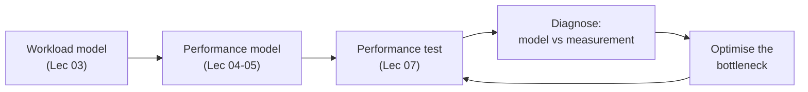
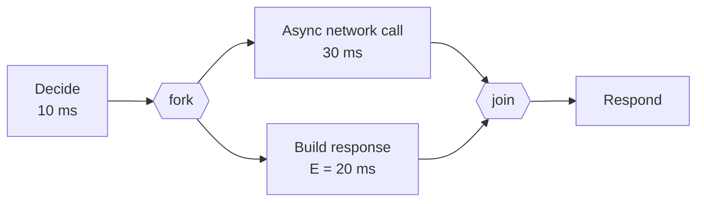
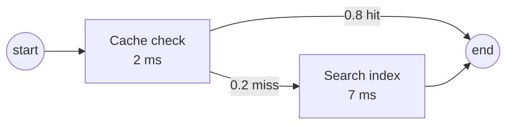
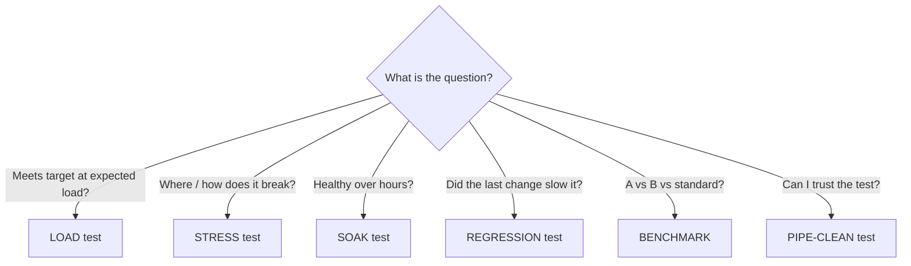

# ICT3113 — Performance Testing and Optimisation Cheat Sheet

> One-stop reference: **what to use, when to use it, and the formula behind it.**
> Derivations and long worked examples: [[ICT3113 - Performance Optimisation Exam Notes]]. Compact formula-only page: [[ICT3113 - Formula Sheet]].
> Items marked **(general)** are standard textbook results that are *not* in the lecture slides.

---

## 0. The Big Picture

| Phase | Question | Tools |
|---|---|---|
| **Measure** | What is it doing now? | Profilers (`cProfile`, `py-spy`), monitors (`psutil`), load generators |
| **Model** | Where are the limits? | Little's Law, operational laws, M/M/1, Kingman, Erlang B |
| **Test** | Does reality match the model? | Load / stress / soak / regression / benchmark / pipe-clean |
| **Optimise** | Fix the *bottleneck* | Reduce V, reduce S, add capacity, cut variance |
| **Deploy** | Keep the gain | Resource limits, autoscaling, headroom |

> [!warning] Golden rule
> Optimise only when (1) the bottleneck is **measured**, not suspected, (2) the gain justifies the cost (Amdahl), and (3) the fix can be **verified with numbers** under the same workload.

---

## 1. Core Metrics and Laws

| Formula | Name | Use it when… | Example |
|---|---|---|---|
| $R = W + S$ | Response time | Splitting any delay into waiting and working | Clinic: 25 + 15 min wait, 10 + 5 min service → R = 55 min, 73% is wait |
| $U = X \times S$ | Utilisation Law | Always. $U = \lambda S$ only if stable ($X=\lambda$) | Pie contest: 5 pies × 10 min each in 60 min → 50/60 = 83% |
| $\rho = \lambda S = \lambda/\mu$ | Traffic intensity | Stability check ($\rho<1$) | λ = 3/s, S = 100 ms → 30% |
| $\mu = 1/S$ | Service rate | Converting S to capacity | S = 10 ms → μ = 100 tps |
| $\lambda_{max} = 1/S$ | Max stable arrival rate (one server) | Quick capacity | S = 6 min → 10 patients/hr |
| $N = X \times R$ | Little's Law | Any stable system or subsystem | 7 req/s × 0.1 s = 0.7 busy DB connections |
| $N_q = X \times W$ | Little's Law (queue only) | Mean queue length | — |
| $\lambda = \dfrac{\text{arrivals}}{\text{window}}$ | Arrival rate | Always use the **whole window** | 4 arrivals in 20 s → 0.2/s (not 1/mean gap) |
| $X = \dfrac{\text{completions}}{\text{window}}$ | Throughput | Supply side; $X<\lambda$ means overload | — |

> [!tip] W/S trick
> **Service time = only the time the server is actively working on *your* request.** Everything else (queueing, interruptions, waiting for results) is wait time.

### Percentiles, tails and SLOs

| Item | Formula / rule | When to use |
|---|---|---|
| Nearest-rank percentile **(general)** | $k = \lceil \tfrac{p}{100}\, n \rceil$ → the k-th smallest of n samples | Computing p95/p99 from a `.jtl` |
| Mean vs median vs p9x | Mean is dragged up by outliers; p95/p99 expose the tail | Pick **p95 or p99** for SLOs, not the mean |
| SLI / SLO / SLA | Metric → target → contract with penalty | "p99 (SLI) < 200 ms (SLO), penalty clause (SLA)" |
| Fan-out tail | $P(\text{≥1 slow}) = 1-(1-q)^N$ | One page triggers N backend calls: q = 1%, N = 100 → **63%** |
| Apdex | $\dfrac{\text{Satisfied} + \tfrac12\,\text{Tolerating}}{\text{Total}}$ | JMeter report. Satisfied ≤ T (500 ms), Tolerating ≤ F (1,500 ms) |
| Perception thresholds | 0.1 s instant · 1 s flow kept · 10 s needs progress bar | Setting response-time targets |

---

## 2. Queueing Models

| Model | Key formulas | Use it when… |
|---|---|---|
| **M/M/1** | $\rho=\lambda S<1$ · $W=\dfrac{\rho}{1-\rho}S$ · $R=\dfrac{S}{1-\rho}$ · $N=\dfrac{\rho}{1-\rho}$ | One server, random arrivals and service; first-order estimate |
| **M/M/c** | $\rho = \dfrac{\lambda S}{c}<1$ (wait needs Erlang C — conceptual) | Thread pool, load-balanced API tier, c GPUs on one queue |
| **G/G/1 Kingman** | $W \approx \dfrac{\rho}{1-\rho}\cdot\dfrac{C_a^2+C_s^2}{2}\cdot S$ | Non-Markov traffic; explaining **why latency is high at moderate U** |
| **G/G/c Sakasegawa** | $W \approx \dfrac{C_a^2+C_s^2}{2}\cdot\dfrac{\rho^{\sqrt{2(c+1)}-1}}{c(1-\rho)}\cdot S$ | Multi-server mechanism (not a point predictor) |
| **Coefficient of variation** | $C=\sigma/\text{mean}$ | $C=0$ regular · $C=1$ Markov · $C>1$ bursty/mixed |

**The hockey-stick:** at low ρ, R ≈ S; as ρ → 1, R → ∞.

| ρ | 0.5 | 0.6 | 0.7 | 0.8 | 0.9 | 0.95 |
|---|---|---|---|---|---|---|
| ρ/(1−ρ) | 1.0 | 1.5 | 2.33 | **4.0** | **9.0** | 19.0 |

**Worked examples**

| Scenario | Working | Answer |
|---|---|---|
| M/M/1, ρ = 0.8, S = 100 ms | R = 0.1/0.2 | R = 500 ms (W = 400 ms) |
| Kingman, ρ = 0.8, Cₐ²=1, Cₛ²=4, S = 100 ms | 4 × 2.5 × 100 | W = **1,000 ms** (2.5× M/M/1) |
| Kingman, ρ = 0.9, Cₛ²=9, S = 50 ms | 9 × 5 × 50 | W = **2,250 ms** vs 450 ms if Cₛ²=1 |
| M/M/c: λ = 8, S = 148 ms, c = 3 → 2 | 8×0.148/3 → /2 | ρ = 0.40 → 0.60; wait 7 ms → 58 ms |

> [!example] One fast vs many slow servers
> Same total capacity: **one fast server gives lower latency** (each job gets the full rate). Many servers win on *fault tolerance, cost and scaling limits*, not on queueing.

---

## 3. Operational Laws, Bottlenecks and Bounds

| Formula | Name | Use it when… | Example |
|---|---|---|---|
| $X_k = V_k \times X$ | Forced Flow Law | Device load from system load | 4 SQL/txn × 25 tps = **100 qps** |
| $D_k = V_k \times S_k$ | Service demand | Total time one txn needs at device k | 4 × 5 ms = 20 ms |
| $U_k = X \times D_k$ | Service Demand Law | Per-device utilisation | 30 tps × 20 ms = 60% |
| $D_k = U_k / X$ | Demand from monitoring | No visit tracing available | — |
| $X \le \dfrac{1}{D_{max}}$ | Throughput ceiling (1 server) | Max system throughput | Checkout: $D_{max}$ = 36 ms (DB) → **27.8 /s** |
| $X \le \dfrac{c}{D_k}$ | Ceiling (c servers) | Multi-server devices | Litho: 3/8.6 h = 8.4 lots/day |
| $R \ge \sum_k D_k$ | Response-time lower bound | Is a target even feasible? | Checkout: 5+10+36+4+25 = **80 ms** |
| $\text{Bottleneck}=\arg\min_k \dfrac{c_k}{D_k}$ | Capacity bottleneck | Finding what saturates first | **Lowest ceiling**, not largest D |

**Background load (Lec 05):** for a resource with capacity $C$, background $b$ and per-request demand $D$ at one request/s:
$\lambda_{max} = \dfrac{C - b}{D}$ → take the **minimum** across devices.

| Device | D | b | Capacity | λ_max |
|---|---|---|---|---|
| Memory | 10 KB | 2 GB | 8 GB | 6 GB / 10 KB ≈ 600,000 /s |
| Disk 1 | 20 MB | 50 GB | 500 GB | 450 GB / 20 MB = 22,500 /s |
| Disk 2 | 100 KB | 500 GB | 2 TB | 1,500 GB / 100 KB = 15,000,000 /s |
| CPU | 0.5% | 0% | 100% | 100 / 0.5 = **200 /s** ← bottleneck |

*(Worked here from the Lec 05 table, taking 1 TB = 1,000 GB. The maximum system rate is the minimum row: 200 req/s.)*

> [!warning] Capacity bottleneck ≠ congestion hotspot
> The *bottleneck* has the lowest ceiling. The *hotspot* is where queueing actually builds. They differ when **variability** (not capacity) drives the queue — e.g. wafer fab: λ = 3.05 vs ceiling 5.6, yet litho queue tripled.

---

## 4. Sizing Formulas ("how many?")

| Question | Formula | Example |
|---|---|---|
| Servers needed | $c = \left\lceil \dfrac{\lambda S}{U_{target}} \right\rceil$ | Flash sale: 2,000 req/s, each server does 100 req/s (S = 10 ms), target 70% → ⌈20 / 0.7⌉ = **29 servers** |
| Concurrent users (open) | $L = \lambda \times W_{session}$ | 20 users/s × 500 s = **10,000** |
| Concurrent users (batch ramp) | $L = \min\!\left(\dfrac{N}{T}\,W,\; N\right)$ | 100 users in 5 s, 10 s sessions → min(200, 100) = **100** |
| JMeter ramp-up for target L | $T = \dfrac{N \times W}{L}$ | N=200, W=5 s, L=100 → **10 s**; W=240 s → **480 s** |
| Closed-system load | $X \approx \dfrac{N}{R+Z}$ | 200 users, Z = 10 s, R = 1.11 s → 18 tps |
| Peak vs average | peak = average × peak factor | 9.3/s × 3 = 28/s (e-filing) |
| Workload chain | population × active % × actions ÷ window × S ÷ U_target | 2 M × 20% = 400 k → 9.3/s → ×3 → ×30 req → 830 req/s → ≈ 24 servers |
| Soak time to failure | $t = \dfrac{\text{free memory}}{\text{slope (MB/min)}}$ | 16 GB ÷ 3.4 MB/min ≈ **3.3 days** |
| Regression threshold | $\Delta = \dfrac{p95_{new}-p95_{base}}{p95_{base}}$ | 0.46 → 0.66 s = **+45%** (flag if > 10%) |

---

## 5. Interactive (Closed) Systems

$$N = X\,(R+Z) \quad\Rightarrow\quad R = \frac{N}{X} - Z$$

- **Use when:** reading load-test output (the tool fixes N and Z, measures X).
- Example: N = 200, Z = 10 s, X = 18 tps → R = 11.11 − 10 = **1.11 s**.
- If X is capped at the bottleneck ceiling, **extra users appear entirely as extra R**, not extra X.

---

## 6. Lost Work — Erlang B

For capacity $m$ (threads, connections, lines, buffer slots) and offered load $\rho = \lambda S$ (Erlangs):

$$B(m,\rho)=\frac{\rho^m/m!}{\sum_{k=0}^{m}\rho^k/k!}$$

**Stable recursion for calculators/code:** $B(0)=1,\; B(m)=\dfrac{\rho\,B(m-1)}{m+\rho\,B(m-1)}$

**Use when:** *a finite pool drops or rejects arrivals* — find the smallest $m$ with $B(m,\rho)\le\varepsilon$.

| m | ρ=0.5 | ρ=0.6 | ρ=0.7 | ρ=0.8 | ρ=1.0 |
|---|---|---|---|---|---|
| 3 | 1.3e-2 | 2.0e-2 | 2.9e-2 | 3.9e-2 | 6.2e-2 |
| 4 | 1.6e-3 | 3.0e-3 | 5.0e-3 | 7.7e-3 | 1.5e-2 |
| 5 | 1.6e-4 | 3.6e-4 | 7.0e-4 | 1.2e-3 | 3.1e-3 |
| 6 | 1.3e-5 | 3.6e-5 | 8.1e-5 | 1.6e-4 | 5.1e-4 |
| 7 | 9.4e-7 | 3.0e-6 | 8.1e-6 | 1.9e-5 | 7.3e-5 |
| 8 | 5.9e-8 | 2.3e-7 | 7.1e-7 | 1.9e-6 | 9.1e-6 |

| Example | Working | Answer |
|---|---|---|
| Router: 300 pkt/s in, 500 pkt/s capacity, drop < 10⁻⁶ | ρ = 300/500 = 0.6; B(7)=3.0e-6 ✗, B(8)=2.3e-7 ✓ | 8 packets × 1,024 B = **8 KiB** buffer |
| DB pool: 7 req/s, S = 100 ms, ≥ 1 free connection 99.9% of the time | Little: N = 7 × 0.1 = 0.7; B(4,0.7)=5.0e-3 ✗, B(5,0.7)=7.0e-4 ✓ | **5 connections** |

---

## 7. Estimating Service Time Before the System Exists (Execution Models)

**Use when:** the system is not built yet, so S cannot be measured. You annotate the design (UML activity or sequence diagram, Smith & Williams 2001) with times and probabilities, then *solve* it for the expected service time. The result feeds straight into the bounds in §3 ($D=V\times S$, $X\le 1/D_{max}$, $R\ge\sum D$) and the sizing in §4.

### 7.1 Method (five steps)

1. **Draw the flow** of one request: activities, messages, branches, parallel paths.
2. **Annotate** each activity with a time estimate (ms) and where it came from (benchmark, vendor figure, similar system).
3. **Annotate** each branch with a probability (must sum to 1) and each loop with an expected iteration count.
4. **Solve** from the inside out using the rules below, giving the expected time per request, $E[S]$.
5. **Feed the bounds:** $D=V\times E[S]$ per device, ceilings $c/D$, then **validate by measurement** once something runs.

### 7.2 Solving rules

| Structure | Rule | Formula | Notes |
|---|---|---|---|
| **Sequence** (A then B) | Add | $t = t_A + t_B$ | Everything on the critical path |
| **Parallel / fork-join** | Longest path | $t = \max(t_A, t_B, \dots)$ | Join waits for the slowest branch |
| **Async with overlap** (call, then work while waiting) | Max of the overlapped parts | $t = \max(t_{wait},\ t_{work})$ | Only overlaps if useful work really happens during the wait |
| **Branch** (probabilities $p_i$) | Weighted average | $E[t]=\sum_i p_i\,t_i$ | $\sum p_i = 1$ |
| **Loop** (expected $k$ iterations) | Multiply | $t = k \cdot t_{body}$ | Use the *mean* iteration count |
| **Retry until success (general)** | Expected attempts | $E[\text{attempts}] = \dfrac{1}{1-p_{fail}}$ | Each failed attempt adds its time (or a timeout) |
| **Repeated device visits** | Visits × time | $D = V\times S$ | Links the model to §3 |

> [!tip] Order of solving
> Work **inside-out**: collapse each branch to its expected value, each parallel block to its maximum, then add the sequence. A common slip is adding the parallel branches instead of taking the maximum.

### 7.3 Worked examples

**Example 1 — async call overlapped with branching work (Lec 05)**
10 ms decision, then a 30 ms async network call; while waiting, build a response: 50% × 12 ms, 40% × 25 ms, 10% × 40 ms.

| Step | Working | Result |
|---|---|---|
| Expected build time | 0.5(12) + 0.4(25) + 0.1(40) = 6 + 10 + 4 | **20 ms** |
| Overlapped block | max(30, 20) | **30 ms** |
| Total | 10 + 30 | **40 ms** |

If the build were *not* overlapped, the total would be 10 + 30 + 20 = 60 ms. The overlap saves 20 ms.

**Example 2 — cache hit or miss (Lec 05)**
Check cache (2 ms). 80% hit → done. 20% miss → query the search index (+7 ms).

$E[S] = 2 + 0.2 \times 7 = \mathbf{3.4\ ms}$ (hit path 2 ms, miss path 9 ms).

Feed the bounds: $D = 3.4$ ms → single-server ceiling $X \le 1/0.0034 \approx \mathbf{294}$ req/s; at a 70% planning target ≈ **206 req/s**.

**Example 3 — MapReduce, serial and parallel phases (Tutorial Wk 5, Q3)**
Map (serial partitioning) → Compute (parallel on $n$ processors) → Reduce (serial). Settings: 15 ms to partition per 1,000 records; 0.1 ms to process a record; 1 ms to reduce per partition.

$$S(n,r)=\underbrace{0.015\,r}_{\text{Map (serial)}}+\underbrace{\frac{0.1\,r}{n}}_{\text{Compute (parallel)}}+\underbrace{n}_{\text{Reduce}}\quad[\text{ms}]$$

| Case | Map | Compute | Reduce | **S** |
|---|---|---|---|---|
| n = 8, r = 100,000 | 1,500 | 12,500 × 0.1 = 1,250 | 8 | **2,758 ms** |
| n = 1 | 1,500 | 10,000 | 1 | 11,501 ms |
| n = 16 | 1,500 | 625 | 16 | 2,141 ms |
| n = 100 (optimum) | 1,500 | 100 | 100 | **1,700 ms** |
| n = 200 | 1,500 | 50 | 200 | 1,750 ms (worse than n = 100) |

- **Optimal processors:** $\dfrac{dS}{dn} = -\dfrac{0.1\,r}{n^2}+1=0 \Rightarrow n^*=\sqrt{0.1\,r}$. For $r=100{,}000$: $n^*=\sqrt{10{,}000}=\mathbf{100}$.
- **Floor:** the serial Map phase (1,500 ms) can never be parallelised away. Going from 8 to 100 processors (12.5× the hardware) only cuts S by 1.62×.
- **Link to Amdahl (general):** serial fraction ≈ 1,500 / 11,501 = 13%, so the maximum speedup is about 1 / 0.13 ≈ 7.7×, and the Reduce term makes very large $n$ *worse*.
- **Use when:** deciding how many workers to buy for a fork-join job. More is not always faster.

**Example 4 — parallel fan-out (new)**
An API gateway spends 5 ms, calls three backends **in parallel** (20 ms, 35 ms, 50 ms), then merges.

| Design | Working | S |
|---|---|---|
| Parallel calls | 5 + max(20, 35, 50) | **55 ms** |
| Sequential calls | 5 + 20 + 35 + 50 | 110 ms |

The slowest backend sets the time. Speeding up the 20 ms call changes nothing; speeding up the 50 ms call helps until it drops below 35 ms. That is the *critical path* idea behind optimising only the bottleneck.

**Example 5 — agent loop with retries (illustrative, links to Wk 9–10 topics)**
Each agent step: one LLM call (800 ms), then two tool calls in parallel (300 ms and 500 ms). Each step fails and is retried with probability 0.1 (assume a failed attempt costs the same time). The task takes 3 steps.

| Quantity | Working | Result |
|---|---|---|
| One attempt | 800 + max(300, 500) | 1,300 ms |
| Expected attempts | 1 / (1 − 0.1) | 1.11 |
| Expected time per step | 1,300 × 1.11 | ≈ 1,444 ms |
| Whole task (3 steps) | 3 × 1,444 | **≈ 4.33 s** (vs 3.9 s with no retries) |

Timeouts, retry policy, caching and fan-out each appear as a number in the model, so you can see which one to attack.

### 7.4 From mean to variability (ties to Kingman)

The expected value hides spread. The same branch probabilities give you $C_s$ for free:

$$\text{Var}(t)=\sum_i p_i\,(t_i-E[t])^2,\qquad C_s=\frac{\sqrt{\text{Var}(t)}}{E[t]}$$

| Model | $E[t]$ | Var | $C_s$ | $C_s^2$ |
|---|---|---|---|---|
| Ex. 1 build step (12 / 25 / 40 ms) | 20 ms | 82 | 0.45 | 0.20 |
| Ex. 2 cache (2 ms or 9 ms) | 3.4 ms | 7.84 | 0.82 | 0.68 |

Plug $C_s^2$ into Kingman ($W\approx\frac{\rho}{1-\rho}\cdot\frac{C_a^2+C_s^2}{2}\cdot S$) to estimate queueing delay *before* building. A rare, very slow branch (a report query, a cache miss to a slow store) raises $C_s$ sharply even when the mean looks harmless.

### 7.5 Common mistakes

| Mistake | Fix |
|---|---|
| Adding parallel branches | Take the **maximum** |
| Branch probabilities do not sum to 1 | Check $\sum p_i = 1$ before solving |
| Assuming async always overlaps | It only overlaps if there is useful work during the wait |
| Using $E[S]$ as a latency guarantee | It is a **mean**; check $C_s$ and the tail |
| Forgetting repeated visits | Multiply by $V$ to get demand $D$ |
| Trusting estimates | Validate once measurable. Course demo: three S values for one service (112 ms sequential, 35 ms inferred, 70 ms at the ceiling); record how each was obtained |

### 7.6 Practice questions (answers hidden below each)

1. A request takes 5 ms of setup, then a branch: 70% of the time a 4 ms path, 30% of the time a 20 ms path. Find $E[S]$ and the single-server ceiling.
2. Three tasks run in parallel (12 ms, 18 ms, 9 ms), followed by a 4 ms merge. Find S.
3. A loop runs on average 3 iterations of 6 ms each, followed by 2 ms of cleanup. Find S.
4. MapReduce with r = 50,000 records and n = 4 processors, using the Example 3 settings. Find S and $n^*$.

> [!note]- Answers
> 1. $E[S]=5+0.7(4)+0.3(20)=5+2.8+6=\mathbf{13.8\ ms}$; ceiling $1/0.0138\approx\mathbf{72}$ req/s.
> 2. $\max(12,18,9)+4=\mathbf{22\ ms}$.
> 3. $3\times6+2=\mathbf{20\ ms}$.
> 4. $S=0.015(50{,}000)+0.1(50{,}000)/4+4=750+1{,}250+4=\mathbf{2{,}004\ ms}$; $n^*=\sqrt{0.1\times50{,}000}=\sqrt{5{,}000}\approx\mathbf{71}$.

---

## 8. Performance Testing

### 8.1 Which test do I need?

| Test | Varies | Look for | Use when… | Course example |
|---|---|---|---|---|
| **Load** | Nothing (hold expected λ) | Flat R, X = λ, errors ≈ 0; decide vs written requirement | Sign-off against the target | 10 req/s × 3 min: p95 120 ms, 0% errors, CPU 16% vs predicted 15% |
| **Stress** | Load ↑ in steps | **Knee** (p95 climbs), **ceiling** (X flat), **failure mode**, recovery | Estimate may be wrong; need limits and graceful degradation | 5→30 req/s on one core: knee 5–10, ceiling ≈ 13–15, 50% errors at 30 |
| **Soak** | Time | Memory **slope**, connection/file-handle growth, R drift | Suspect leaks; long-running service | 3.4 MB/min straight line, no plateau → leak; 16 GB in 3.3 days |
| **Regression** | Build | p95 and X vs baseline; one change per build | Every merge in CI | Duplicate-check scan: p50 +30%, p95 +45% |
| **Benchmark** | Candidate | Side-by-side table; one variable at a time | Choosing between configs/models/vendors (TPC, MLPerf, SPEC) | PBKDF2 25k/100k/400k: p95 110 ms / 480 ms / collapse (83% timeouts) |
| **Pipe-clean** | Nothing (low load) | Assertions that can't fail; counts reconcile | **Before every real run** | Broken path, no body assertion: 100% "pass", 0 orders created |
| Isolation | One component | Which tier owns the time | Full test shows a problem; locate it | Time PBKDF2 alone in a loop |
| UAT | Real users | Does it *feel* acceptable | Validating the targets themselves | 1.9 s vs "2 s" target, users still complain |

> [!example] Pokémon Go (2016)
> Planned for 5×, got 50×. A **load test** at 5× passes and is silent about 50×. A **stress test** finds the ceiling *and the ungraceful failure mode*, motivating admission control or a waiting room.

### 8.2 Open loop vs closed loop

| | Closed loop | Open loop |
|---|---|---|
| Behaviour | Each user waits for reply, thinks, repeats | Arrivals at fixed λ regardless of replies |
| Offered load | $N/(R+Z)$ — **backs off** when system slows | $\lambda$ — queue grows if system falls behind |
| JMeter | Standard Thread Group | Open Model Thread Group / Throughput Shaping Timer |
| Other tools | Locust (default) | k6 constant-arrival-rate |
| Use for | Modelling humans in sessions | Real web traffic; **any result compared with a queueing model** |

> [!warning] A closed-loop result is not evidence of throughput capacity — it hides saturation by sending less load.

### 8.3 Reading a results row

| Column | Check |
|---|---|
| offered | Count λ from the `.jtl`, not the requested rate |
| samples | Excludes warm-up; **must equal** server-log lines |
| p50 / p95 / p99 | Compare to requirement *and to prediction* |
| err % | Defined by **body assertion**, not HTTP status |
| throughput | = offered ⇒ kept up; < offered ⇒ queueing/failure |
| cpu_pct | Compare with $\lambda S/c$ (whole-machine: one core of 8 ≈ 12.5%) |
| rss_mb[app] | Should be constant at constant load; upward line = leak |

**Prediction check (Demo 1):** U = λS/c = 10 × 0.034 / 1 = **0.34** → measured CPU 35–37%. When prediction and measurement disagree, *the gap is where the work is*.

**Ceiling estimates:** $X_{max}=c/S$. Sequential S = 112 ms → 9/s; inferred 35 ms → 28/s; actual ≈ 70 ms → 14/s. Record how each S was obtained.

### 8.4 Writing a testable requirement (Bondi, 10 fields)

| # | Field | # | Field |
|---|---|---|---|
| 1 | Requirement number | 6 | **Derivation of quantities** |
| 2 | Title | 7 | Dependent requirements |
| 3 | **Statement** | 8 | **Assumptions** |
| 4 | Supporting commentary | 9 | **Measurement** |
| 5 | Precedents / sources | 10 | Subject-matter expert |

Fields **3, 6, 8, 9** are where requirements usually fail.

**Template:** *"In [x]% of cases, under [load], the [operation] shall have a [statistic] response time of no more than [n] [unit]."*
Example: *95% of POST /orders complete within 200 ms at 10 req/s (open loop) for 10 minutes on reference hardware.*

**Seven quality checks:** unambiguous · measurable · verifiable · complete · consistent (e.g. 5 req/s × 5 s response needs ≥ 25 in flight by Little's Law — impossible with 2 workers) · traceable · time scale stated.

**Four documents:** requirements (everyone, the contract) → measurement plan (instruments) → test plan (tests, playbook) → capacity management plan (operations).

### 8.5 Test environment and playbook

| Rule | Why |
|---|---|
| Reproducible, controlled, recorded | Someone else must get the same answer; keep raw `.jtl` and server log |
| ≥ 3 runs per configuration | One run is a number, three show whether it means anything |
| Discard warm-up; state window start | Report steady-state only |
| Generator on a different machine | Otherwise it competes for CPU and removes network delay |
| Measure the cost of measuring | Profilers/loggers are load; `cProfile` can double R in pure-Python handlers |
| Match production in **structure** | Same config, data shape/size, state, dependencies (stubs), network hops |
| Scale **all** components together | Ceiling scales with cores; soak lifetime scales with RAM — they don't scale together |
| Write down what the test does not cover | That list is a result |

**Playbook skeleton:** **A** Initialise (log commit hash, record settings, empty store, start monitor) → **B** Run (**B1** one request by hand; run plan; don't touch) → **C** Record (copy logs, **C3 reconcile** samples = server log = stored orders). Counts differ ⇒ discard the run.

### 8.6 Load model

| Element | Rule |
|---|---|
| User types | One script per behaviour; mix matches the workload model |
| Think time | Zero turns users into tight loops. Constant Timer = fixed pause; **Gaussian Random Timer** = varying around a mean |
| Pacing | Big bang (start-up transient) · ramp-up (steady state) · ramp-down (recovery) |
| Load profile | Flat · stepped (stress) · spike · replayed trace |
| Data | From CSV Data Set Config, realistic in size — not the same order 3,000 times |

**JMeter non-GUI:** `jmeter -n -t plan.jmx -l results.csv -e -o report/` (validate in GUI first).

### 8.7 Tools

| Tool | Notes |
|---|---|
| Apache JMeter | Java, GUI to build plans, CLI to run; Open Model Thread Group |
| k6 | JavaScript, CI-friendly, open-loop executors |
| Locust | Python, closed-loop by default |
| LoadRunner | Commercial, large enterprises |

---

## 9. Optimisation

### 9.1 Decision table — symptom → cause → fix (Four Sources)

| Symptom | Source | Law | Fix |
|---|---|---|---|
| High U on one device; throughput plateaus | **Capacity** | $X\le c/D$ | Add servers/replicas, faster hardware |
| Bottleneck busy because each txn asks too much | **Demand** | $D=V\times S$ | Cache (↓V), index/algorithm (↓S) |
| High p95/p99 at moderate U | **Variability** | Kingman | Split heavy/light queues; jitter retries; smooth bursts |
| R grows with users while X is flat | **Population** | $R=N/X-Z$ | Raise ceiling, cap N, admission control |

### 9.2 Technique reference

| Technique | Mechanism | Formula / effect | Use when… |
|---|---|---|---|
| **Indexing** | Lookup structure avoids scans | O(n) → O(log n) | Query scans dominate (the O(n) duplicate check) |
| **Algorithmic** | Better complexity | O(n²) → O(n log n) | Profiler shows a hot loop; AI-generated code |
| **Caching** | Reuse expensive results | $S_{eff}=h\,S_{hit}+(1-h)\,S_{miss}$; also ↓V at the device | Repeated reads; DB is the bottleneck |
| **Concurrency** | Parallel execution | X rises until a resource saturates, then falls with contention | Idle capacity elsewhere |
| **Separate queues** | Isolate heavy from light | Cs² collapses; Kingman W falls | Mixed workloads (report vs standard queries) |
| **Replicas / scale-out** | More servers | Ceiling $c/D$ rises; ρ = λS/c falls | Capacity-bound |
| **Admission control / limits** | Reject early, bound the queue | Stops wasted work on abandoned requests | Stress test showed ungraceful collapse |
| **Headroom** | Run below 70–80% U | Keeps you left of the knee | Interactive systems (uniform batch can run hotter) |
| **Jittered retries** | Spread bursts | ↓ Cₐ | Retry storms, on-the-hour jobs |
| **LLM serving** | Continuous batching; split prefill/decode | ↓ Cₛ (token counts vary) | Inference servers |

**Cache arithmetic:** hit 2 ms, miss 50 ms → 90% hit ⇒ 6.8 ms; 99% hit ⇒ **2.48 ms** (2.7× better from 9 more points of hit rate).

**Amdahl's Law (general):** if a fraction $p$ of the work is improved by factor $s$,
$$\text{Speedup}=\frac{1}{(1-p)+p/s}\qquad \text{limit as } s\to\infty:\ \frac{1}{1-p}$$
Use it to decide whether a fix is worth it: p = 0.6, s = 4 → 1.82×; ceiling 2.5× however fast the part becomes.

**Levers on D = V × S:** halve V (4 → 2 queries) ⇒ halve D ⇒ ceiling doubles at that device.

**Optimisation is iterative:** fix bottleneck → recompute all ceilings → next bottleneck appears.

### 9.3 Verified results from the course

| Case | Before | After | Why |
|---|---|---|---|
| Online service | p95 **3.48 s**, DB Cs² ≈ 34 | p95 **0.44 s** (8×), DB wait 165 → 5 ms | Reports moved to a read replica (variance, not load) |
| Kingman check on DB-RPT | Predicted 0.30 s | Measured 0.27 s (within 8%) | Valid where assumptions hold; over-predicts 2–3× on shared DB-01 |
| Wafer fab | Cycle time 1.8 → 2.2 days | Throughput unchanged | Lost tool: ρ 0.36 → 0.54, Cₐ ≈ 1.5 amplified wait (variability, not capacity) |
| PBKDF2 benchmark | 400k iterations | 83% timeouts | Server hashed for clients that had already left; throughput fell *below* ceiling |

---

## 10. Exam Checklist

1. **Name the source:** Demand / Capacity / Variability / Population.
2. **Draw the system:** devices, visit counts V, server counts c.
3. **Compute demands** $D_k=V_kS_k$, then **ceilings** $c_k/D_k$; bottleneck = lowest.
4. **Pick the right law:** forced flow (device load) · Little (counts) · interactive (closed) · Kingman (tail at moderate U) · Erlang B (drops).
5. **Sanity-check:** U < 1; R ≥ S; R ≥ ΣD; units on every line.

> [!warning] Common traps
> - Using **λ** in $U=\lambda S$ when overloaded — use $U=XS$.
> - Choosing the **largest D** instead of the **lowest c/D** ceiling.
> - Forgetting to divide by **c** (servers).
> - Taking λ = 1 / mean observed gap instead of arrivals ÷ whole window.
> - Trusting **mean** latency; asserting only HTTP **status** (200 with error body passes).
> - Reading falling p50 under load as good — fast failures drag the median down; check the error column.
> - Comparing a **closed-loop** result with a queueing-model prediction.
> - Reporting soak growth instead of **slope**, or one run instead of three.
> - Forgetting the **cap** at total users N in JMeter concurrency.

---

## 11. Symbols

| Symbol | Meaning | Symbol | Meaning |
|---|---|---|---|
| λ | Arrival rate (demand) | N | Number in system / virtual users |
| μ | Service rate = 1/S | Z | Think time |
| S | Service time | V_k | Visits to device k |
| W | Wait (queue) time | D_k | Service demand = V_k S_k |
| R | Response time = W + S | c | Number of servers |
| X | Throughput (supply) | Cₐ, Cₛ | CV of inter-arrival / service times |
| U | Utilisation | ρ | Traffic intensity (λS, or λS/c) |
| B(m,ρ) | Erlang B loss probability | L | Concurrent users |

---

## 12. Profiling Toolkit (Lab 1, Week 2)

**Use when:** you must find *where* one program spends time or memory before optimising it. A profile gives the service time $S$ that the workload model multiplies by $\lambda$ (§1, §4).

### 12.1 Deterministic versus statistical profiling

| | Deterministic (tracing) | Statistical (sampling) |
|---|---|---|
| Mechanism | Instruments every call, return and exception | Samples the call stack $N$ times per second |
| Overhead | High (2–10×); distorts what it measures | Low (a few % or less); safe on production |
| Output | Exact call counts and timings | Estimate: a function's sample share ≈ its time share |
| Tools | `cProfile`, `profile` | `py-spy`, `pyinstrument`, `perf` |
| Use when | Offline; you need call counts or a call graph | Long-running or production process you cannot edit or restart |

### 12.2 Which tool do I need?

| Question | Tool | Call |
|---|---|---|
| How long does this block take? | `time.perf_counter` | `t0 = perf_counter(); …; perf_counter() - t0` |
| Repeatable timing of a snippet | `timeit.repeat` | `repeat(stmt, setup, repeat=10, number=1)` → report **min** |
| Which function is hot? | `cProfile` | `python -m cProfile -s tottime script.py` |
| Whole call tree | `gprof2dot`, `snakeviz` | `.pstats` → `.dot` → `dot -Tpng` |
| Long-running or production process | `py-spy` | `py-spy record --rate 100 --format flamegraph -o f.svg -- python s.py`; `py-spy top --pid N`; `py-spy dump --pid N` |
| Which **line** grows memory? | `memory_profiler` | `@profile` + `python -m memory_profiler`; `%memit` |
| Which **allocation site**, and the peak? | `tracemalloc` | `start()`, `take_snapshot()`, `compare_to()`, `get_traced_memory()` → (current, peak) |
| Which machine produced this number? | `psutil`, `platform` | `cpu_count()`, `cpu_freq()`, `virtual_memory()` |

### 12.3 Reading the output

| `cProfile` column | Meaning | Use |
|---|---|---|
| `ncalls` | Number of calls (`36/1` = 36 total, 1 primitive) | Spot runaway recursion |
| `tottime` | Time in the function **only**, excluding callees | **Optimise here** (sort by it for hot spots) |
| `cumtime` | Time in the function **and everything it calls** | Find expensive call trees |
| `percall` | tottime / ncalls (or cumtime / primitive calls) | Per-call cost |

**Flame graph:** width = share of samples (**not** time order; x is alphabetical), y = stack depth. Wide boxes are where the program lives.

| Formula | Meaning | Example |
|---|---|---|
| $\text{overhead}=\dfrac{t_{profiled}}{t_{plain}}$ | Cost of the profiler | 9.56 s ÷ 1.83 s = **5.2×** under `cProfile` |
| $f_i=\dfrac{n_i}{\sum_j n_j}$ | `py-spy` self-time share (leaf frame) | `func_b` 49%, `func_c` 32%, `func_e` 18% |
| $\text{Speedup}=\dfrac{1}{(1-p)+p/s}$ | Amdahl **(general)** | 2× on a function that is 1% of runtime: $1/(0.99+0.005)=1.005\times$ |
| $T_{fib}(n)=T(n-1)+T(n-2)+1$ | Naive recursion → $O(\varphi^n)$; memoised → $O(n)$ | `fib(30)`: **2,692,537** calls vs memoised `fib(34)`: **35** |

### 12.4 Measured results (Ryzen, 16 logical CPUs)

| Test | Result |
|---|---|
| Insertion ÷ merge sort time, n = 500 / 1000 / 2000 / 4000 | ×6.7 / ×12.6 / ×24.7 / ×50.4 (the ratio grows roughly like $n/\log n$) |
| `cProfile` overhead | 1.83 s → 9.56 s; `py-spy` at 100 Hz: no perceptible slowdown |
| `tracemalloc` peak, n = 2000 | insertion **0.8 KiB**, quick **1.7 KiB**, merge **19.5 KiB** (copies sub-arrays) |
| Same script, local versus Colab (2-core Xeon) | 9.56 s versus 12.79 s: **timings do not transfer; call counts do** (35 calls on both) |

### 12.5 Traps

| Trap | Fix |
|---|---|
| `timeit` runs `setup` **once**: an in-place sort sees sorted data from run 2 | `repeat(..., number=1)` so each run gets fresh setup; report the **minimum** (least disturbed), not the mean |
| Profiler distorts the thing measured | Take an **unprofiled baseline** first |
| Irreproducible inputs | Fix the RNG seed; record the environment (`psutil`) with every result |
| `memory_profiler` samples RSS (≈ 64–125 MiB interpreter baseline) and is unreadable on recursion | Use `tracemalloc` for peaks; it sees Python allocations only |
| `py-spy top` is a terminal UI | Capture `--format raw`, attribute each sample to its leaf frame |
| No Graphviz `dot` on Windows | Read `.pstats` and bar-chart with matplotlib |
| Handout `fib` recurses on `n-1` instead of `n-2`: every cached value shifts by one index and the driver's `fib_dict[n-1]` cancels it | "Final number correct" ≠ "cache correct": spot-check intermediates (`fib_dict[10]` should be 55). A profiler cannot catch this |

**Method:** record environment → fix inputs → unprofiled baseline → `cProfile` (exact) or `py-spy` (low overhead) → optimise the top `tottime` → re-measure → repeat until flat or on target.

---

## 13. Flask + JMeter Lab (Lab 2, Week 3)

Stack: Flask `/sort` endpoint, `flask-profiler` (`@flask_profiler.profile()`, sqlite storage, dashboard at `/flask-profiler/`), JMeter 5.6.

### 13.1 Plan and sizing

| Item | Rule |
|---|---|
| Build order | Validate in the GUI (Thread Group → HTTP Request → View Results Tree), then run **non-GUI** |
| Command | `jmeter -n -t plan.jmx -Jthreads=50 -Jrampup=5 -Jloops=10 -l results.csv -e -o report/` |
| Parametrise | `${__P(threads,1)}` etc., so one plan serves every run |
| Arrival rate | $\lambda = \text{threads}/\text{ramp-up}$: 50/5 = 10 users/s; 5000/50 = 100 users/s |
| Samples | $\text{threads}\times\text{loops}\times\text{samplers per loop}$: 50 × 10 = 500 |
| Concurrent users | $L=\lambda W$ (Little), capped at $N$ (§4) |
| Knee | Plot response time against active threads; the knee is where R leaves its flat region. Lab reference: R < 50 ms up to ≈ **17 concurrent users** |
| Reference stress recipe | 5000 threads, 50 s ramp-up on the instructor's CPU: machine-specific, a recipe and not a result |
| Think time | Constant Timer (fixed) or Gaussian Random Timer (mean = offset, spread = deviation) |

### 13.2 The "recursive use of cursors" crash

| Step | Finding |
|---|---|
| Symptom | 50 threads, 5 s ramp-up, 10 loops: **100% errors**, server dead in ≈ 5 s, `sqlite3.ProgrammingError: Recursive use of cursors not allowed` |
| Root cause | Flask `app.run()` is **threaded by default** (since 1.0), and flask-profiler's sqlite backend shares **one cursor** for the app's lifetime. `check_same_thread=False` lifts the thread guard but does not make concurrent `execute()` on one cursor safe |
| Control run | Same plan with `threaded=False`: **0% errors**, 500/500, average 158 ms |
| Fixes | `threaded=False` (trades concurrency); a `threading.Lock` around the cursor; MongoDB storage engine (`pymongo==3.13.0`, pooled per-thread connections, needs `mongod`) |

> [!tip] Method
> Isolate the cause by changing **one variable** (the threading model). Do not blame the load tool or the network without a control run.

### 13.3 Lab lessons

- **The profiler is an observer.** It writes every call to storage and can limit the throughput of the system under test. flask-profiler time is wall-clock (running **plus** waiting on I/O and GIL contention).
- **View Results Tree** stores every sample: remove it for real runs; use non-GUI mode plus the HTML dashboard.
- **Tester and server on one machine** compete for CPU and give less accurate results; separate them (Docker Compose).
- **Close the profiler dashboard** during a load test: each load fires about 10 asset and API calls (and a 308 redirect to `/flask-profiler/`).
- **Read the server log line** before blaming the endpoint (one 404 came from a URL pasted after the Colab host).
- **`curl` needs `-g`** (or quotes) for URLs containing `[ ]`.
- **Virtual environments:** `python -m venv test_env` → activate → `pip install flask flask-profiler==1.8.1`; `pip freeze` isolates versions per project.
- **Apdex = 0.000** when every response exceeds T (for example `time.sleep(5)` against T = 500 ms).

---

## 14. Assignment 1: Ticket Triage Service

**Task:** test an intentionally naive, CPU-only LLM ticket classifier (7 categories) to get an honest baseline before the optimisation assignment.

### 14.1 Method

1. **Golden test set first** (150–200 items): labels before any model exists; drop the noisy source label so raters are not anchored; resolve disagreements.
2. **Baseline = the straightforward version:** synchronous `POST /tickets`, no cache, no queue, a fresh SQLite connection per request. Do **not** pre-optimise.
3. **Instrument:** one JSON line per request and per classification (`ticket_id`, `model`, `category`, `classify_latency_ms`, `fallback_used`). Every JMeter number must reconcile with a log entry.
4. **Swap the model only through an environment variable** (`OLLAMA_MODEL`): 3–5 pinned models across at least 2 size classes under an identical harness.
5. **Apply §8:** load (expected λ) · stress (find the knee: Ollama CPU, SQLite lock contention) · pipe-clean (assert the body category is one of the 7) · benchmark per model (one variable at a time).

Classifier fallback: exact match → substring match → fixed fallback category. `fallback_used` separates "the model was wrong" from "the model ignored the output format".

### 14.2 Formulas

| Quantity | Formula | Example |
|---|---|---|
| Accuracy **(general)** | correct ÷ total | — |
| Fallback rate **(general)** | `fallback_used` ÷ total | — |
| Cohen's κ (2 raters) | $\kappa=\dfrac{p_o-p_e}{1-p_e}$ | $p_o=0.80$ (40 of 50), 3 equally used categories → $p_e=1/3$ → κ = 0.467/0.667 = **0.70** |
| Fleiss' κ (3+ raters) | $\kappa=\dfrac{\bar P-\bar P_e}{1-\bar P_e}$ | Same idea, averaged over items |
| Interpretation (Landis & Koch, **general**) | < 0 poor · 0–0.20 slight · 0.21–0.40 fair · 0.41–0.60 moderate · **0.61–0.80 substantial** · 0.81–1 almost perfect | κ is below raw agreement because chance agreement is subtracted |

Practical tips: read the CSV with `csv.DictReader` (quoted narratives contain newlines, so `wc -l` overcounts); use `with TestClient(app)` so start-up events run; mock `classify` when Docker or Ollama is unavailable.

---

## 15. Capacity-Planning Formulas (Tutorial Week 4)

| Quantity | Formula | Example |
|---|---|---|
| End-to-end yield | $Y=\prod \text{pass rates}$ | 0.90 × 0.975 = **87.75%** |
| Required incoming | $\text{target}/Y$ | 100,000 ÷ (0.96 × 0.95) = 109,650 /day (round up) |
| Mixed-workload demand | $D=\sum p_i D_i$ | 0.9(5) + 0.1(30) = **7.5 ms**; 120 req/s × 7.5 ms = 90% |
| Mean fan-out | $V=\sum p_i V_i$ | 0.9(2) + 0.1(8) = 2.6; × 1,200 = **3,120 qps** |
| Retry visits | $V=\dfrac{1}{1-p_{fail}}$; attempts/s = $X\cdot V$ | p = 0.1: 1.111; 90 → 100 attempts/s; U = 100 × 8 ms = **80%** |
| Instances needed | $m=\left\lceil\dfrac{\lambda S}{U_{cap}}\right\rceil$ | 250 × 0.04 = 10 Erlangs; 10 ÷ 0.8 = 12.5 → **13** (76.9%) |
| Max rate from the bottleneck | $X_{max}=c/S$, then × downstream pass rate | 24 × 25/s = 600 attempts/s × 0.96 = **576 orders/s** |
| Propagate upstream | $\lambda_{up}=\lambda_{down}/\text{pass rate}$ | 600 ÷ 0.80 = 750 req/s; 250 per validator × 2 ms = **50%** |
| Thread-pool check | $\bar n=\lambda R$ against thread count (mean, not peak) | 250 × 0.12 = 30 < 48 threads; saturates at R = 48/250 = **192 ms** |
| SLO tail count | $(1-p)\times N$ | 5% × 1,080,000 = **54,000** above p95 |
| Growth to saturation | $t=\dfrac{\ln(1/U_0)}{\ln(1+g)}$ | $U_0=0.8$, $g=20\%$: **1.22 years** |
| Query optimisation | $X_{max}=U_{cap}/D_{new}$ | 0.8 ÷ 1.25 ms = 640 req/s < 691 (year-3 peak): buys ≈ 2.6 years |
| Read replicas | $D_{primary}=(1-r)D+\dfrac{rD}{1+k}$ | $r=0.7,\ k=2$: 0.6 + 0.467 = 1.067 ms → U = 691.2 × 1.067 ms = **73.7%** |

> [!tip] Pattern
> Find the bottleneck → compute U at the planning horizon → compare each option against the U cap (70–80%).
