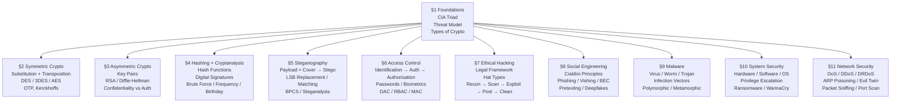
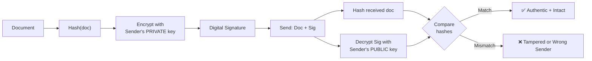
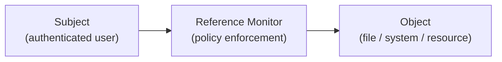
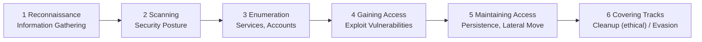

# INF2005 Cyber Security Fundamentals
## Complete Exam Study Notes

> [!tip] How to Use These Notes
> Start with the **Module Map** to orient yourself, then drill each section in order. The **Access Control** section (§5) is the most practically detailed. **Cryptanalysis** (§4) and **Pen Testing Stages** (§7) are the most likely long-answer exam areas. Keep the [[INF2005 - Formula Sheet|Formula Sheet]] open alongside this for quick formula look-up.

---

## Module Map



---

## §1 — Foundations

### The CIA Triad

> [!warning] Most Examined Concept
> Every security control maps back to one or more CIA properties. Always state *which* property a technique supports in exam answers.

| Property | Meaning | Supported by |
|----------|---------|--------------|
| **Confidentiality** | Only authorised parties can read the data | Symmetric encryption, asymmetric encryption |
| **Integrity** | Data has not been altered in transit or at rest | Hashing, digital signatures |
| **Availability** | Systems and data are accessible when needed | Backups, redundancy, DoS defences |

### The Threat Model (Alice, Bob, Eve)

```
Alice ──[plaintext]──► Encrypt(key) ──[ciphertext]──► Decrypt(key) ──[plaintext]──► Bob
                                              │
                                              ▼
                                          Eve (eavesdropper)
                                    sees ciphertext; cannot read it
                                    without the key
```

Eve can **intercept** the ciphertext on the insecure channel, but without the key the data is unintelligible.

### Types of Cryptography

| Type | Keys | Direction | CIA Goal |
|------|------|-----------|----------|
| **Symmetric** | Single shared key | Enc + Dec with the same key | Confidentiality |
| **Asymmetric** | Key pair (public + private) | Public enc / private dec (or reversed) | Confidentiality **or** Authentication |
| **Hashing** | No keys | One-way only (no decryption) | Integrity, Authentication (signatures) |

---

## §2 — Symmetric Cryptography

### Classical Ciphers

#### Substitution Ciphers — *change the characters*

| Cipher | Mechanism | Example |
|--------|-----------|---------|
| **Caesar** (monoalphabetic) | Shift every letter by a fixed amount | Shift 3: `HELLO` → `KHOOR` |
| **Vigenère** (polyalphabetic) | Repeating keyword drives a different shift per position | Key `ALICE`, `HELLO` → `HPTNS` |

> [!note] Mono vs Poly
> Monoalphabetic = one fixed substitution alphabet → vulnerable to frequency analysis.
> Polyalphabetic = multiple alphabets keyed to position → resists simple frequency analysis.

#### Transposition Ciphers — *move the characters*

| Cipher | Mechanism | Example |
|--------|-----------|---------|
| **Simple reversal** | Reverse the string | `UNIVERSITY` → `YTISREVINU` |
| **Rail Fence** | Write in zig-zag across N rails, read row by row | `HELLOBOB` / 2 rails → `HLOOELBB` |
| **Columnar Transposition** | Write into grid row-by-row; read columns in keyword order | Key `RED`, `HELLOWORLD` → `LWLX EORX HLOD` |

### Kerckhoffs's Principle

> *"The security of a cryptosystem must not depend on the secrecy of the algorithm; it should only depend on the secrecy of the **key**."*

**Implication:** even if an attacker knows exactly how Caesar cipher works, they still can't decrypt without the shift key. Design systems so that the *algorithm* can be public — only the *key* must remain secret.

### Modern Symmetric Algorithms

| Algorithm | Key Length | Block Size | Status |
|-----------|-----------|------------|--------|
| **DES** | 56-bit effective | 64-bit | **Broken** — cracked in <24 hrs (2002); 16 rounds of S-P-XOR |
| **3DES** | 168-bit (3×56) | 64-bit | **Deprecated from 2024** — small block vulnerable to birthday attacks; uses Ek1 → Dk2 → Ek3 |
| **AES** | 128 / 192 / 256-bit | 128-bit | **Current standard** — theoretically vulnerable to quantum computing |

> [!tip] DES → 3DES → AES progression
> Increasing key length is driven by increasing computing power making shorter keys brute-forceable.

### One-Time Pad (OTP)

- Key is **at least as long as the plaintext**; used **once only**; must be **truly random**
- **Theoretically unbreakable** — but impractical at scale (key distribution problem)
- Real-world analogues: 2FA codes, hardware dongles

### Random Number Generators

| Type | Source | Security |
|------|--------|----------|
| **True RNG** | Physical entropy: mouse movement, fan noise, thermal noise | Cryptographically strong |
| **Pseudo RNG** | Mathematical formula + seed | **Predictable if seed is known** — do not use for OTP keys |

---

## §3 — Asymmetric Cryptography

### The Key Distribution Problem

Symmetric crypto requires the shared key to reach the recipient securely *before* communication begins — but on an insecure channel, how? Asymmetric crypto solves this.

### Key Pair Roles

```
Default roles:
  Public key  ──► ENCRYPTS  (anyone can send you a confidential message)
  Private key ──► DECRYPTS  (only you can read it)

Reversed roles:
  Private key ──► ENCRYPTS  (proves the message came from you — "signing")
  Public key  ──► DECRYPTS  (anyone can verify the signature)
```

### Confidentiality vs Authentication

| Goal | Encrypt with | Decrypt with |
|------|-------------|-------------|
| **Confidentiality** | Recipient's **public** key | Recipient's **private** key |
| **Authentication** | Sender's **private** key | Sender's **public** key |

#### Combined (Authentication + Confidentiality)

Alice sends a secure, authenticated message to Bob:

1. Alice encrypts with **her own private key** → signs it
2. Alice encrypts result with **Bob's public key** → sealed for Bob only
3. Bob decrypts with **his private key** → unseals
4. Bob decrypts again with **Alice's public key** → verifies Alice's signature

### One-Way Functions

The security of asymmetric crypto relies on problems easy to compute forward but infeasible to reverse:

| Problem | Easy direction | Hard direction |
|---------|---------------|----------------|
| **Modular arithmetic** | Compute `a mod n` | Recover `a` from result alone |
| **Prime factorisation** | Multiply two primes: `p × q = n` | Factor `n` back to `p` and `q` |
| **Discrete logarithm** | Compute `G^a mod p` | Recover `a` from `G^a mod p` |

### RSA

**Key generation (know all 6 steps):**

1. Pick two large distinct primes `p` and `q`
2. Compute `n = p × q`
3. Compute Euler's totient: `φ(n) = (p−1)(q−1)`
4. Pick `e` where `1 < e < φ(n)` and `gcd(e, φ(n)) = 1`
5. Compute `d` such that `d × e ≡ 1 mod φ(n)`
6. **Public key = (e, n)** · **Private key = (d, n)**

> [!warning] Common RSA Confusion
> Encryption/decryption use modulus `n`. Key *generation* uses modulus `φ(n)`. These are different.

**Security foundation:** knowing `e` and `n` (both public) does not let you compute `d` without factoring `n`.

### Diffie–Hellman Key Exchange

> [!important]
> DH is **not** encryption — it establishes a **shared secret key** that both parties can then use with a symmetric cipher. No key is ever transmitted.

**Setup:** publicly agree on prime `p` and generator `G`.

```
Alice                             Bob
Choose secret a                   Choose secret b
A = G^a mod p ────────────────►
              ◄──────────────── B = G^b mod p
K = B^a mod p                     K = A^b mod p
Both arrive at K = G^(ab) mod p   (same shared secret)
```

An eavesdropper sees `p`, `G`, `A`, `B` — but cannot compute `K` without solving the discrete logarithm problem.

---

## §4 — Hashing, Digital Signatures & Cryptanalysis

### Hash Functions

A hash function takes **arbitrary-length input** → produces **fixed-length digest**. It is **one-way**: given the digest, you cannot recover the input.

**Two required properties:**
1. **One-way (pre-image resistance)** — cannot find a message `m` such that `hash(m) = h`
2. **Strong collision resistance** — cannot find two *different* messages `m₁ ≠ m₂` where `hash(m₁) = hash(m₂)`

**CIA contribution:** primarily **Integrity**; combined with signing → Authentication.

| Algorithm | Digest Size | Status |
|-----------|------------|--------|
| **MD5** | 128 bits | **Broken** — collision demonstrated 2004 |
| **SHA-1** | 160 bits | **Broken** — practical collision demonstrated |
| **SHA-256** | 256 bits | Currently secure |
| **SHA-384 / SHA-512** | 384 / 512 bits | Currently secure |

### Digital Signatures



**Provides:** Authenticity (who sent it) + Integrity (not altered). Not confidentiality on its own (document is still visible unless separately encrypted).

### Birthday Attack

Named after the birthday paradox: in a group of 23 people, >50% chance two share a birthday — because you're comparing *every pair*, not one against all.

**Applied to hashing:** finding *any two inputs* that produce the same hash is far easier than finding a second input matching a *specific* hash. This is why 64-bit blocks (DES) and 128-bit digests (MD5) are insecure — the effective collision resistance is only half the digest length in bits.

### Cryptanalysis — Attacking Ciphers

| Attack | What the attacker has | What they do | Best against |
|--------|----------------------|--------------|--------------|
| **Brute Force** | Just ciphertext | Try every possible key; needs ~half the keyspace on average | Small key spaces / weak algorithms |
| **Frequency Analysis** | Just ciphertext | Count letter frequencies; E=12.51%, T, A, O, I most common | Monoalphabetic substitution and transposition ciphers |
| **Known Plaintext** | Both plaintext + its ciphertext | Infer key from `C = (P + K) mod 26` | Any cipher where paired samples are obtainable |

> [!note] Frequency Analysis — Key Fact
> Transposition ciphers change character *positions* but not their *frequencies* — so frequency analysis still works on them.

---

## §5 — Steganography

### Steganography vs. Cryptography

| | Cryptography | Steganography |
|---|---|---|
| **Hides** | Content of the message | **Existence** of the message |
| **What the attacker sees** | Obviously encrypted data | An ordinary-looking file |
| **CIA contribution** | Confidentiality | Obscurity (security through obscurity) |

> The two can be **combined**: encrypt the payload first, then hide the ciphertext in a cover object.

### The Core Process

```
Payload  ───┐
            ├──► Steganography algorithm ──► Stego Object (looks like an ordinary file)
Cover Object ──┘
```

- **Payload** — the secret data to hide
- **Cover Object** — the carrier (image, audio, text)
- **Stego Object** — the output that contains the hidden payload

Steganography exploits **redundancy**: parts of the carrier file that can be altered without perceptible change.

### LSB (Least Significant Bit) Algorithms

Each RGB pixel byte has 8 bits. Changing **only the rightmost bit** causes a ≤1/255 change to the pixel value — visually imperceptible.

> [!warning] Format Constraint
> LSB works **only on lossless formats** (PNG, TIFF, BMP). Lossy compression (JPEG) destroys embedded LSB data.

| Variant | How it works | Statistical detectability |
|---------|-------------|--------------------------|
| **LSB Replacement** | Directly replace LSB of cover pixel with payload bit | Higher — creates detectable asymmetry |
| **LSB Matching** | If LSB ≠ payload bit, randomly ±1 the pixel value | Lower — avoids hard-flip pattern |

**Capacity:** only **50% of LSBs change on average** (Replacement), since half already match the payload bit.

### Bit Planes

Each colour channel decomposes into **8 bit planes** (one per bit position, 0 = LSB, 7 = MSB):

- **High planes** (7, 6, 5) → retain the visible structure of the image
- **Low planes** (0, 1, 2) → look like random noise

This explains why LSB changes are invisible: the 0th plane already appears as noise.

### BPCS (Bit Plane Complexity Segmentation)

Instead of always using the LSB plane, hide data in **any complex (noisy) region** of any bit plane.

**Complexity measure** for an 8-byte segment/block:

```
c = (number of bit-value transitions) / 112

where 112 = 2 × 8 rows × 7 max transitions per row

If c > T (threshold, typically 0.3) → segment is "complex" → usable for hiding
```

**Algorithm:**
```
While payload remains:
    Get next bit plane
    For each complex segment in the plane:
        Get next payload block
        If payload block is complex: hide it directly
        Else: conjugate (XOR) it to make it complex, then hide it
```

**Advantage over LSB:** can hide more data without visible degradation; uses any bit plane, not just the least significant.

### Steganalysis (Attacking Steganography)

| Technique | Method |
|-----------|--------|
| **Visual** | Black-and-white filter (even pixels → black, odd → white) makes LSB changes visible; difference image between original and stego |
| **Statistical** | Analyse pixel-value distribution for irregularities introduced by embedding |
| **Tool-based** | Automated detection software |

---

## §6 — Access Control

### The Three-Stage Pipeline

```
Identification ──► Authentication ──► Authorisation
 (who are you?)   (prove it)          (what can you do?)
```

### Authentication Categories (The Three Factors)

> [!tip] Exam Mnemonic
> **KTB** — **K**nowledge / **T**oken / **B**iometrics

| Factor | Basis | Examples |
|--------|-------|----------|
| **Knowledge** | Something you **know** | Password, passphrase, PIN, graphical password |
| **Token** | Something you **have** | Smart card, eToken, RFID tag, mobile device |
| **Biometrics** | Something you **are** | Fingerprint, iris, retina, face, gait, voice |

**Multi-Factor Authentication (MFA/2FA):** combines two or more factor types — significantly stronger than any single factor.

### Passwords

#### Secure Storage — Progressive Hardening

| Method | Weakness |
|--------|----------|
| Store **plaintext** | One breach = all passwords exposed |
| Store **encrypted** | Reversible — key compromise = all exposed |
| Store **Hash(password)** | Vulnerable to precomputed rainbow tables |
| Store **Hash(password + salt)** ✅ | **Best** — salt defeats precomputed tables |

**Salt:** a random string appended before hashing. Since each user gets a unique salt, attackers cannot reuse precomputed tables — every password must be cracked individually.

#### Password Attacks

| Attack | Method | Defence |
|--------|--------|---------|
| **Brute Force** | Try all combinations | Long passwords; account lockout |
| **Dictionary Attack** | Try known/common passwords + variants | Avoid dictionary words; salted hashing |
| **Rainbow Table** | Precomputed hash→password lookup | **Salting** renders these useless |
| **Social Engineering** | Mine personal details from social media | User education; avoid personal passwords |
| **Google Dorking** | `ext:csv inurl:passwd` — find exposed credential files | Correct file permissions; proper .htaccess |

#### Passphrase Technique
`"i love to watch physical 100 on netflix every friday, saturday and sunday"` → take nth letter of each word → `iltwp100one56a7` (long, memorable, not in any dictionary)

### Graphical Authentication

| Type | Method | Vulnerability |
|------|--------|--------------|
| **Recognition-based** | Pick passimages from challenge set | Shoulder surfing |
| **Cued-recall** | Click specific points on an image | "Hotspots" — people click obvious features |
| **Recall-based** | Draw a pattern (e.g. Android unlock) | Smudge attacks; limited effective pattern space |

Password space for recognition-based: `(set_size)^(rounds)` — e.g. 1 of 9 images, 5 rounds → 9⁵ = 59,049.

### Token Authentication

| Token | Technology | Key Features |
|-------|-----------|--------------|
| **eToken** | USB key / smart card / mobile | Stores keys/certificates; 2FA; digital signing |
| **Smart Card** | Embedded microprocessor | JavaCard/MULTOS multi-app; PIN storage; tamper-resistant |
| **RFID Tag** | RF-powered IC + antenna | Passive (reader-powered) or active (battery); ~2KB storage |

**RFID vulnerabilities:** OTA spoof, MITM sniffing, side-channel power analysis.

### Biometric Authentication

#### Requirements of a Good Biometric

> [!note] Acronym: UDPC
> **U**niversality · **D**istinctiveness · **P**ermanence · **C**ollectability

| Property | Meaning |
|----------|---------|
| **Universality** | Every person must have the characteristic |
| **Distinctiveness** | Any two people differ sufficiently |
| **Permanence** | Characteristic stays stable over time |
| **Collectability** | Can be quantitatively measured |

#### Accuracy Metrics

- **FAR (False Accept Rate)** — wrongly grants access to an impostor (ideally 0)
- **TAR (True Accept Rate)** — correctly grants access to the legitimate user (ideally 1)
- **ROC curve** — plots TAR vs FAR across threshold settings; higher TAR typically means higher FAR

#### Biometric Modality Comparison

| Modality | Uniqueness | Accuracy | Speed | Cost | Notes |
|----------|-----------|----------|-------|------|-------|
| **Retinal** | ~400 features | Most accurate (~20 000× fingerprint) | 15 s enrol; ≥10 s verify | $100K+ | Most invasive; changes with glaucoma |
| **Iris** | 256 features | FAR ~1 in 10M; more than fingerprint | Few seconds enrol; <5 s verify | $200–$2000 | Less invasive than retinal; equal in twins |
| **Fingerprint** | ~1 in 64B | ~1 in 100K false positive | <1 s (contactless); 5–10 s (contact) | $30–$1000 | Affected by dryness/injury |
| **Facial** | Geometric landmarks | >90% with ML; FAR ~1 in 1M | <1 s both | $90–$1500 | Vulnerable to spoofing; racial accuracy bias |
| **Gait (behavioural)** | Posture/movement | ~99.3% with AI | Continuous | High | Changes with weight/injury |
| **Keystroke dynamics** | Typing timing | Moderate | Low overhead | Low | Subtle; changes with fatigue |

> [!warning] Bias in Facial Recognition
> Facial recognition false-positive rates for Asian and Black individuals can be up to **100× higher** than for white individuals — a significant fairness and reliability concern.

### Authorisation Models



| Model | Who sets access rules | Mechanism | Security level |
|-------|----------------------|-----------|----------------|
| **DAC** (Discretionary) | **Resource owner** | ACLs + capability tables; Owner/Group/Other categories | Lowest |
| **RBAC** (Role-Based) | **System administrator** (by role) | Roles assigned to users; Principle of Least Privilege | Medium — watch for **Role Creep** |
| **MAC** (Mandatory) | **OS** (via security labels) | Classification (Top Secret→Unclassified) + Category (need-to-know) | **Highest** — most overhead |

#### Role Creep (RBAC Pitfall)
A user transfers to a new role but retains their old role's access rights. Requires ongoing role review to prevent privilege accumulation.

### Cross-Cutting Controls

**Principle of Least Privilege (POLP):** grant only the minimum permissions needed for a task. Limits blast radius of a compromise.

**Separation of Duties (SoD):** divide a sensitive task across ≥2 people so no one individual controls it end-to-end.
Example: the person who *authorises* a paycheck ≠ the person who *prepares* it.

---

## §7 — Ethical Hacking

### The Defining Line

> [!danger] Most Important Concept in This Section
> The difference between ethical hacking and a criminal offence is a single word: **authorisation**. The Singapore Computer Misuse Act criminalises *unauthorised* access — the techniques themselves are identical.

### Legal Framework

**Singapore Computer Misuse Act (CMA / Computer Misuse and Cybersecurity Act, Chapter 50A):**

Key offences — all share the word **"unauthorised"**:
- Unauthorised access to computer material
- Access with intent to commit an offence
- Unauthorised modification of computer material
- Unauthorised use or interception of a computer service
- Unauthorised obstruction of use of a computer
- Unauthorised disclosure of an access code

**International dimension:** laws vary by country; an act legal in one country may be prosecutable in another (e.g. ILOVEYOU virus — Philippines had no applicable law at the time). The **Convention on Cybercrime** fosters cross-border law enforcement cooperation covering CIA offences, copyright, fraud, and content offences.

### Hacker Types

| Hat | Authorised? | Description |
|-----|------------|-------------|
| **White Hat** ✅ | Yes | Security professional; finds and reports vulnerabilities; operates entirely within scope |
| **Black Hat** ❌ | No | Malicious; steals, damages, disrupts; purely illegal |
| **Gray Hat** ⚠️ | Partially | May have initial authorisation but crosses ethical/legal lines (e.g. selling vulnerability to a competitor; public disclosure after being ignored) |

> **Insider threats** (disgruntled employees) are often considered a *greater* organisational risk than external black hats — they already have access.

**Key distinction between White and Gray:** White Hat has and *maintains* integrity within scope. Gray Hat has crossed a boundary, leaving them legally exposed.

### Pen Testing Approaches

| | **Black Box** | **White Box** |
|---|---|---|
| Prior knowledge | Minimal | Full system knowledge |
| Scope | May include social engineering employees | Tests all known aspects |
| Style | Covert — mimics a real attacker | Overt — systematic, thorough |

### The 6-Stage Hacking Process



#### Stage 1 — Reconnaissance

Goal: gather information about the target before touching it.

| Technique | Description |
|-----------|-------------|
| **Shoulder surfing** | Observe directly to capture credentials |
| **Dumpster diving** | Search discarded materials for sensitive data |
| **Social engineering** | Manipulate people into divulging information |
| **Whois** | Reveals domain owner, name servers, admin contacts |
| **Google Dorking** | Use search operators to find exposed data passively |
| **OSINT tools** | Maltego, Pipl, KnowEm, Netcraft Site Report |

**Google Dork examples:**
```
site:target.com              → limit results to that domain
inurl:admin/login.php        → find admin login pages
ext:csv inurl:passwd         → find exposed credential files
filetype:pdf confidential    → find sensitive PDFs
```

**Passive vs Active recon:**
- **Passive** — no packets sent to target; low detection risk (Google dorking, Whois)
- **Active** — direct interaction; target may log your activity; must be authorised

#### Stage 2 — Scanning

Move from IP addresses (obtained via recon) to identifying **open ports and running services**.

| Tool/Technique | What it does |
|----------------|-------------|
| **Ping** | Checks if a host is alive (ICMP) |
| **Ping Sweep (Zenmap / Angry IP)** | Discovers all live hosts in a range |
| **Nmap / Zenmap** | Port scan (TCP connect, SYN scan); identifies services |
| **Traceroute** (`tracert`) | Maps hops; reveals neighbouring systems for lateral movement |
| **Banner Grabbing** | Connects to open port; reads service name/version for exploit selection |
| **Nessus** | Automated vulnerability scanner |
| **NSE (Nmap Scripting Engine)** | Verifies findings; automates pen testing techniques |

**Vulnerability databases:**
- `cve.mitre.org` — CVE identifiers for known vulnerabilities
- `nvd.nist.gov` — National Vulnerability Database
- `exploit-db.com` — Exploit Database (ready-to-use exploits)

#### Vulnerability Scanning vs Penetration Testing

| | Vulnerability Scanning | Penetration Testing |
|---|---|---|
| Action | Identifies *potential* weaknesses | Actively **exploits** them for proof |

#### Stage 3 — Gaining Access (Exploitation)

- Use findings from scanning to select an appropriate exploit
- Tools: **Metasploit**, **Kali Linux**, **Hydra**, **Wireshark**, **Cain & Abel**
- Classic example: **EternalBlue (MS17-010)** exploit via Metasploit

Exploit + Payload model:
- **Exploit** — code launched against the vulnerable target
- **Payload** — what runs once the exploit succeeds (e.g. reverse shell, RAT)

#### Stage 4 — Maintaining Access (Post-Exploitation)

| Technique | How it works |
|-----------|-------------|
| **Create hidden user accounts** | Elevate privileges; hide account from standard listings |
| **Modify startup services** | Add malicious scripts to cron / Windows Registry startup |
| **Backdoor / RAT** | E.g. **Netcat** — opens a persistent listener; **ProRAT** |
| **Rootkit** | Kernel-level malware; deep control; hard to detect |
| **Hide files** | `attrib +s +a +h <file>` (Windows CMD); Explorer folder options |

#### Stage 5 — Covering Tracks

- **For a black hat:** erase logs, hide presence, evade detection
- **For a white hat (ethical hacker):** **restore the target machine** — remove installed tools/accounts/backdoors; clean logs of test activity; confirm system is in its original state

#### The Pentest Report

A professional engagement concludes with a report delivered to an **authorised officer** of the client:
- Scope and objectives
- Record of findings
- Specific remediation advice per vulnerability
- Steps for the client going forward

> The report — combined with prior authorisation — is what makes ethical hacking demonstrably different from criminal intrusion. The techniques are identical; the paperwork is not.

---

## §8 — Social Engineering

> Social engineering exploits **human psychology** rather than technical vulnerabilities. It is involved in approximately **60% of all breaches** (Verizon DBIR 2025).

### Why It Works — Cialdini's Six Principles

| Principle | How Attackers Exploit It |
|-----------|------------------------|
| **Authority** | Impersonate executives, IT support, government officials |
| **Urgency / Scarcity** | "Your account will be deactivated in 24 hours" — forces hasty action |
| **Reciprocity** | Offer a small favour before making a larger request |
| **Consistency** | Small initial agreement escalates to larger compliance |
| **Social Proof** | "Your colleagues have already verified their credentials" |
| **Liking** | Extended rapport-building, matching targets' interests |

Additional levers: **Fear** (fake virus alerts), **Curiosity** (dropped USB drives), **Sympathy** (impersonating distressed colleague).

---

### Attack Types

#### Email-Based

| Attack | Description |
|--------|-------------|
| **Phishing** | Mass deceptive emails to fake login portals or malicious downloads |
| **Spear Phishing** | Personalised; uses victim-specific reconnaissance |
| **Whaling** | Spear phishing targeting C-suite executives |
| **Clone Phishing** | Duplicate of a legitimate email with links replaced by malicious ones |
| **Business Email Compromise (BEC)** | Impersonates an executive to redirect payments; **$4.4 billion** in losses in 2024 (FBI IC3) |

#### Telephone / Voice

| Attack | Description |
|--------|-------------|
| **Vishing** | Voice phishing via phone; impersonates IT helpdesk, bank, government |
| **Callback Phishing (TOAD)** | Email claims subscription requires phone cancellation; victim calls, operator installs RAT |
| **AI Voice Cloning** | Generative AI replicates a known contact's voice in real-time |

#### Physical / In-Person

| Attack | Description |
|--------|-------------|
| **Tailgating / Piggybacking** | Follows an authorised employee through a secured door |
| **Shoulder Surfing** | Observes credentials or PINs in public |
| **Baiting (USB Drop)** | Infected USB left in car park; DHS: 60% plugged in (90% if branded) |

#### Advanced / Multi-Vector

| Attack | Description |
|--------|-------------|
| **Pretexting** | Detailed fabricated scenario + fake identity; 27% of SE incidents (DBIR 2024) |
| **Pharming** | Redirects legitimate URL traffic to attacker-controlled server via DNS poisoning or hosts file modification |
| **MFA Fatigue (Push Bombing)** | Repeated push notifications until exhausted user approves; bypasses MFA |
| **Deepfake Video / Audio** | AI-generated impersonation in real-time video calls; $25M CFO fraud (2024) |
| **Quishing** | Malicious QR codes bypass email security gateways |
| **Watering Hole** | Compromise a site frequented by the target group |
| **Scareware** | Fake security alerts direct victim to purchase fraudulent antivirus |

---

### Red Flags

- Unsolicited urgency; pressure to act before your manager knows
- Unusual request channel (executive via personal email / WhatsApp)
- Demands for secrecy; "don't tell IT"
- Identity mismatch: caller ID, domain, or display name differs subtly
- Mismatched URLs: hover before clicking
- Any request for your password — **no legitimate service ever needs it**

### URL Checking Tools

| Tool | Purpose |
|------|---------|
| `virustotal.com` | Scan files / URLs against antivirus engines |
| `urlvoid.com` | Check URL against blacklists |
| `checkshorturl.com` | Expand shortened URLs |
| `phishtank.com` | Community-sourced phishing database |

---

### Defence Layers

| Layer | Controls |
|-------|---------|
| **People** | Continuous security awareness training; reward rapid reporting |
| **Process** | Out-of-band verification for payments; SoD for financial ops; strict helpdesk reset protocols |
| **Technology** | Phishing-resistant MFA (FIDO2/passkeys); email gateways; URL sandboxing; anomaly detection |

> [!tip] FIDO2/passkeys are **origin-bound** — a phished site cannot trigger the registered key, directly neutralising credential-phishing and MFA fatigue.

---

## §9 — Malware

**Malware** = any software designed to intrude, disrupt, or damage a computer or its contents.

### Impact Areas

| Area | Impact |
|------|--------|
| **Data** | Change or exfiltrate file contents |
| **Time** | Render system unusable until removed |
| **Hardware** | Break drivers / critical system software |
| **Reputation** | Leaked data erodes customer confidence; financial loss |

---

### Three Core Types

```
Virus · Worm · Trojan  (+triggers: Logic Bomb, Time Bomb)
```

#### Virus

- **Attaches to a host** file or programme (`.exe`, scripts, batch files)
- **Does not auto-replicate** — user interaction required to spread
- **Inserts a marker** to avoid re-infecting the same host

| Anatomy Part | Purpose |
|---|---|
| **Concealment** | Hide from antivirus |
| **Propagation** | Locate and infect files |
| **Payload** | The damaging code (often a separate piece of malware) |

**Triggers:** Logic bomb = event-triggered; Time bomb = date/time-triggered.

**Evasion:** Polymorphic = encrypts body per copy; Metamorphic = rewrites own code.

#### Worm

- **No user interaction** and **no host file** needed
- **Auto-replicates** across networks by exploiting vulnerabilities
- Acts as a **carrier** — may deliver additional attack tools

| Notable Worm | Year | Notes |
|---|---|---|
| **Morris** | 1988 | First major internet worm; password cracking |
| **Blaster** | 2003 | Windows RPC/DCOM exploit |
| **Stuxnet** | 2010 | Nation-state weapon; targeted Iranian nuclear centrifuges |
| **EternalRocks** | 2017 | Used NSA's EternalBlue + 6 more exploits |

#### Trojan

- **Hidden inside an innocuous-looking programme**; does not self-replicate
- Relies on user running the host programme (social engineering)
- Typically includes a **back door**, **keylogger**, and/or webcam control

---

### Comparison Table

| | **Virus** | **Worm** | **Trojan** |
|---|---|---|---|
| Self-replicates | On attachment (needs user) | Yes, automatically | No |
| Needs a host file | Yes | No | Hidden inside legitimate programme |
| User interaction | Required | Not required | Required |
| Spreads via | Infected files | Networks / vulnerabilities | Social engineering |

---

### Infection Vectors

1. **Email attachments** — user opens malicious file
2. **Drive-by download** — authorised (hidden payload) or unauthorised (silent)
3. **Exploiting application vulnerabilities** — Adobe Flash, IE "Double Kill"
4. **Exploiting OS vulnerabilities** — unpatched kernel bugs
5. **Removable media (BYOD)** — running software from USB
6. **Social engineering** — deceiving user into installing malware

### Signs of Infection

- Programmes slow down or take longer to start
- Sudden drop in available memory
- Changing programme file lengths (classic virus indicator)
- Old file with unexpectedly recent modification date
- Unusually heavy network traffic
- Key typed does not match key displayed (keylogger indicator)

---

## §10 — System Security

A system = hardware + software + data. Vulnerabilities routinely **cross layer boundaries**; defenders must understand the full stack.

**Von Neumann architecture note:** memory holds both data *and* instructions — this is what makes injection and control-flow attacks possible.

### Attack Layer Stack

```
Applications
System Software  (package managers, dynamic linker)
Operating System (kernel, kernel modules)
Hypervisor       (Type-1, Type-2, OS-level)
Software         (user-space programmes)
Hardware         (CPU, DRAM, peripherals)
```

---

### 1. Hardware Attacks

| Attack | Description |
|---|---|
| **Counterfeit** | Malicious hardware in the supply chain; hardware trojans with backdoors |
| **Fault injection** | Physically alters hardware — voltage/clock glitching, EM pulses |
| **Micro-architectural** | Targets CPU implementation — Spectre (speculative execution timing side-channel), Rowhammer |

> **Spectre:** CPU speculatively executes instructions; wrong-path traces remain in cache state and can be read via timing. A CPU *design flaw* — mitigation requires expensive software patches (KPTI, retpoline).

---

### 2. Software Attacks

| Technique | Mechanism |
|---|---|
| **Stack smashing** | Overflow a buffer to overwrite the return address on the call stack |
| **Return-oriented programming (ROP)** | Chain existing code "gadgets" (ending in `ret`) to build malicious logic without injecting new code |
| **Code injection** | Input to a *generator* programme produces code that an *executor* programme runs |
| **Command injection** | Attacker-supplied input reaches a command interpreter (shell) → arbitrary commands execute |

**Defence:** never concatenate unsanitised input into a command string; use parameterised APIs.

---

### 3. Hypervisor / Virtualisation Attacks

| Type | Description |
|---|---|
| **Type-1 (bare-metal)** | Runs directly on hardware (VMware ESXi, Xen, Hyper-V) |
| **Type-2 (hosted)** | Runs on top of a host OS (VirtualBox, VMware Workstation) |
| **OS-level (container)** | Virtualises at OS level (Docker, LXC) |

| Attack | Description |
|---|---|
| **Hyperjacking** | Replaces the legitimate hypervisor with a malicious one — nearly undetectable from the OS |
| **VM escape** | Breaks hypervisor isolation so a guest VM can interact with the host |
| **VM rootkit** | Rootkit running *beneath* the OS in a separate, invisible VM |

> Notable VM escapes: **VENOM (CVE-2015-3456)** — QEMU virtual floppy controller out-of-bounds write.

---

### 4. OS Attacks

| Attack | Description |
|---|---|
| **Loadable kernel module** | Injects malicious code into the kernel via a driver |
| **Kernel rootkit** | Installs rootkit in the kernel; nearly impossible to detect — complete reinstallation required |
| **Privilege escalation — horizontal** | Gains access to another user's account at the *same* privilege level |
| **Privilege escalation — vertical** | *Raises* a compromised account's privileges to admin/root |

#### Typical Attack Chain

1. Initial exploit → **unprivileged access**
2. Privilege escalation exploit → **root/kernel access**
3. Install **persistent rootkit** (backdoors, hides presence)
4. Exfiltrate data, block access, or launch further attacks

---

### 5. Ransomware

A **crypto-virology** attack permanently blocking access to the victim's data:
- Encrypts files with a random key (victim cannot decrypt without paying)
- **Targets backups** to maximise pressure
- Advanced variants **exfiltrate before encrypting** (*double extortion*)

> **WannaCry (2017):** 200,000+ computers, 150+ countries, in under 2 days. Exploited EternalBlue (MS17-010). Microsoft patch was issued in March 2017 — victims failed to apply it.

---

### Defensive Principles

| Principle | Practice |
|---|---|
| Patch promptly | WannaCry exploited a *patched* vulnerability; delay = exposure |
| Defence in depth | No single layer is sufficient |
| Least privilege | Limits blast radius of a compromise |
| Input validation | Prevents injection attacks |
| Assume breach | Plan detection and response, not just prevention |

---

## §11 — Network Security Attacks

```
Vulnerabilities + Threats = Risks
```

Severity and likelihood are quantified using the **CVSS** (Common Vulnerability Scoring System).

### Common Network Vulnerabilities

| Vulnerability | What it Enables |
|---|---|
| Unsecured SSID / fake AP | Evil Twin, traffic interception |
| Unfiltered service ports | DoS, reconnaissance scanning |
| Unencrypted packets | Credential theft via sniffing |
| Stateless ARP protocol | ARP poisoning → MitM |

---

### 1. Denial of Service (DoS / DDoS)

Targets **availability** — does not need to breach confidentiality or integrity.

| Type | Mechanism |
|---|---|
| **Bandwidth flood** | Sends more traffic than target can handle |
| **Service request flood** | SYN flood — sends SYN packets without completing the handshake; fills connection table |
| **Distributed Reflective DoS (DRDoS)** | Spoofed source IP → reflectors send replies to the victim; amplified via botnets |

**Botnet terminology:**
- **Bot** — malware granting remote control
- **Zombie** — an infected internet-connected computer
- **Botnet** — coordinated collection of zombies; IoT devices are common targets

---

### 2. Man-in-the-Middle: Wireless Access Point Attacks

- **Wardriving** — mapping WiFi APs while driving to locate exploitable targets
- **Evil Twin** — fake AP with an SSID mimicking a legitimate network; all traffic flows through attacker
- **Access point hijacking** — attacker's AP sits in the traffic path for full interception

---

### 3. Packet Sniffing

| | **Passive** | **Active** |
|---|---|---|
| Technique | NIC in promiscuous mode | Injects packets to redirect traffic |
| Works on | **Hubs** (broadcast to all ports) | **Switched networks** |
| Detection | Difficult | More detectable |
| Tools | Wireshark, Cain and Abel | ArpSpoof |

> On a switch, unicast frames go to the correct port only — the attacker must first **poison the ARP cache** to redirect traffic.

**Risk:** Any credentials over unencrypted HTTP are visible in plaintext. A `http.request.method == POST` Wireshark filter exposes passwords immediately. **Countermeasure: enforce HTTPS/TLS.**

---

### 4. ARP Spoofing (ARP Poisoning)

**ARP** maps a 32-bit IP address → 48-bit MAC address. It is **stateless** — there is no authentication; unsolicited replies are accepted.

**Attack steps:**
1. Attacker sends forged ARP reply: maps the gateway's IP to the attacker's MAC
2. Victim accepts the unsolicited reply and updates its ARP cache
3. Victim's frames for the gateway now go to the attacker → **MitM on a switched network**
4. Attacker continuously re-sends forged replies (cache entries expire)

**Countermeasure:** Dynamic ARP Inspection (DAI) on managed switches; static ARP entries for critical hosts.

---

### 5. Port Spoofing and Deep Packet Inspection (DPI)

- **Port spoofing:** tunnel malicious traffic over unexpected ports (e.g. SSH over port 80) to evade port-based firewalls
- **DPI:** inspects the payload — not just headers — to identify actual application protocol regardless of port; classifies and blocks evasion attempts

---

### 6. Port Scanning

Probes TCP/UDP ports to determine open/closed/filtered status. Primary reconnaissance technique.

| Scan type | Command | Notes |
|---|---|---|
| TCP Connect | `nmap -sT <ip>` | Full handshake; **logged by target** |
| Focused | `nmap -p <port> <ip>` | Single port or range |
| Zenmap Quick | `nmap -T4 -F <ip>` | Top 100 ports; faster |

Cross-reference results with **cve.mitre.org** and **nvd.nist.gov** for known exploits.

---

### Attack–Countermeasure Summary

| Attack | Countermeasure |
|---|---|
| DoS / DDoS | Rate limiting, SYN cookies, upstream scrubbing |
| Evil Twin | Mutual authentication (WPA3-Enterprise, 802.1X) |
| Packet sniffing | Enforce HTTPS/TLS on all sensitive traffic |
| ARP poisoning | DAI on managed switches; static ARP for critical hosts |
| Port spoofing | DPI; application-layer firewalls |
| Port scan recon | Host-based firewalls; IDS logging |

---

## §12 — Quick-Reference Summary Tables

### Cryptography Decision Matrix

| I need to… | Use | Why |
|-----------|-----|-----|
| Keep data confidential (symmetric) | AES-256 | Fast, current standard |
| Agree on a key over insecure channel | Diffie–Hellman | No key transmitted |
| Encrypt for one recipient's eyes only | Recipient's **public** key (RSA/asym) | Only they can decrypt |
| Sign a document (prove it came from me) | My **private** key | Anyone can verify with my public key |
| Verify integrity of data | SHA-256 hash | One-way, collision-resistant |
| Sign + encrypt (auth + confidentiality) | Private key → then recipient's public key | Two-pass |

### Access Control Model Selector

| Situation | Use |
|-----------|-----|
| User owns the data and should control access | **DAC** |
| Organisation-wide role structure; least privilege matters | **RBAC** (but monitor for role creep) |
| Government/military; strict need-to-know, classification labels | **MAC** |

### Hacker Hat Quick-Check

| Scenario | Hat |
|----------|-----|
| Engaged by Company X; reports vulnerability only to Company X | ⚪ White |
| Engaged by Company Y; also sells vulnerability to competitor | 🩶 Gray |
| Exploits Company X's vulnerability; installs malware | ⚫ Black |
| Engaged by Company Y; report ignored; posts publicly | 🩶 Gray |
| Disgruntled employee; insider access | ⚫ Black (insider threat) |

---

## §13 — Common Exam Mistakes

> [!warning] Common Mistakes — Memorise These

1. **Transposition ciphers are NOT immune to frequency analysis** — they rearrange positions but preserve character frequencies.
2. **DH is not encryption** — it establishes a shared key; encryption is a separate step.
3. **RSA key generation uses `φ(n)` not `n`** — encryption/decryption use `n`; the generation step uses `(p−1)(q−1)`.
4. **Hashing alone ≠ digital signature** — a signature additionally encrypts the hash with the sender's private key.
5. **MD5 and SHA-1 are broken** — do not cite them as "secure hash algorithms."
6. **Salt defeats rainbow tables; encryption does NOT** — only the one-way + salt combination is truly robust.
7. **LSB steganography fails on JPEG** — lossy compression destroys embedded bits. PNG/TIFF/BMP only.
8. **Authentication ≠ Authorisation** — authentication proves identity; authorisation determines what that identity may do.
9. **RBAC Role Creep** — always mention the need for ongoing role review when writing about RBAC.
10. **Ethical hacking requires *legal authorisation*, not just good intentions** — intentions alone never make it legal.
11. **Virus ≠ Worm ≠ Trojan** — a virus needs user interaction to spread; a worm does not; a trojan does not self-replicate at all.
12. **Social engineering is NOT a purely technical attack** — Cialdini's psychological principles (authority, urgency, etc.) are the mechanism; the attacker exploits *people*, not software.
13. **Pharming ≠ Phishing** — phishing uses a deceptive link; pharming redirects the *correct* URL to a malicious server via DNS poisoning or hosts-file modification.
14. **DoS targets Availability only** — it does not breach Confidentiality or Integrity.
15. **Passive sniffing works on hubs; active (ARP-poisoning) is needed on switches** — do not state that sniffing "just works" on modern switched networks.
16. **ARP has no authentication** — unsolicited ARP replies are accepted; this is the root cause of ARP poisoning.
17. **Ransomware also targets backups** — stating "restore from backup" without noting attackers specifically target backups misses the double-extortion threat model.
