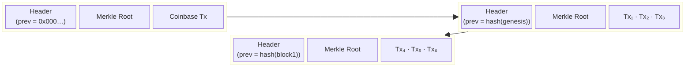
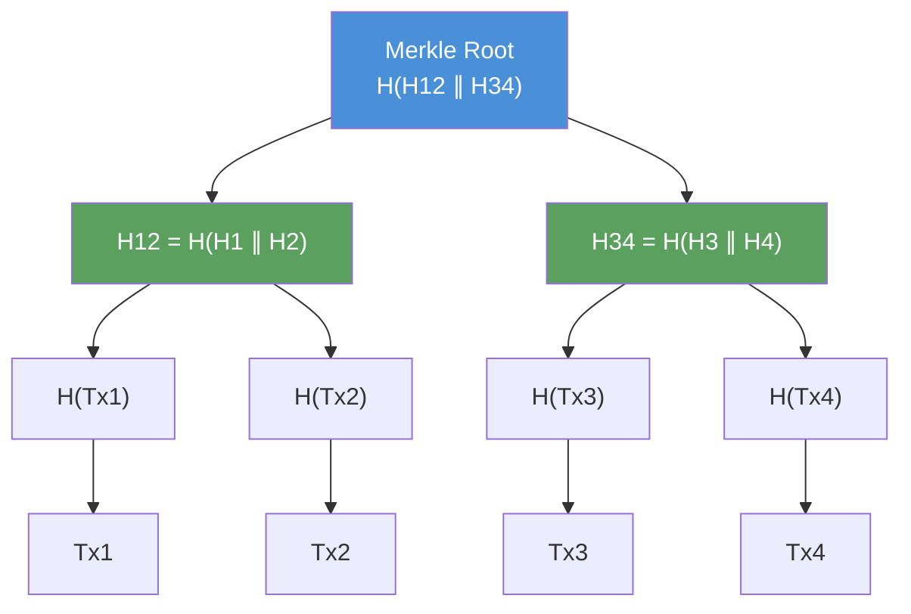
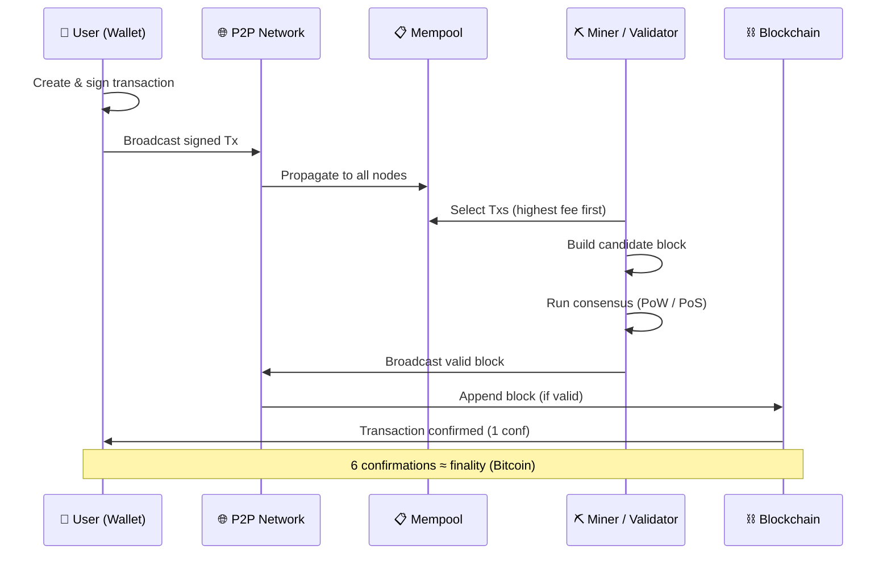
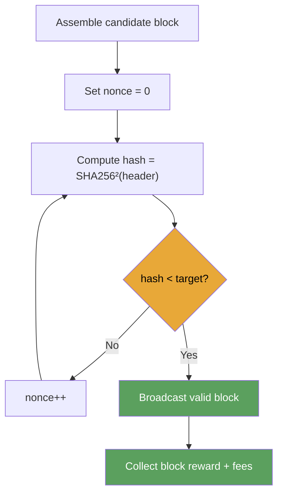
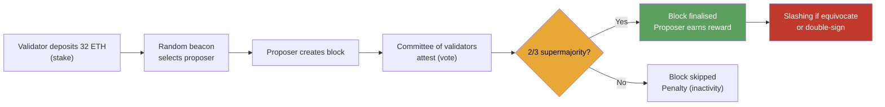
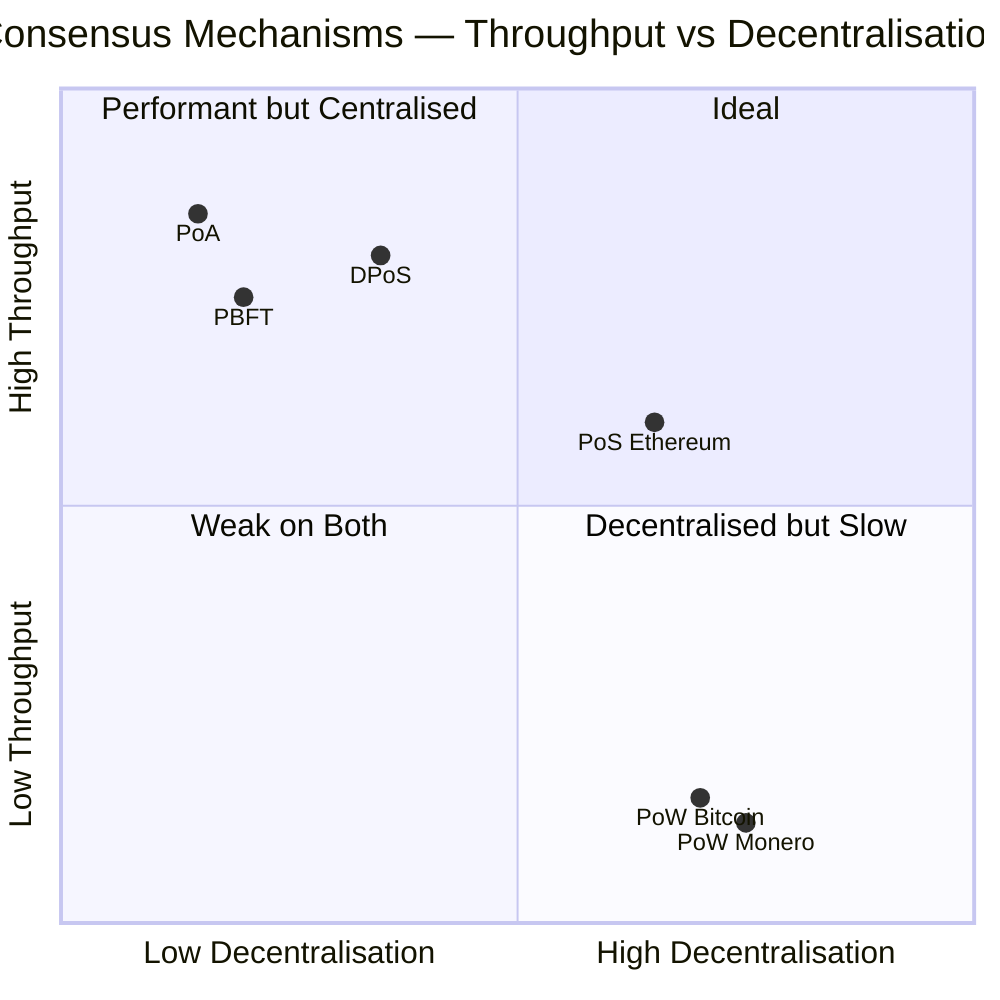
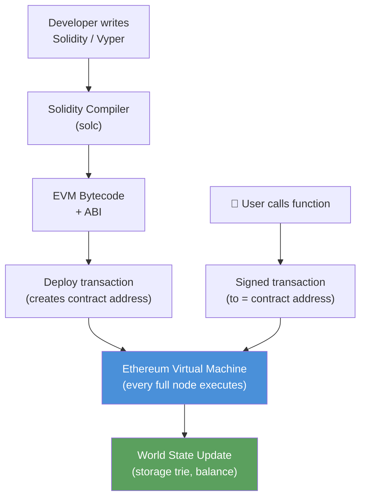
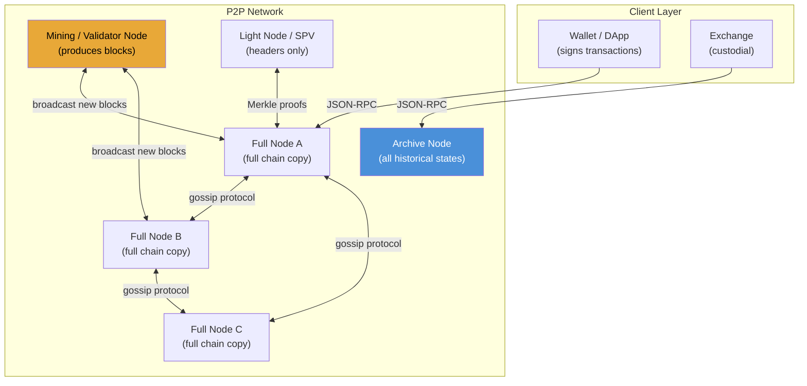
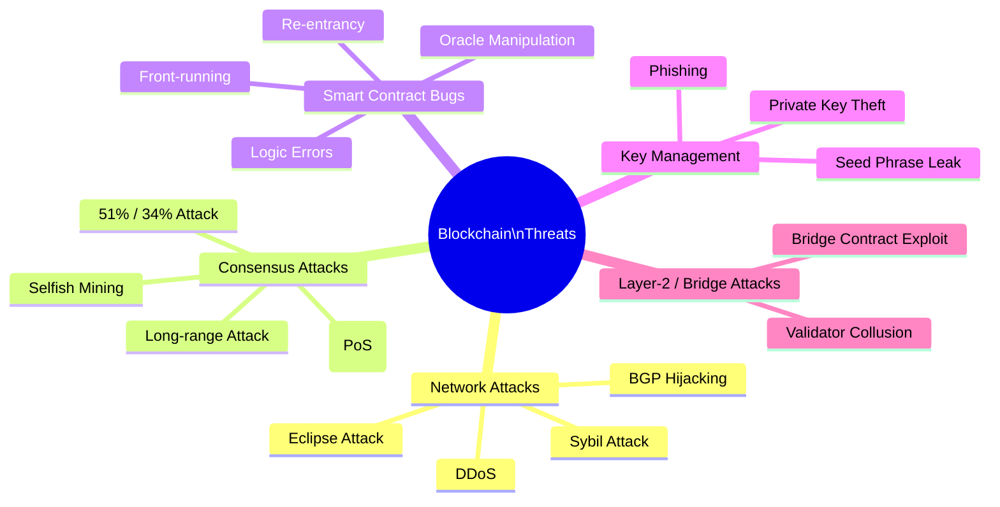
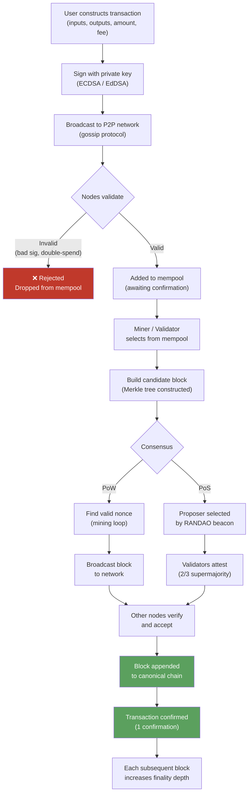

# Blockchain Technology

## 1. Overview

A **blockchain** is a distributed, append-only ledger that records transactions in cryptographically linked blocks. No single authority controls the chain; every participating node holds a complete or partial copy, and the consensus rules of the network determine which version is canonical. The combination of cryptographic hashing, distributed storage, and economic incentives makes unilateral tampering computationally infeasible.

> **Key properties**: Decentralisation · Immutability · Transparency · Trustlessness · Censorship-resistance

---

## 2. The Block — Anatomy

Every block is a data structure containing four logical sections:

| Field | Description | Typical size |
|---|---|---|
| **Block header** | Metadata about the block itself | ~80 bytes (Bitcoin) |
| **Previous block hash** | SHA-256 digest of the preceding header — the "chain link" | 32 bytes |
| **Merkle root** | Root hash of all transactions in this block | 32 bytes |
| **Timestamp** | UNIX epoch of block creation | 4 bytes |
| **Nonce** | Arbitrary counter miners adjust to satisfy the target | 4 bytes |
| **Difficulty target** | The required leading-zero prefix of the block hash | 4 bytes |
| **Transaction list** | Ordered list of all included transactions | variable |

### 2.1 Block Header Hash

```
block_hash = SHA256( SHA256( header_bytes ) )
```

Bitcoin double-hashes to reduce collision risk and protect against certain length-extension attacks. The hash must be numerically less than the current **target** — i.e., it must begin with `N` leading zero bits.

### 2.2 Block Diagram



---

## 3. Cryptographic Foundations

### 3.1 Hash Functions

Blockchain relies on **SHA-256** (Bitcoin) or **Keccak-256** (Ethereum). A cryptographic hash function must satisfy:

- **Determinism** — same input always produces the same digest
- **Avalanche effect** — a one-bit input change flips ~50 % of output bits
- **Pre-image resistance** — given `h`, finding `m` such that `H(m) = h` is computationally infeasible
- **Collision resistance** — finding two inputs with the same hash is computationally infeasible

### 3.2 Digital Signatures (ECDSA / EdDSA)

Transactions are authorised with asymmetric cryptography. Bitcoin uses **ECDSA** over the `secp256k1` curve; Ethereum uses the same; newer protocols (e.g., Cardano, Solana) use **Ed25519**.

```
private key  (256-bit random scalar k)
     │
     ▼ elliptic-curve point multiplication
public key   (point on secp256k1)
     │
     ▼ RIPEMD-160(SHA-256(public key))
wallet address
```

**Signing a transaction:**

```
signature = ECDSA.sign(tx_hash, private_key)
```

**Verifying a transaction:**

```
valid = ECDSA.verify(tx_hash, signature, public_key)
```

The private key never leaves the signer's device; anyone can verify with only the public key.

### 3.3 Merkle Trees

A **Merkle tree** allows efficient, tamper-evident summarisation of all transactions in a block.



A **Merkle proof** for Tx2 requires only `H(Tx1)` and `H34` — O(log n) nodes instead of all n transactions. Light clients (SPV nodes) use this to verify inclusion without downloading the full block.

---

## 4. How a Transaction Flows



---

## 5. Consensus Mechanisms

Consensus is the protocol by which distributed, potentially adversarial nodes agree on the canonical chain state. The choice of mechanism directly determines throughput, energy use, decentralisation, and security guarantees.

### 5.1 Proof of Work (PoW)

Used by: **Bitcoin**, Litecoin, Monero

Miners compete to find a nonce such that:

```
SHA256(SHA256(header ∥ nonce)) < target
```

Expected attempts to find a valid hash ≈ `2^256 / target`. This is computationally expensive by design.



**Properties**:
- Security relies on accumulated computational work (hashrate)
- 51 % attack requires controlling > 50 % of network hashrate
- Energy intensive; incentivises specialised hardware (ASICs)
- Probabilistic finality — deepening chain makes reversal exponentially expensive

**Bitcoin difficulty adjustment**: Every 2016 blocks (~2 weeks), the target adjusts so that the average inter-block time stays at 10 minutes.

### 5.2 Proof of Stake (PoS)

Used by: **Ethereum** (post-Merge), Cardano, Solana, Avalanche

Validators lock up ("stake") native tokens as collateral. The protocol pseudo-randomly selects a validator to propose the next block, weighted by stake.



**Slashing**: validators that equivocate (sign two conflicting blocks) have a portion of their stake destroyed — this is the economic disincentive replacing PoW's energy cost.

| Metric | PoW | PoS |
|---|---|---|
| Energy use | Very high (ASICs, electricity) | ~99.9% lower |
| Attack cost | Buy/rent hashrate | Buy 33% of stake |
| Finality | Probabilistic | Economic finality (Casper FFG) |
| Throughput | ~7 TPS (Bitcoin) | Hundreds to thousands TPS |
| Decentralisation risk | ASIC/pool centralisation | Stake concentration |

### 5.3 Delegated Proof of Stake (DPoS)

Used by: EOS, TRON, Cosmos (via validators)

Token holders vote for a small set of **delegates** (e.g., 21 in EOS) who produce blocks in a round-robin schedule. High throughput (~thousands TPS), but delegates introduce a trust assumption — it is not fully trustless.

### 5.4 Practical Byzantine Fault Tolerance (PBFT)

Used by: **Hyperledger Fabric** (permissioned), Tendermint (Cosmos)

A leader proposes a block; nodes exchange two rounds of signed messages (pre-prepare → prepare → commit). The system tolerates up to `f` faulty nodes out of `3f + 1` total — Byzantine fault tolerance. Provides **deterministic finality** (no forks) but scales poorly beyond ~100 validators (O(n²) messages).

### 5.5 Proof of Authority (PoA)

Used by: **Ethereum testnets** (Rinkeby, Görli), private chains

A known, whitelisted set of validators (authorities) takes turns signing blocks. Suitable for enterprise/private blockchains where participants are identified and accountable. Not appropriate where censorship-resistance or trustlessness is required.

### 5.6 Consensus Comparison



---

## 6. Types of Blockchain

| Type | Access | Trust model | Examples | Use cases |
|---|---|---|---|---|
| **Public** | Anyone can read, write, validate | Trustless — no identity required | Bitcoin, Ethereum | Cryptocurrency, DeFi, NFTs |
| **Private** | Restricted write/read, centralised admin | Trust in operator | Hyperledger Fabric | Enterprise internal records |
| **Consortium** | Multiple known organisations share control | Trust in member set | R3 Corda, Quorum | Inter-bank settlement, supply chain |
| **Hybrid** | Public read, permissioned write | Mixed | Dragonchain | Regulated industries |

---

## 7. Smart Contracts

A **smart contract** is a programme stored on-chain whose execution is deterministic, transparent, and triggered by transactions. First introduced by Nick Szabo (1994); popularised by **Ethereum** (2015).

### 7.1 Execution Model (Ethereum EVM)



**Gas**: every EVM opcode has a fixed gas cost. Users pay `gas_used × gas_price` in ETH. This prevents infinite loops and prices computation/storage fairly.

### 7.2 Simple Smart Contract (Solidity)

```solidity
// SPDX-License-Identifier: MIT
pragma solidity ^0.8.0;

contract SimpleEscrow {
    address public payer;
    address public payee;
    address public arbiter;
    uint    public amount;
    bool    public released;

    constructor(address _payee, address _arbiter) payable {
        payer   = msg.sender;
        payee   = _payee;
        arbiter = _arbiter;
        amount  = msg.value;
    }

    function release() external {
        require(msg.sender == arbiter, "Only arbiter");
        require(!released, "Already released");
        released = true;
        payable(payee).transfer(amount);
    }

    function refund() external {
        require(msg.sender == arbiter, "Only arbiter");
        require(!released, "Already released");
        released = true;
        payable(payer).transfer(amount);
    }
}
```

Once deployed, no party — including the arbiter or Ethereum Foundation — can modify or delete this contract. It executes exactly as written.

### 7.3 Smart Contract Risks

| Risk | Description | Mitigation |
|---|---|---|
| Re-entrancy | Attacker contract calls back before state updates (DAO hack 2016: $60 M) | Checks-Effects-Interactions pattern; `nonReentrant` modifier |
| Integer overflow | Arithmetic wraps around (Solidity < 0.8.0) | Solidity ≥ 0.8.0 built-in overflow checks; OpenZeppelin SafeMath |
| Front-running | Miners insert transactions to profit from visible pending Txs | Commit-reveal schemes; EIP-1559 |
| Oracle manipulation | On-chain logic depends on off-chain price feed — feed is compromised | Chainlink decentralised oracles; TWAP pricing |
| Access control bugs | Missing `onlyOwner` or `onlyRole` checks | OpenZeppelin AccessControl; thorough auditing |

---

## 8. The UTXO vs Account Model

Two fundamentally different ways to track balances:

### 8.1 UTXO (Bitcoin)

Each transaction consumes **Unspent Transaction Outputs** and creates new ones. There is no "balance"; a wallet scans the chain for all UTXOs locked to its public keys.

```
Tx A  ─┬─► UTXO₁ (5 BTC → Alice)   ← unspent
        └─► UTXO₂ (3 BTC → Bob)     ← unspent

Alice spends UTXO₁:
Tx B  [input: UTXO₁]  ─┬─► UTXO₃ (4.9 BTC → Carol)
                        └─► UTXO₄ (0.1 BTC → Alice, change)
```

**Advantages**: natural parallel validation; no double-spend without consuming the UTXO; privacy (new address per Tx).

### 8.2 Account Model (Ethereum)

Accounts have a persistent `balance` field updated by each transaction. Simpler for smart contracts (which need persistent state), but more complex replay-attack protection (nonce required).

```
Alice.balance = 10 ETH
Bob.balance   = 2  ETH

Tx: Alice → Bob, 3 ETH
→ Alice.balance = 7 ETH
→ Bob.balance   = 5 ETH
```

---

## 9. Blockchain Network Architecture



**Node types**:
- **Full node**: downloads and validates every block and transaction; enforces consensus rules; does not trust anyone
- **Light node (SPV)**: stores only block headers; uses Merkle proofs to verify specific transactions; trusts full nodes for chain validity
- **Archive node**: stores every historical state (required by block explorers and analytics tools)
- **Validator / miner node**: a full node that additionally participates in block production

---

## 10. Blockchain Security

### 10.1 Threat Model



### 10.2 The 51 % Attack

An attacker controlling > 50 % of the network's hashrate (PoW) or stake (PoS) can:
- **Double-spend**: broadcast a private fork in which a payment is reversed
- **Censor transactions**: exclude specific addresses from blocks
- **Selfish mine**: withhold valid blocks to waste competitors' work

They **cannot**:
- Steal coins from other wallets (requires private keys)
- Change the block reward retroactively
- Create coins from thin air

**Cost to 51 % attack Bitcoin (2024)**: exceeds $20 billion in hardware + ongoing electricity. Smaller PoW chains (e.g., Ethereum Classic) have been successfully attacked multiple times.

### 10.3 Eclipse Attack

An attacker monopolises all of a node's peer connections, feeding it a false view of the network. The node may be tricked into accepting a stale or fabricated chain.

**Mitigations**: deterministic peer selection; preferring long-lived connections; IP diversity requirements; using multiple independent connections.

### 10.4 Long-Range Attack (PoS)

In PoS, an attacker who acquires old private keys (from validators who have since moved their stake) could rewrite history from that point forward at near-zero cost, since old stake costs nothing to re-sign.

**Mitigations**: **checkpointing** (weak subjectivity — nodes trust a recent checkpoint from a trusted source); key erasure after unbonding; slashing for signing conflicting blocks at the same height.

### 10.5 Cryptographic Security

| Primitive | Algorithm | Bit strength | Quantum risk |
|---|---|---|---|
| Hashing | SHA-256 | 256-bit | Grover's: ~128-bit effective — still safe |
| Signatures | ECDSA / secp256k1 | ~128-bit | Shor's: **broken** — quantum-vulnerable |
| Signatures (newer) | Ed25519 | ~128-bit | Shor's: **broken** — quantum-vulnerable |
| Post-quantum | CRYSTALS-Dilithium, Falcon | ~128-256-bit | Designed to resist quantum |

> **Quantum threat**: ECDSA private keys are safe as long as public keys are not reused — once a public key is exposed on-chain, a large-enough quantum computer could derive the private key via Shor's algorithm. Bitcoin addresses hash the public key (RIPEMD-160), providing one additional layer of protection.

### 10.6 Privacy Considerations

Public blockchains are **pseudonymous, not anonymous**. Addresses are not inherently linked to identities, but:
- Chain analysis firms (Chainalysis, Elliptic) correlate clusters of addresses via input heuristics
- Exchange KYC links real-world identities to addresses
- Transaction graph analysis can de-anonymise patterns

**Privacy-enhancing techniques**:
- **CoinJoin** (Bitcoin): merge many users' inputs in one transaction to break the heuristic
- **Confidential Transactions**: Pedersen commitments hide amounts (Monero, Liquid)
- **zk-SNARKs**: zero-knowledge proofs allow proving valid state transitions without revealing inputs (Zcash, zkSync)
- **Stealth addresses**: one-time recipient addresses derived from a public scanning key (Monero)
- **Tornado Cash model**: smart contract mixer — deposit fixed amounts, withdraw with ZK proof (sanctioned by OFAC 2022)

---

## 11. Scalability — The Blockchain Trilemma

Vitalik Buterin's **Trilemma**: it is extremely difficult to achieve all three simultaneously:

```
              Decentralisation
                    ▲
                   / \
                  /   \
                 /     \
                /  ???  \
               /─────────\
      Security ─────────── Scalability
```

| Solution | Decentralisation | Security | Scalability | Trade-off |
|---|---|---|---|---|
| **Base layer (Bitcoin)** | ✅ | ✅ | ❌ (~7 TPS) | Speed for security |
| **Lightning Network (L2)** | ⚠️ | ✅ | ✅ (millions TPS) | Channel liquidity complexity |
| **Rollups (zk / Optimistic)** | ✅ | ✅ | ✅ (~1000+ TPS) | Proving cost / challenge period |
| **DPoS chains (EOS)** | ❌ | ⚠️ | ✅ (thousands TPS) | Centralised delegates |
| **Sidechains** | ⚠️ | ⚠️ | ✅ | Weakened security guarantees |

### 11.1 Layer-2 Rollups

**Optimistic Rollups** (Arbitrum, Optimism):
- Execute thousands of transactions off-chain
- Post compressed data + state root to L1
- Assume transactions are valid (optimistic) — fraud proofs challenge incorrect state within a 7-day window

**ZK Rollups** (zkSync, StarkNet, Polygon zkEVM):
- Generate a **zero-knowledge proof** (SNARK/STARK) proving correct execution
- Post proof + state root to L1 — instant cryptographic finality
- More computationally expensive to generate proofs; no challenge period needed

---

## 12. Real-World Implementations

### 12.1 Bitcoin

| Property | Value |
|---|---|
| Consensus | PoW (SHA-256d) |
| Block time | ~10 minutes |
| Block size | 1–4 MB (SegWit weight) |
| Throughput | ~7 TPS |
| Supply | 21 million BTC (hardcoded) |
| Scripting | Bitcoin Script (stack-based, intentionally limited) |
| UTXO set size | ~90 million UTXOs (2024) |

### 12.2 Ethereum

| Property | Value |
|---|---|
| Consensus | PoS (Gasper = Casper FFG + LMD GHOST) |
| Block time | ~12 seconds (slots) |
| Throughput | ~15–30 TPS base; ~1000+ TPS with rollups |
| Supply | No hard cap; issuance ~0.5 % / yr post-Merge |
| Execution | EVM (256-bit stack machine) |
| Smart contracts | Solidity, Vyper, Yul |
| State | Merkle-Patricia trie |

### 12.3 Hyperledger Fabric (Enterprise)

| Property | Value |
|---|---|
| Type | Permissioned consortium |
| Consensus | Raft (ordering service) + PBFT variants |
| Throughput | Thousands TPS |
| Identities | X.509 certificates via MSP |
| Smart contracts | Chaincode (Go, Java, Node.js) |
| Ledger | LevelDB / CouchDB world state + blockchain log |
| Privacy | Channels + Private Data Collections |

---

## 13. Full Transaction Lifecycle — Detailed Diagram



---

## 14. Blockchain vs Traditional Database

| Dimension | Traditional Database | Blockchain |
|---|---|---|
| **Control** | Central authority | Distributed, no single owner |
| **Trust** | Trust the operator | Trust the protocol |
| **Mutability** | Read/Write/Delete | Append-only (immutable history) |
| **Throughput** | Millions TPS | Tens to thousands TPS |
| **Latency** | Milliseconds | Seconds to minutes |
| **Finality** | Immediate (ACID) | Probabilistic or economic |
| **Auditability** | Requires access grants | Inherently public (public chains) |
| **Cost** | Low (centralised hardware) | Higher (consensus overhead) |
| **Use case** | Internal data, OLTP | Multi-party, trustless, cross-border |

> **When to use blockchain**: only when multiple mutually distrusting parties need to share a single source of truth without a trusted intermediary. If a trusted central party exists, a traditional database is almost always faster, cheaper, and simpler.

---

## 15. Key Vocabulary

| Term | Definition |
|---|---|
| **Block** | Ordered set of transactions + metadata header |
| **Chain** | Sequence of blocks linked by prev-hash pointers |
| **Node** | Participant that stores and validates the chain |
| **Mining** | PoW process of finding a valid block hash |
| **Nonce** | Counter adjusted during mining to change the hash |
| **Mempool** | Pending transaction pool awaiting confirmation |
| **Fork** | Two competing chain branches; resolved by longest/heaviest chain rule |
| **Hard fork** | Rule change that is not backward-compatible (e.g., Bitcoin Cash) |
| **Soft fork** | Rule change that is backward-compatible (e.g., SegWit) |
| **Smart contract** | Self-executing programme stored on-chain |
| **Gas** | Unit of computation cost on Ethereum |
| **Wallet** | Software managing private keys; does not store coins |
| **UTXO** | Unspent Transaction Output (Bitcoin's balance model) |
| **DeFi** | Decentralised Finance — financial services via smart contracts |
| **NFT** | Non-Fungible Token — unique on-chain asset |
| **Rollup** | L2 scaling solution bundling many txs into one L1 tx |
| **ZK-proof** | Zero-knowledge proof — proves validity without revealing inputs |
| **Slashing** | Penalty destroying a PoS validator's stake for misbehaviour |
| **Finality** | Point after which a transaction cannot be reversed |

---

## 16. Cross-Domain Connections

- **Cryptography** → [[concepts/secure-design-implementation]] (hash functions, digital signatures, asymmetric crypto — same primitives as HTTPS/TLS)
- **Distributed Systems** → consensus is a special case of the Byzantine Generals Problem; PBFT is used in Hyperledger
- **Security** → [[concepts/threat-modeling]] (STRIDE applies: Spoofing = stolen private key; Tampering = 51 % attack; Repudiation = public ledger prevents; DoS = mempool spam)
- **Databases** → [[concepts/relational-database-fundamentals]] (blockchain trades ACID transactional guarantees for distributed trustlessness)
- **Networking** → [[concepts/tcp-ip-network-model]] (blockchain nodes communicate over TCP/IP using gossip protocols; peer discovery via DNS seeds or DHT)
- **Software Architecture** → [[concepts/software-architecture-patterns]] (blockchain as an event-sourced, append-only log — similar to event sourcing pattern)

---

---

## 17. Live Statistics (2025–2026)

> Data sourced from autoresearch session 2026-06-12. See [[questions/research-blockchain-technology]] for full synthesis.

### Security & Losses

| Metric | Figure | Source |
|---|---|---|
| Total crypto stolen (2025) | **>$3.4 billion** | [[sources/chainalysis-crypto-crime-report-2025]] |
| Largest single hack (Bybit, 2025) | **$1.5 billion** | Chainalysis |
| DPRK attributed theft (2025) | **≥$2.02 billion** | Chainalysis |
| DeFi losses (2025) | **$680 million** | Chainalysis |
| DeFi losses peak (2022) | $2.62 billion | Chainalysis |
| Median loss per DeFi incident | $1.5M (down from $6M in 2022) | Chainalysis |
| Q1 2026 smart contract incidents | **44 incidents · $482M losses** | [[sources/hacken-smart-contract-vulnerabilities-2025]] |
| MEV extraction since June 2020 | **>$1 billion** | Hacken |

### Layer 2 Market

| Project | Type | TVL | TPS |
|---|---|---|---|
| Arbitrum | Optimistic Rollup | **$15B+** | 2,000–4,000 |
| Optimism | Optimistic Rollup | **$10B+** | 2,000–4,000 |
| All ZK Rollups | ZK Rollup | **$6.27B** | 2,000–20,000 |
| Polygon PoS | Sidechain | **$5B+** | 7,000+ |

### CBDC Adoption

| Metric | Figure | Source |
|---|---|---|
| Countries exploring CBDCs | **146** (98 % of global GDP) | [[sources/atlantic-council-cbdc-tracker-2026]] |
| Retail CBDCs fully launched | **3** (Bahamas, Jamaica, Nigeria) | Atlantic Council |
| China e-CNY transactions | 3.4 billion (16.7 trillion RMB) | Atlantic Council |
| mBridge volume growth | 2,500× since 2022 pilot | Atlantic Council |
| US GENIUS Act (July 2025) | **Bans** Fed retail CBDC | US Congress |

### Real-World Asset Tokenisation

| Metric | Figure |
|---|---|
| On-chain RWAs (excl. stablecoins, May 2026) | **~$32 billion** |
| Including stablecoins | **>$300 billion** |
| Standard Chartered 2034 projection | **$30 trillion** |

---

*Primary sources: Bitcoin Whitepaper (Nakamoto 2008) · Ethereum Yellow Paper (Wood 2014) · Mastering Bitcoin (Antonopoulos) · Mastering Ethereum (Antonopoulos & Wood) · Ethereum Proof-of-Stake Specs (ethereum.org) · Hyperledger Fabric Docs · NIST Post-Quantum Cryptography Standards (FIPS 203/204/205, 2024) · Chainalysis Crypto Crime Report 2025 · Hacken Smart Contract Vulnerabilities 2025 · Atlantic Council CBDC Tracker 2026 · Layer 2 Scaling Comparison 2025*
