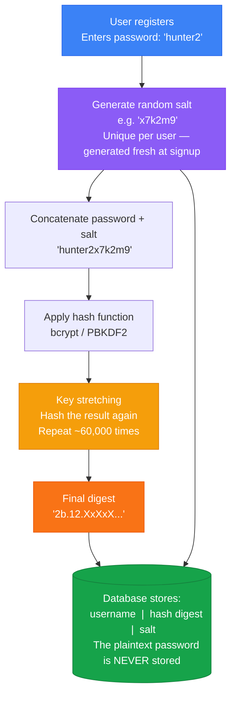
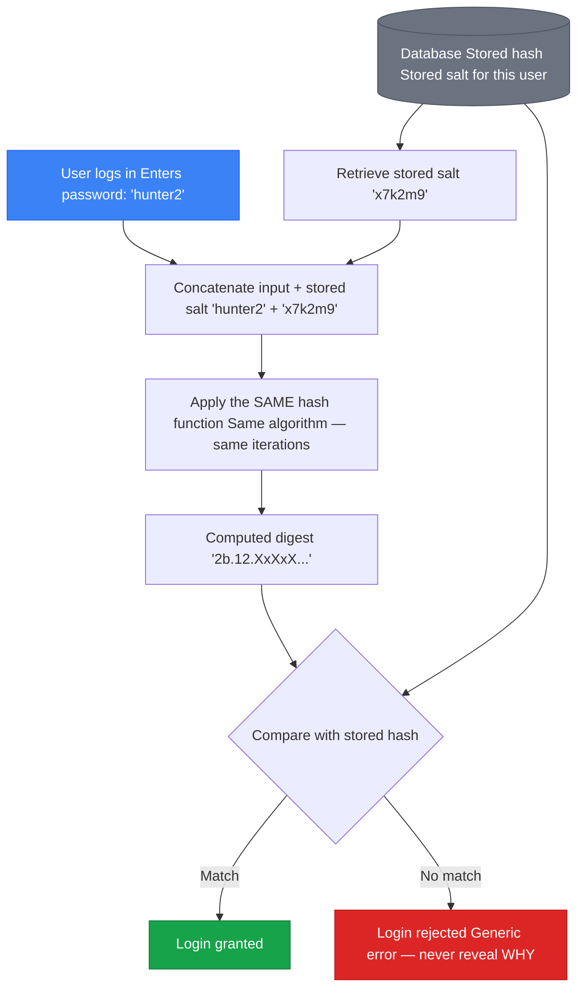
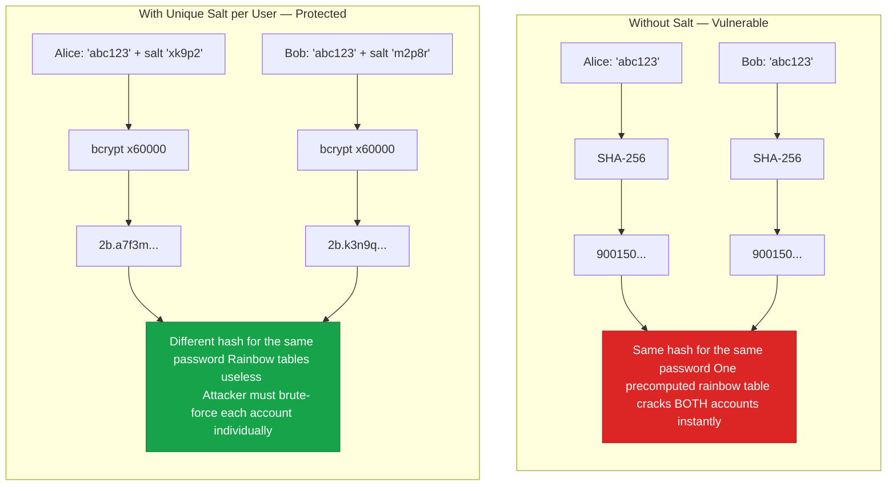

# Secure Design Implementation

Security requirements identify *what* to protect. Security by Design Principles provide *thinking rules*. This page covers the next step: **how to translate each CIA-AAA pillar into concrete architectural and design decisions**. Every requirement from the CIA-AAA model must become a specific, implementable design choice before coding begins.

---

## From Requirements to Design

| Pillar | Requirement Phase | Design Phase |
|--------|------------------|-------------|
| Confidentiality | "Encrypt data at rest, in transit, and in processing" | Choose algorithm (AES-256), key management approach (PKI), masking rules |
| Integrity | "Prevent unauthorised modification" | Salted hashing for passwords, referential integrity constraints, resource locking strategy |
| Availability | "99.999% uptime, restore in < 1 hour" | Replication topology, failover mechanism, horizontal vs. vertical scaling plan |
| Authentication | "Verify user identity; support MFA for privileged accounts" | Choose factor types, design account recovery, consider passwordless |
| Authorisation | "Role-based access; least privilege" | RBAC vs. UBAC decision, Data Access Control Matrix, permission check performance |
| Accountability | "Immutable audit log of all state-changing actions" | Log schema (who/what/where/when), storage and rotation policy, PII exclusion rules |

---

## Confidentiality Design

### Masking

Useful when sensitive data is displayed on screen or printed. The data is not encrypted — it is simply hidden from view at the presentation layer.

*Example:* Credit card displayed as `**** **** **** 1234` — the last four digits confirm card identity to the user without exposing the full number.

### Cryptographic Techniques

Used to protect data in transit, at rest, and in offline archives.

#### Symmetric Encryption

A **single shared key** is used for both encryption and decryption. Both sender and receiver must possess the same key.

**Algorithms:** DES (deprecated), 3DES (deprecated), Blowfish, AES

| Property | Detail |
|----------|--------|
| Key distribution | Requires a secure out-of-band exchange mechanism |
| Key count for N parties | **N(N−1)/2** — scales poorly (10 parties → 45 keys; 1000 parties → 499,500 keys) |
| Speed | Much faster than asymmetric |
| Non-repudiation | Not addressed — shared key means either party could have encrypted the message |

#### Asymmetric Encryption

Two mathematically related keys — a **private key** (kept secret by the owner) and a **public key** (disclosed freely). It must be computationally infeasible to derive the private key from the public key.

**Algorithms:** RSA, ECC, DSA

| Property | Detail |
|----------|--------|
| Key distribution | Based on Public Key Infrastructure (PKI); no out-of-band exchange needed |
| Key count for N parties | **N key pairs** — scales linearly (1000 parties → 1000 key pairs) |
| Speed | Much slower than symmetric |
| Non-repudiation | Addressed — only the private key owner could have signed the message |

#### Hybrid Approach (Used in Practice)

Most real-world secure systems combine both:
1. **Asymmetric** cryptography to securely exchange a session key
2. **Symmetric** cryptography (using that session key) for the bulk data transfer

This is how **TLS/HTTPS** works — it gets key exchange security from asymmetric and performance from symmetric.

### Digital Certificates (X.509 v3)

A digital certificate binds a public key to an identity, signed by a trusted Certificate Authority (CA).

**Standard:** ITU X.509 version 3

**Certificate contents:**

| Field | Description |
|-------|-------------|
| Certificate version | Version of the X.509 standard (v1, v2, or v3) |
| Serial number | Unique per CA — used for revocation tracking |
| Signature algorithm | Algorithm used by the CA to sign (e.g., SHA-256 with RSA) |
| Issuer distinguished name | The Certificate Authority that signed this certificate |
| Validity period | Not Before / Not After dates |
| Subject name | The entity the certificate is issued to (domain, organisation, person) |
| Subject public key | The public key and its algorithm |
| Extensions | Key usage, Subject Alternative Names (SANs), and other attributes |
| CA's digital signature | Proves the certificate was issued by the stated CA |

Certificates enable **trust chains**: verify the CA's signature → confirm the public key genuinely belongs to the stated entity → trust encrypted communications with that entity.

### Design Question — Signup Feature

> Should a password be transmitted in plaintext during signup, relying solely on TLS?

**Risk:** Even with TLS, if SSL certificate pinning is not correctly implemented, a MITM attack can intercept plaintext credentials.

**Better design approaches:**
- Hash the password **client-side** before transmission — the server never sees the plaintext, even during an intercept
- Use a **challenge-response** mechanism — server sends a nonce; client hashes `(password + nonce)`; server verifies
- Enforce **SSL certificate pinning** correctly to prevent MITM

---

## Integrity Design

### Hashing

A hash function produces an **irreversible, fixed-size output** (message digest) from a variable-length input. Good hash functions are collision-resistant — two different inputs should not produce the same digest.

**Algorithms:** MD5 (deprecated), SHA-1 (deprecated), SHA-256, SHA-3

**Uses:**
- **File integrity verification** — sender provides file + hash; receiver hashes the received file and compares
- **Password storage** — store the hash, never the plaintext

#### Dictionary and Rainbow Table Attacks

A dictionary attack tries hashed versions of known passwords against stored hashes. A precomputed **rainbow table** maps hashes back to plaintext — if all users' passwords are hashed with the same algorithm and no salt, one table cracks all matching accounts.

#### Salted, Iterated Hashing

**Salt:** a unique, randomly generated value appended to each password before hashing.
- Must be **unique per user** and **randomly generated** at account creation
- Stored alongside the hash in the database
- Makes precomputed rainbow table attacks computationally infeasible — different salt → different hash even for identical passwords

**Key stretching (bcrypt / PBKDF2):** repeat the hashing operation thousands of times:
1. Generate a random salt
2. Hash `(password + salt)`
3. Hash the result again
4. Repeat (e.g., 60,000 iterations)

Each iteration adds negligible time for the legitimate user but multiplies the cost for an attacker attempting millions of guesses.

> **Non-functional requirement:** The iteration count must be specified as a non-functional security requirement — not chosen arbitrarily. Too high a count introduces unacceptable authentication latency; too low a count provides insufficient protection. The chosen value must be justified (e.g., "bcrypt cost factor 12 — authentication completes in < 300 ms on target hardware and raises per-guess cost above 100 ms for an attacker").

**Password storage comparison:**

| Approach | Security |
|----------|----------|
| Plaintext | ❌ Catastrophic — any DB read exposes all passwords |
| Unsalted MD5 | ❌ Rainbow tables trivially crack the most common passwords |
| Unsalted SHA-256 | ❌ Still vulnerable to precomputed attacks |
| Salted SHA-256 (unique per user) | ✅ Significantly better — precomputed tables defeated |
| Salted + iterated (bcrypt/PBKDF2) with metadata | ✅ Best practice |

**Additional metadata to store alongside the hash:**
- Account creation date
- Last login datetime
- Failed login count (for lockout and velocity checking)
- Password history (to prevent reuse)

**Design question:** Are you generating one salt for all users or a unique salt per user? Where and when is the salt generated?

---

#### Visual: Password Registration and Storage



#### Visual: Password Verification at Login



> The login flow never decrypts — hashing is one-way. The system re-hashes the input with the stored salt and checks whether the result matches. Decryption is impossible by design.

#### Visual: Why Salting Defeats Rainbow Tables



> 🗺️ **Interactive canvas:** [[canvases/password-hashing.canvas|Password Hashing — Visual Canvas]]

---

### Referential Integrity

**Referential integrity** requires that every foreign key value in a table has a corresponding primary key in the referenced table. Without it, "orphaned" records accumulate — e.g., an ORDER with no corresponding CUSTOMER.

Enforcing referential integrity prevents phantom records, data inconsistencies, and ensures cascading operations (update/delete) are handled deterministically.

**Design question:** Does your application allow deleting a customer who still has orders? What happens to those records?

**Recommended pattern — deactivate, not delete:** Rather than physically removing a customer row (which orphans all related orders), add an `active` column (Boolean or status flag) to the user table. When a customer closes their account, set `active = false`. The row and all referencing records remain intact. The application presents the account as non-existent to other users ("User not found") without exposing whether it is inactive or truly absent. This preserves audit history, protects referential integrity, and simplifies data recovery.

### Resource Locking

Two concurrent operations must not be allowed on the same object simultaneously.

*Example — Online banking:* If a user presses "Transfer" on both a web browser and a mobile app at the same time, resource locking (database locks, optimistic/pessimistic locking, mutexes) prevents double-spends or data corruption.

---

## Availability Design

### Replication

A **single point of failure** means any component failure affects all users. Replicating data, databases, and application software across multiple systems provides redundancy.

Typical approach: **primary-secondary** (master-slave) backup scheme — writes go to the primary, replicated asynchronously (or synchronously) to secondaries.

### Failover

**Failover** = automatic switching from an active system to a standby when the primary fails. When designed correctly, failover is transparent to users and minimises downtime. Failover clusters allow one node to take over another's workload immediately.

### Scalability

| Type | Description | Availability Benefit |
|------|-------------|---------------------|
| **Vertical scaling** | Add resources to the existing node (more RAM, faster CPU) | Increases capacity but still single point of failure |
| **Horizontal scaling** | Add more nodes to the cluster (more servers) | Eliminates single-node bottlenecks; preferred for availability |

Horizontal scaling is generally preferred — it eliminates single-node failure risk and allows incremental capacity increases.

---

## SSL/TLS Security Analysis

Standard security measures are **not composable** in the way developers assume. Each protects against a specific threat, and combining them does not eliminate the threats each one misses.

### The Fundamental Incompatibility Table

| Security Measure | Protects Against | Does NOT Protect Against |
|-----------------|------------------|--------------------------|
| SSL/TLS | Eavesdropping (encrypts the channel) | Phishing (attacker controls the server at the other end) |
| Salted hash password storage | Password database breach | Phishing (password is still transmitted in cleartext before hashing) |
| 2FA / OTP | Replayed stolen passwords | Real-time phishing (attacker proxies the OTP live to the legitimate service) |

### Why Salted Hashing Forces Cleartext Transmission

Salted hashing is the correct approach to **storing** passwords — but it creates an unavoidable consequence for **transmission**:

> **Hash is a one-way function.** The server needs the original plaintext password to produce the same hash for comparison against the stored value.

Therefore, the client must send the plaintext password to the server before hashing occurs server-side. Even over HTTPS, the plaintext password crosses the network. A phishing site receives that plaintext directly.

**Alternative approaches:**
- Hash the password **client-side** before transmission — the server stores `hash(hash+salt)` and compares against a re-hash of the received value. This prevents the server from ever seeing plaintext, including during interception.
- Use a **challenge-response** mechanism — server issues a nonce; client hashes `(password + nonce)`; server verifies without the plaintext ever being transmitted directly.
- Use **SRP** (see below) — the gold standard for mutual authentication without transmitting passwords.

### Why Phishing Remains Viable Despite SSL/TLS

SSL/TLS encrypts the channel — but only between the client and **whichever server the client connected to**. If that server is an attacker's phishing site:

- The TLS certificate belongs to the attacker's domain (easily obtainable from Let's Encrypt)
- The browser shows the padlock — the connection is encrypted to the attacker
- Password encryption added inside TLS is useless: the attacker's server receives the decrypted plaintext

> **Phishing attacks remain feasible and attractive even when SSL/TLS is universal.**

### MitM SSL Stripping

An attacker positioned between the client and server can **intercept HTTP traffic before HTTPS is established**, downgrading the connection from HTTPS to HTTP. The user receives an unencrypted connection; the attacker sees plaintext.

**Mitigation — HTTP Strict Transport Security (HSTS):**
- Server sends an `HSTS` header instructing the browser to **only communicate via HTTPS** for a defined max-age period
- Browser refuses to connect over HTTP even if directed to — prevents the downgrade
- First-visit vulnerability: a user visiting for the first time over HTTP before receiving the HSTS header is still vulnerable. HSTS preload lists (maintained by browsers) solve this for well-known domains.

### Perfect Forward Secrecy (PFS)

In 2013, Snowden disclosures revealed that intelligence services had been recording encrypted internet traffic, intending to decrypt it later if private keys were ever obtained.

> **Without PFS:** compromise of the server's private key in the future can decrypt all past recorded sessions.

> **With PFS:** each session uses an **ephemeral key** derived independently. Compromising the long-term private key gives the attacker nothing about past sessions.

**Implementation:** Only configure SSL/TLS to support **cipher suites that achieve PFS**:
- Prefer suites using ECDHE or DHE key exchange (ephemeral Diffie-Hellman)
- Avoid RSA key exchange (no PFS — decrypted retrospectively if key is compromised)

**Example cipher suite:** `TLS_ECDHE_RSA_WITH_AES_128_GCM_SHA256`

| Component | Role |
|-----------|------|
| ECDHE | Ephemeral key exchange → PFS |
| RSA | Authentication (certificate signature) |
| AES_128_GCM | Symmetric encryption |
| SHA256 | MAC / integrity |

### Secure Remote Password (SRP) Protocol

SRP addresses all three weaknesses simultaneously: phishing, MitM, and lack of PFS.

**SRP flow (RFC 5054, standardised 2007):**
1. User enters username and password **before contacting any server**
2. A zero-knowledge proof is computed locally — the password is never transmitted
3. If key establishment succeeds, **mutual authentication** is achieved: the server proved it knows the password verifier, and the client proved it knows the password, without either transmitting it
4. If the server is a phishing site, SRP key establishment fails — the password is never exposed

SRP has been standardised for TLS since 2007 (`TLS_SRP_SHA_WITH_AES_128_CBC_SHA`) but was **not widely adopted** because it prevents the server from authenticating users before they have registered an account — a bootstrapping problem for new user flows.

### Security Theatre

> **Security theatre:** a security measure implemented to make users *feel* secure rather than to actually *make* them more secure.

Before implementing any security control, ask:
- What specific threat does this mitigate?
- Does it address the root cause, or only a symptom?
- Can the same threat bypass this control via a different vector?

*Example of security theatre:* Requiring a password to be transmitted over HTTPS to a server that stores it as a salted hash — does not protect against phishing, because the attacker's server receives the plaintext password before any hashing occurs.

---

## Authentication Design

### Factor Types

| Factor | Examples |
|--------|----------|
| Something you **know** | Password, PIN |
| Something you **are** | Fingerprint, face recognition |
| Something you **have** | Smartphone, hardware token, smart card |

**Multi-Factor Authentication (MFA)** requires two or more factors from different categories — dramatically reduces account takeover risk even if one factor is compromised.

**Single Sign-On (SSO)** allows users to authenticate once and access multiple services (e.g., "Sign in with Google"). Centralises authentication — reduces credential fatigue and password sprawl, but creates a single high-value target.

**Design questions:**
- What happens if an admin forgets their password? How is account recovery handled securely?
- How is the initial admin account created and who has access to that process?

**Recommended pattern — installation-wizard model:** Do not pre-seed an admin account in the database with hard-coded credentials. Instead, prompt for the initial administrator's username and password during the first application launch (the same pattern used by Windows and Linux installations). The credentials entered are hashed and stored, and that account is granted administrator privileges. This avoids shipping or committing default credentials and ensures the admin identity is established interactively by the deployer.

### Password Policy — Breached Password List Checking

**NIST 800-63B §5.1.1.2** requires that password verifiers check new passwords against a list of known-compromised values. This prevents users from setting passwords that have appeared in real data breaches and are trivially guessable by credential-stuffing attacks.

**Minimum list to use (ICT2216 D3 requirement):**

> `10-million-password-list-top-1000.txt` — SecLists / Common Credentials  
> https://github.com/danielmiessler/SecLists/tree/master/Passwords/Common-Credentials

This file contains the 1,000 most common passwords derived from the 10-million password corpus. Any submitted password that appears in this list must be **rejected outright** during registration and password-change flows.

**When to apply the check:**

| Event | Apply check |
|-------|------------|
| User registration | ✓ Always |
| Password change | ✓ Always |
| Password reset | ✓ Always |
| Login | ✗ No — do not leak timing information |

> **Real-world divergence (2026-07-23):** [[examples/ict2216-practical-test-secure-webapp]] checks breach status at login too, on explicit stakeholder request, after credentials already validate correctly. Since the check only runs once auth has already succeeded (not on every attempt, and not distinguishing "wrong password" from "right-but-breached password" until after the constant-time credential check), the timing-leak risk this guidance warns about is reduced but not eliminated versus a pure registration/change-only implementation. Noted here rather than changed in the guidance above, since "don't check at login" remains the correct default recommendation.

**Implementation pattern (Python):**

```python
# Load once at application startup — not per request
with open("10-million-password-list-top-1000.txt") as f:
    BREACHED_PASSWORDS: set[str] = {line.strip() for line in f}

def validate_password(password: str) -> tuple[bool, str]:
    if password in BREACHED_PASSWORDS:
        return False, "This password is too commonly used. Please choose a different password."
    # ... other checks (length, etc.)
    return True, ""
```

**Implementation notes:**
- Load the set **once at startup** — not on every request; use `set` for O(1) lookup
- **Case-sensitive** comparison (if your application is case-sensitive); some implementations normalise to lowercase first
- Do **not** tell the user *why* a specific password was rejected with details (e.g., "this appears in breach data") — just say it is not allowed; reduces information leakage
- Extend the list over time: HIBP's Pwned Passwords API provides 800M+ compromised passwords via a k-anonymity API without sending the full password

**Expanded production option — HIBP k-anonymity API:**

```python
import hashlib, requests

def is_pwned(password: str) -> bool:
    sha1 = hashlib.sha1(password.encode()).hexdigest().upper()
    prefix, suffix = sha1[:5], sha1[5:]
    resp = requests.get(f"https://api.pwnedpasswords.com/range/{prefix}")
    return suffix in resp.text  # each line: HASH_SUFFIX:COUNT
```

The password is never transmitted — only the first 5 characters of its SHA-1 hash are sent (k-anonymity model).

> See also: [[concepts/secure-software-requirements]] — NIST 800-63 guidelines; [[concepts/owasp-top-10]] — A07:2025 Authentication Failures

### Passwordless Authentication

A growing pattern — removes the password entirely to eliminate the attack surface around credential theft. See [[concepts/fido-passkeys-passwordless]] for full coverage of FIDO, passkeys, OTP/magic link design constraints, and real-world platform limitations.

**How it works:**
1. User registers an authenticator app or trusted device (something you *have*)
2. Initial identity validation via SMS or email OTP
3. Subsequent logins require cryptographic proof from the registered authenticator — no password is transmitted or stored

**Real-world examples:**
- **WhatsApp** — OTP only at device setup; no ongoing password
- **Microsoft Accounts** — fully passwordless option via Microsoft Authenticator
- **SingPass** — multi-factor without traditional passwords
- **Apple ID** — approval prompts pushed to trusted devices
- **Google** — approval prompts sent to registered devices

> Passwordless eliminates the risk of password reuse, credential stuffing, and phishing for passwords — at the cost of device dependency and recovery complexity.

---

## Authorisation Design

**Role-Based Access Control (RBAC)** is the predominant model — permissions are assigned to roles, and users are assigned to roles. Scales well and is auditable.

**User-Based Access Control (UBAC)** assigns permissions directly to individual users. Appropriate only for systems with very few users and highly granular, non-standardisable permission needs.

**Key principles:**
- **Separation of duties** — no single user should be able to complete a high-risk action alone (see [[security-by-design-principles]])
- **Least privilege** — grant only the minimum permissions necessary for each role
- **Performance impact** — complex permission checks on every request can introduce latency; cache where appropriate

### Data Access Control Matrix

A systematic design artefact that defines which role can perform which operation on which data:

| Data | Administrator | Sales Agent | Customer |
|------|--------------|-------------|----------|
| Customer Data | CRUD | CRUD | Read (own only) |
| Product Data | CRUD | Read | Read |
| Order Data | CRUD | CRUD (own) | Read (own only) |

Build this matrix as part of design — it feeds directly into database permission grants and API authorisation middleware.

---

## Accountability Design

Audit logging must be designed in from the beginning — not added as an afterthought.

**Every log entry should capture:**
- **Who** — authenticated identity of the actor
- **What** — action type and parameters
- **Where** — source IP address, component, and endpoint
- **When** — accurate, tamper-evident timestamp

**Critical rule:** Sensitive data must **never** be logged in plaintext — no passwords, no credit card numbers, no session tokens in log files.

**Good audit log design:**
- Easy for developers to use for debugging
- Contains no PII or credentials in plaintext
- Stores the minimum necessary information
- Implements log rotation and disposal policies (retention limits)
- Protected from tampering — access-controlled; ideally write-once (WORM storage or append-only log service)

---

## Security Quality Gates

Quality gates are formal checkpoints that a project must pass before it can proceed to the next SDLC phase. They enforce that security is validated at each transition — not deferred to a final review or post-release patch cycle.

| Gate | Phase Transition | Key Activity |
|------|-----------------|-------------|
| **Gate 1** | Concept / Priority → Project Definition | High-level security risk assessment; risk-based controls selection |
| **Gate 2** | Project Definition → Preliminary Design | Agreement on security requirements and controls |
| **Gate 3** | Preliminary Design → Detailed Design & Development | Security Design Review; Source Code Agreement |
| **Gate 4** | Detailed Design → Deployment | Penetration Testing; Third-party Assessment; Approve Build |

No phase can begin until its corresponding gate is passed. Gate 4 (Penetration Testing + Third-party Assessment before deployment) is the final safety net — not the first security check.

The SSDLC integrates security activities at every phase transition:

```
Requirements Definition
        ↓
   Secure Requirements Review   ← Gate 1 / Gate 2
        ↓
   Secure Design Review         ← Gate 3
        ↓
   Develop  ←──────────────────┐
        ↓                       │
   Secure Code Review           │
        ↓                       │
   Deploy / Implement           │ ← Gate 4
        ↓                       │
   Penetration Testing          │
        ↓                       │
   Maintain ───────────────────┘
```

> Source: ICT2216 Lecture 1 / Module Overview (Slides 14–15). See [[sources/ICT2216-lecture-10-module-overview-secure-concepts]].

---

## Sprint + Security Approaches

When integrating security into Agile development, two approaches exist:

| Approach | Description | Verdict |
|----------|-------------|---------|
| **Security Sprint** | A dedicated sprint focused exclusively on security stories (input validation, logging, authentication, authorisation, XSS/SQL injection fixes). Code is reviewed; all stories are security-related. | ⚠ Acceptable for legacy projects with accumulated security debt |
| **Every Sprint** | Security requirements and stories are included in **every** sprint. No software can ever be released without security requirements met. If a security requirement in the every-sprint category is not completed, the sprint is deemed **incomplete** and software cannot be released. | ✓ **Preferred — aligned with Microsoft SDL** |

**Every Sprint details:**
- Sprint length: 2 weeks to 2 months
- Every security requirement in the "every-sprint" category must be completed in each sprint
- An incomplete security requirement = incomplete sprint = no release

> The Every Sprint approach prevents security debt from accumulating. The Security Sprint approach risks creating a false sense of security by isolating security work into one period.

---

## Secure Agile Development

Security activities must be embedded across every sprint phase — not deferred to a final security review before release.

| Phase | Security Activities |
|-------|-------------------|
| **Modelling** | Derived requirements, security requirements definition |
| **Sprint Planning** | Definition of Ready (includes security criteria); secure design; architectural risk analysis |
| **Agile Sprint** | Origin analysis; code review; static analysis (SAST); unit tests; refactoring; continuous integration with automated security checks |
| **Dynamic Testing** | Dynamic analysis (DAST); penetration testing; regression and performance testing |
| **Release** | Test automation; red teaming; automated deployment; sprint demo; user acceptance testing |
| **Operations** | Vulnerability tracking; operational monitoring; release management; incident response |

**Key tools used across phases:**
- IDE with security plugins (static analysis)
- Configuration management (secrets management, IaC)
- Test automation frameworks (DAST, fuzzing)

> Embedding security throughout ensures that security debt does not accumulate and that vulnerabilities are caught at the cheapest point in the SDLC.

---

## Secure Design Architecture

The secure design architecture process integrates threat modelling with architectural decision-making across four steps.

### Step 1: Document the Architecture

Capture the system's structure:
- **Physical and logical topologies**
- Services, ports, and protocols
- Authentication mechanisms and identity model
- Authorisation rules
- Data elements and classification
- Human and non-human actors
- Auditing controls

### Step 2: Identify Threats

Using the documented architecture, identify threats via:
- Trust boundaries and data flows
- Entry and exit points
- Mis-actors (attacker profiles)
- Threat catalogues: **STRIDE, OWASP Top 10, CWE Top 25**
- Attack trees

### Step 3: Prioritise and Implement Controls

| Control Area | Techniques |
|-------------|------------|
| Input validation | Whitelist validation at every trust boundary |
| Error handling | Sanitised error messages; no stack traces to users |
| Encryption and hashing | TLS, AES, bcrypt/PBKDF2 |
| Replication | Primary-secondary, failover clusters |
| Access Control | RBAC, ACLs, deny by default |
| Multi-factor authentication | Hardware tokens, authenticator apps, OTP |
| Logging | Immutable audit trail, SIEM integration |

### Step 4: Document and Validate

Produce:
- **Documented Threat Profile** — all identified threats and their risk ratings
- **Residual Risk Assessment** — what risk remains after mitigations
- **Verification and Validation (V&V) Report** — evidence that each control was tested and confirmed effective

---

## Physical Topology Zones

Determine where and how the application will be deployed. Each zone has a distinct security posture.

| Zone | Description | Security Posture |
|------|-------------|-----------------|
| **Internet (External)** | Public-facing — any user on the internet | Highest threat exposure; all input untrusted |
| **Demilitarised Zone (DMZ)** | Between external and internal; hosts web/app servers | Partially exposed; protected by perimeter firewall |
| **Intranet (Internal)** | Internal corporate network | Lower external exposure; internal threat model still applies |
| **Development Environment** | Used for building and testing | Must also be secured — source code and credentials at risk |

**Typical layered architecture:**
```
Internet → [Firewall] → DMZ (Application Server) → [Firewall] → Internal Network (Database Server)
```

The DMZ pattern ensures that even if the application server is compromised, the attacker must break through a second firewall to reach the database.

---

## Logical Topology

Determine components, services, ports, and protocols:
- How is authentication designed? (forms-based, certificate-based, token-based, biometrics, SSO, MFA)
- What ports and protocols are used? (e.g., HTTPS on 443, database on 1433)
- How are services layered? (presentation → business logic → data layer)

**Example:**
```
User Browser → Port 443 (HTTPS) → Application Server → Port 1433 (TCP/IP, cert-based) → Database Server
```

---

## Human and Non-Human Actors

All actors interacting with the system must be explicitly identified and designed for.

**Human actors:** customers, sales agents, system administrators, database administrators, developers, testers.

**Non-human actors:** scheduled backup processes, batch jobs, automated monitoring agents.

Each non-human actor should use a dedicated **service account** with least privilege — not a shared human account. Service accounts should have no interactive login capability.

---

## External Dependencies

External dependencies are software and hardware components the system relies on but does not control (credit card processors, backup services, cloud providers, open-source libraries).

**Security techniques to evaluate for each dependency:**

| Area | Techniques |
|------|------------|
| Authentication | Basic auth, MFA, SSO, OTP, biometrics |
| Password management | NIST 800-63 standards, complexity policy, breach-list checking |
| Certificate management | PKI hierarchy, CA selection, certificate revocation (CRL / OCSP) |
| Flow control | Firewalls, reverse proxies, WAFs |
| Auditing | Application event logs, syslog, SIEM integration |
| Intrusion detection | IDS/IPS at network and host level |
| Database security | Encryption at rest and in transit; least-privilege DB accounts |
| Sandboxing | Isolate risky or third-party code execution |

> External dependencies are a significant supply-chain risk. Apply **Don't Trust Services** (OWASP Principle 6) — validate all data received from third parties as if it were untrusted input.

---

## Related

- [[secure-software-requirements]] — CIA-AAA requirements phase: defines *what* to protect; this page translates those requirements into design
- [[security-by-design-principles]] — 10 OWASP design principles applied throughout this page (least privilege, fail securely, defence in depth, separation of duties)
- [[threat-modeling]] — the threat identification process that feeds Steps 1–2 of the Secure Design Architecture process
- [[owasp-top-10]] — the threat catalogue used in Step 2 alongside STRIDE and CWE Top 25
- [[ICT2216-secure-software-development]] — source course
